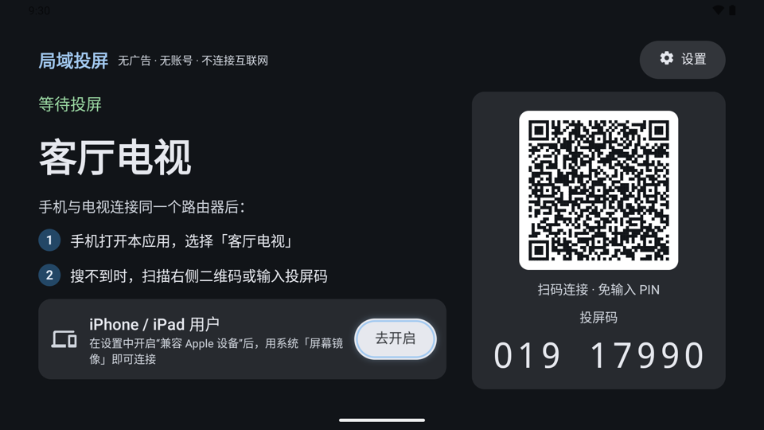
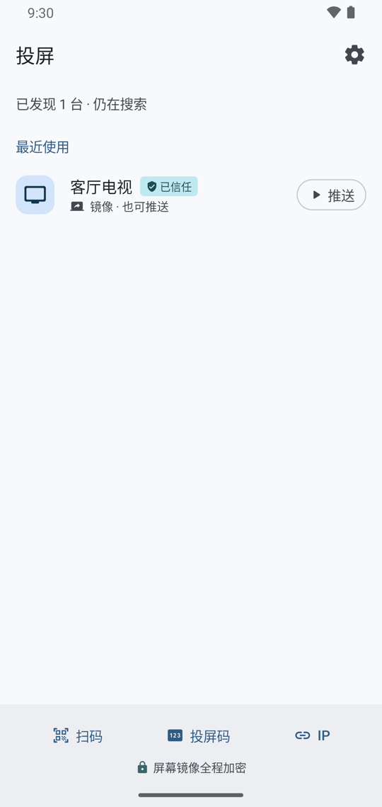
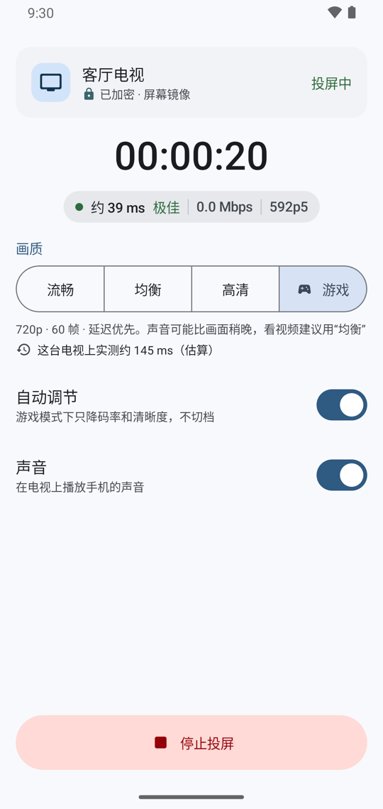
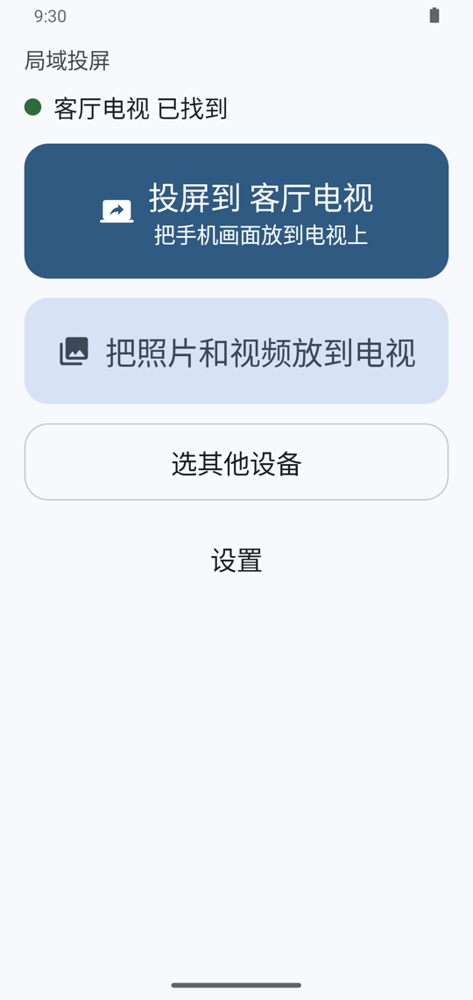
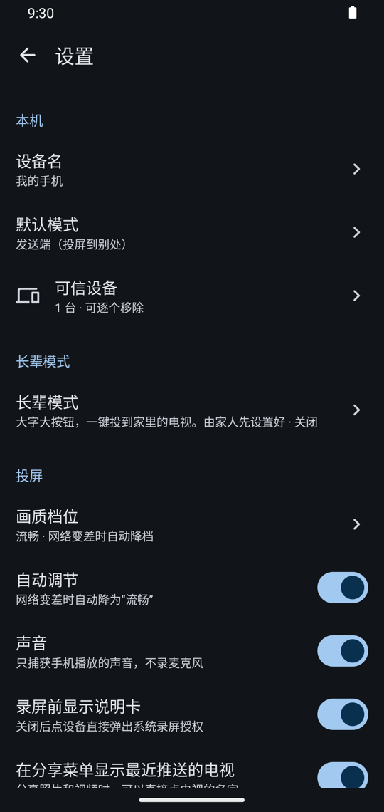

# 局域投屏 — 开源的安卓局域网投屏、屏幕镜像与 DLNA 推送工具

[English](README.md) | **简体中文**

[](https://github.com/binbenc/Android-LANScreenCast/actions/workflows/ci.yml)    

**局域投屏**（英文名 LAN Screen Cast）是一款免费、开源（GPL-3.0）的安卓**局域网投屏 / 无线投屏**应用：把手机、平板的画面镜像到电视、电视盒子、平板或另一台手机；把视频、照片、音乐推送到支持 **DLNA / UPnP** 的智能电视；也能接收视频 App 和 iPhone、iPad 的投屏。只要连同一个 Wi‑Fi 就能用：不联网、不走云端、无广告、无账号、不收集任何数据。

同一个 APK 既能当**发送端**，也能当**接收端**。手机、平板默认是发送端，电视默认是接收端。

> **当前状态：预发布。** 下面列出的功能都已实现，有单元测试和模拟器验证，但**还没有在任何真机上验证过**。各功能的状态和真机测试清单见 [`docs/dev/开发进度.md`](docs/dev/开发进度.md)。

## 效果图

<p align="center">
  
</p>

<p align="center">
  
  
  
  
</p>

<p align="center"><sub>电视接收端 · 设备列表 · 游戏模式投屏 · 长辈模式 · 深色模式（模拟器截图）</sub></p>

## 功能

**屏幕镜像**
- 基于 WebRTC（H.264）低延迟投屏，同时投送手机播放的声音，全程不打开麦克风。
- 加密始终开启：TLS 1.3 双向认证并校验证书指纹。只有第一次连接需要输入 4 位 PIN，之后互相信任。
- 多种连接方式：自动发现（mDNS/SSDP）、扫码、8 位投屏码、手动输入 IP。
- 四个画质档位：流畅、均衡、高清、**游戏**（720p60，接收端缓冲压到最低），投屏中可以随时切换。
- 断线自动重连，提供快捷设置图块，并生成本机投屏报告。

**DLNA**
- **接收**：在视频 App 的“投屏”按钮里可以直接选到本机。
- **推送**：把手机上的视频、照片、音乐或视频网址推到电视自带的 DLNA 接收端，在手机或锁屏上就能遥控播放。电视放不了的视频会先转码再推。
- **系统分享菜单**：在任何 App 里分享文件或链接，就能直接推到电视；最近推过的电视会直接显示在分享面板里。

**兼容 Apple 设备（非官方）**
- iPhone、iPad 用系统自带的“屏幕镜像”就能连接，支持画面、声音和视频网址。设置里默认关闭，基于 [UxPlay](https://github.com/FDH2/UxPlay) 实现。

**其他**
- **长辈模式**：大字、大按钮，家人设置好电视后，长辈一键就能投屏。
- **反向控制（可选）**：接收端可以操作发送端手机。通过无障碍服务实现，每次投屏都要手机主人确认。
- **电视端适配遥控器**：界面可用遥控器操作，支持 Leanback 桌面。
- **分享安装包**：在局域网内把接收端 APK 发给电视安装。
- **诊断只在本机**：网络诊断和诊断日志都只保存在本机。

## 隐私

- 不接入任何统计、广告、崩溃上报，也不依赖 Google Play 服务。
- WebRTC 只用局域网主机候选，不使用 STUN/TURN 服务器。
- 应用本身不访问互联网。只有两种例外，都由用户主动发起：用户推送给电视的网址，以及 Apple 设备发来的视频网址。这两种网址都由电视或播放器直接打开，应用本身不访问。

详见 [`docs/PRIVACY.md`](docs/PRIVACY.md)。

## 常见问题

**不联网怎么把安卓手机投屏到电视？**
两台设备都装上局域投屏，连同一个 Wi‑Fi。在电视上打开它，电视就是接收端；然后在手机上选这台电视即可。所有数据只在局域网内传输。

**电视没装这个应用能投吗？**
可以推送媒体。大多数智能电视和电视盒子自带 DLNA/UPnP 接收功能，本应用可以把视频、照片、音乐和视频网址推过去。完整的屏幕镜像需要接收端也装本应用。

**iPhone、iPad 能用它投到安卓电视吗？**
能。在接收端设置里打开“兼容 Apple 设备（非官方）”，iPhone、iPad 就能用系统自带的“屏幕镜像”连接。底层是基于 UxPlay 的非官方开源实现，兼容 AirPlay 屏幕镜像协议，未获 Apple 认可。

**能当视频 App 的 DLNA 投屏接收端吗？**
能。接收端会以 DLNA 媒体渲染器的身份广播自己，视频 App 里的“投屏”或“TV”按钮可以搜到它。

**安全吗？**
屏幕镜像始终加密：TLS 1.3 双向认证并校验证书指纹，首次连接还要输入 PIN 确认。DLNA 协议本身不加密，所以有新的 DLNA 发送方时，接收端会先询问是否接受。

**延迟有多低？**
游戏档在良好 Wi‑Fi 下的目标是端到端约 100 ms，真机实测数据还在补充。

**需要 Google Play 服务或 root 吗？**
都不需要，也没有统计和崩溃上报。

## 运行要求

- Android 10（API 29）及以上，手机、平板和 Android TV 都可以。
- 发送端和接收端要连在同一个局域网里。

## 构建

需要 Android SDK（compileSdk 37），JDK 由 Gradle 工具链自动下载。默认构建包含“兼容 Apple 设备”模块，所以还需要 NDK `27.0.12077973`、CMake `3.22.1` 和 git 子模块。

```bash
git clone https://github.com/binbenc/Android-LANScreenCast.git && cd Android-LANScreenCast
git submodule update --init --depth 1 protocol-impl/airplay/src/main/cpp/third_party

./gradlew assembleDebug          # 按 ABI 拆分的 debug APK 和 universal 包（app/build/outputs/apk/debug）
./gradlew assembleRelease        # 经 R8 优化的 release APK（未签名）
./gradlew test                   # JVM 单元测试
./gradlew lint

./gradlew assembleDebug -Pwsc.airplay=false   # 不含“兼容 Apple 设备”（不需要子模块和 NDK）
```

第一次原生构建会为每个 ABI 交叉编译 OpenSSL 和 FFmpeg，约需 2–3 分钟；之后会自动跳过。

## 目录结构

```
app/              入口、导航、首次引导
core/             协议、安全（TLS/SPAKE2）、设备发现、信令、WebRTC、数据、UI 主题
feature/          发送端、接收端、设置、反向控制
protocol-impl/    DLNA 接收与推送、UPnP 客户端、兼容 Apple 设备（JNI）
protocol/         通信协议规范（PROTOCOL.md）和共享测试向量
docs/             PRD、技术方案、交互稿、开发进度
```

## 文档

- 产品需求：[`docs/prd/PRD-局域网投屏-v1.0.md`](docs/prd/PRD-局域网投屏-v1.0.md)
- 技术方案：[`docs/tech/技术方案-v1.0.md`](docs/tech/技术方案-v1.0.md)
- 交互稿与色卡：[`docs/design/交互稿与色卡-v1.0.html`](docs/design/交互稿与色卡-v1.0.html)
- 通信协议：[`protocol/PROTOCOL.md`](protocol/PROTOCOL.md)

## 参与贡献

欢迎提交 Issue 和 Pull Request。请遵守以下项目规则：

- 不新增任何联网行为。
- 新依赖必须与 GPL-3.0 兼容。
- 不接入统计和 Google Play 服务。
- 提交前运行 `./gradlew test lint`。

## 许可证

[GPL-3.0](LICENSE)。

第三方组件沿用各自的许可证：

- libwebrtc：BSD-3-Clause
- UxPlay：GPL-3.0
- libplist：LGPL-2.1+
- OpenSSL 3.5：Apache-2.0
- FFmpeg（只用 ALAC 解码器）：LGPL-2.1+

详见 [`protocol-impl/airplay/src/main/cpp/third_party/README.md`](protocol-impl/airplay/src/main/cpp/third_party/README.md) 和 [`core/rtc/THIRD_PARTY.md`](core/rtc/THIRD_PARTY.md)。

本项目与 Apple Inc. 无关，也未获其认可。AirPlay、iPhone、iPad 是 Apple Inc. 的商标。所有商标归各自所有者所有。
