# PRD：局域网投屏（工作名 WirelessScreenCasting）

## 0. 文档信息

| 项 | 内容 |
|---|---|
| 文档名 | PRD-局域网投屏-v1.0 |
| 状态 | v1.1，已吸收技术方案反馈，待评审；v1.3（2026-11-15）：F23 反向控制提前实施并细化决策 #16；v1.4（2026-11-15）：F13 DLNA 推送细化为可开发需求（8.1.1）；v1.5（2026-11-15）：F13 拍板（决策 #26~#32），新增视频转换后推送 |
| 产品阶段 | 0 到 1 孵化期（仓库目前是 Android Studio 空模板） |
| 适用工程 | `com.benchan.wireless.screencasting`，单 `:app` 模块，AGP 9.4.1（内置 Kotlin），compileSdk/targetSdk 37 |
| 附件 | [乐播痛点调研](research/lebo-pain-points.md)、[技术方案](../tech/技术方案-v1.0.md)、[交互稿与色卡](../design/交互稿与色卡-v1.0.html) |
| 日期 | 2026-11-14（最近更新 2026-11-15） |

| 版本 | 日期 | 修改人 | 说明 |
|---|---|---|---|
| v0.1 | 2026-11-14 | PM（AI 草拟） | 初稿：痛点调研、第一性原理拆解、完整 PRD 框架、16 个待决策项 |
| v1.0 | 2026-11-14 | PM（AI）+ 产品负责人 | 产品负责人确认 16 项决策（见第 16 节）：传输层改为 WebRTC、AirPlay 内置进 MVP、minSdk 29、PC 端用 Electron 等 |
| v1.1 | 2026-11-14 | PM（AI）+ 产品负责人 | 吸收技术方案反馈（技术方案第 9 节 F1~F11），新增决策 #17~#20：锁屏停投处理、维持 minSdk 29、投屏码 8 位、手机局域网分发 APK；M0 延长到 4~5 周；DLNA 改为自研 |
| v1.2 | 2026-11-14 | PM（AI）+ 产品负责人 | M1 开发后确认决策 #21~#24：投屏码免弹窗、黑屏 3 秒提示、默认值、universal 安装包；新增 WAKE_LOCK 权限 |
| v1.3 | 2026-11-15 | PM（AI）+ 产品负责人 | F23 反向控制提前实施并细化决策 #16（补记：此前只写在“状态”栏） |
| v1.4 | 2026-11-15 | PM（AI） | 新增 8.1.1“F13 DLNA 推送（DMC）详细需求”：范围与 F14 边界、设备列表呈现、用户旅程、遥控页、后台保活、本地文件服务安全、兼容降级与失败提示、报告日志、验收标准、5 项待拍板（D13-1~D13-5）；同步修改 7.2 F13、S-06、8.3.2、8.5（防误投、零外联、权限）、第 10 节、13 节 M2、14 节记录字段、15 节新增 Q16~Q18 |
| v1.5 | 2026-11-15 | PM（AI）+ 产品负责人 | F13 拍板，新增决策 #26~#32：范围按 A+B 一起做（照片连续切换、状态实时同步、锁屏媒体控件和后台音量键、播放列表多选连播）；本应用接收端可以接收推送；本地音乐进 V1（单曲 + 列表连播）；首次推送一次性确认卡；文件服务只响应目标电视 IP；**D13-5 改为转码**：新增 8.1.1 F2“转换后推送”（系统硬件编解码，不引入 FFmpeg）；推送前台服务类型改为 `mediaPlayback`（和技术方案 3.13 T3 一致）；DLNA 设备单独分组。同步修改 8.1.1 A~H、8.5 权限表、Q18 |

### 一页摘要

- **定位**：免费、开源（GPL-3.0）、免账号、不连公网的局域网投屏工具，是乐播的反面。乐播的主要痛点（限时收费、广告、强制登录、超范围收集信息）都来自它的商业模式，我们"不做"就消除了。
- **差异化**：一次就能投成功（多路径发现）、可以量化的低延迟、陌生设备必须当面确认才能投。
- **技术主线**：mDNS/SSDP 发现 → 自研 WSC 信令（WebSocket over TLS）→ **WebRTC** 传输音视频（DTLS-SRTP 强制加密，只用局域网 host 候选）→ 硬件解码渲染。接收端同时兼容 **DLNA** 和 **AirPlay**（AirPlay 内置，默认关闭）。
- **分期**：MVP 只做 Android 单 APK 双模式（手机、平板、TV），自研、DLNA 接收、AirPlay 接收全部进 MVP；V1 加 DLNA 推送和 Electron PC 接收端；V2 加 Web 收发端。反向控制（F23）原定 V2，已提前实施（v1.3，A 期触控已完成）。

---

## 1. 背景与目标

### 1.1 背景
- 乐播自称已连接超过 16 亿手机、5 亿台电视，月活超 6000 万，LeLink 协议内置在 95% 以上的电视品牌里（企业自述，未经第三方验证，来源：36氪 2025-11）。
- 2025 年乐播启动收费体系，用户侧随即出现"局域网投屏几分钟后被要求付费"的集中抱怨（见第 3 节）。
- 局域网投屏需要的能力，系统本身都有：采集（MediaProjection）、编解码（MediaCodec 和 WebRTC）、发现（NsdManager/mDNS），不需要云端。因此有条件做成完全免费、不收集数据的开源工具。

### 1.2 产品目标

| 维度 | 目标 |
|---|---|
| 用户价值 | 在家用局域网里，打开就能投、投了就稳定；没有广告、不用登录、不收费 |
| 产品价值 | 成为 F-Droid 和 GitHub 上"乐播替代品"的首选开源方案 |
| 非目标 | 跨公网和远程投屏、企业会议室管理、云端账号、绕过 DRM 或视频平台的会员限制、iOS 发送端 |

### 1.3 北极星指标与关键指标
默认不上报任何数据（决策 #12），指标只在两个地方测：**兼容性实验室**（固定设备矩阵和网络环境），以及用户自愿导出的**本地诊断报告**。

| 类型 | 指标 | 目标值 | 依据 |
|---|---|---|---|
| **北极星** | 首次投屏成功率：新用户从打开 App 到接收端出画面，60 秒内、不求助就完成的比例 | 实验室 ≥90% | 乐播类产品最大的流失点是"连不上"和"被收费拦住"，这个指标同时覆盖发现、配对和首帧 |
| 体验 | 镜像端到端延迟（发送端屏幕变化到接收端显示，1080p30，5GHz） | 中位数 ≤150ms，P95 ≤250ms（M0 实测后校准；技术方案建议按设备档位分开：近 3 年 SoC ≤150ms，低端盒子 ≤220ms） | scrcpy 有线约 35~70ms（README 标称，待验证）；无线要多出空口时间和 WebRTC 抖动缓冲，150ms 是"可以演示、可以轻度操作"的线 |
| 体验 | 游戏模式（720p60）延迟 | 中位数 ≤100ms | 交互感知的 0.1 秒阈值（Nielsen 响应时间准则） |
| 体验 | 首帧时间（用户授权录屏之后到接收端首帧） | ≤2s | 信令往返 + ICE（只有 host 候选）+ DTLS 握手 + 首个关键帧，在局域网里可以做到 1s 左右 |
| 体验 | 音画同步偏差 | 声音超前 ≤45ms、落后 ≤125ms | ITU-R BT.1359 的可察觉阈值 |
| 连接 | 3 秒内设备发现成功率（同网段、组播正常） | ≥95%；组播被屏蔽时走兜底路径，30 秒内成功率 ≥90% | mDNS 通告和查询通常在 1 秒级完成 |
| 稳定 | 断线自动恢复时间（网络中断 <10s） | 网络恢复后 ≤3s 出画面，不需要重新授权录屏 | 断线期间保留采集会话，只做 ICE 重启（见 8.4）。不适用于锁屏：Android 15 QPR1 起锁屏会由系统停止投屏，必须重新授权（决策 #17） |
| 稳定 | 连续镜像 2 小时 | 不崩溃、不黑屏、内存不持续增长（测试期间发送端保持亮屏、不锁屏） | 家庭看剧场景 |
| 口碑代理 | GitHub issue 里"连不上、搜不到"类的占比 | <20% 并持续下降 | 不上报数据时可观察的外部信号 |

---

## 2. 竞品分析

### 2.1 竞品对比

| 维度 | 乐播投屏 | AirPlay | Google Cast | Miracast | scrcpy | BubbleUPnP | 本产品（目标） |
|---|---|---|---|---|---|---|---|
| 模式 | 镜像 + 推网址 | 镜像 + 推网址 | 主要推网址，也可镜像 | 镜像 | 镜像 + 回控 | 推网址和文件（DLNA） | 镜像 + 推网址和文件 |
| 接收端 | 电视预装 SDK + 各端 App | Apple TV、部分电视、Mac | Chromecast、Google TV | 部分电视和 Windows | PC | 电视自带 DLNA 接收 | Android、TV、PC、Web 分期 |
| 发现方式 | 自有协议 + DLNA + AirPlay | mDNS | mDNS + DIAL | Wi-Fi Direct | ADB（USB 或无线调试） | SSDP | mDNS + SSDP + 二维码、投屏码、IP |
| 收费和广告 | 会员（¥3.8~28.8/月不等）、有广告 | 免费（锁定苹果生态） | 免费（要 Google 服务） | 免费 | 免费开源 | 免费版有限制，Pro 付费 | 免费开源 |
| 账号 | 要（手机号） | Apple ID 生态 | Google 生态 | 不要 | 不要 | 不要 | 不要 |
| 门槛 | 低（电视预装） | 低（同生态） | 低 | 不稳定，国内手机厂商支持不一 | 高（要开开发者选项） | 中 | 中低（接收端要装 App，或推到电视自带 DLNA） |
| 主要短板 | 收费墙、隐私 | 封闭 | 国内没有 Google 服务 | Android 已移除第三方接入，兼容差 | 不适合普通用户 | 只能投文件，不能镜像 | 没有电视预装渠道 |

说明：BubbleUPnP 的收费细节、Miracast 在各国内手机品牌上的实际表现，本次没有逐一核实，标为"待验证"。

### 2.2 SWOT（本产品）

| 优势 S | 劣势 W |
|---|---|
| 无广告、无会员、免账号，打的正是乐播收费墙的痛点 | 没有电视预装渠道，电视端要侧载安装 |
| 开源可审计，隐私可以验证 | 个人开发，资源有限，兼容的设备数量有限 |
| 基于 WebRTC，Android、PC（Electron）、Web 用同一种传输，跨端成本低 | AirPlay 内置带来的合规不确定性由整包承担 |
| **机会 O** | **威胁 T** |
| 乐播 2025 年开始收费，"免费替代品"的搜索需求上升（V2EX 等社区出现求替代的帖子） | 电视厂商系统封锁侧载、后台查杀 |
| 已有成熟开源组件（UxPlay、jUPnP、libwebrtc）可以复用 | Android 每年收紧投屏权限 |
| DLNA 推送不需要在电视上装任何东西，可以绕开"没有预装"的问题 | 苹果更改协议导致 AirPlay 失效 |

---

## 3. 乐播用户痛点（摘要）

完整证据、可信度和来源见附件 [lebo-pain-points.md](research/lebo-pain-points.md)。可信度：A = 一手证据，B = 二手或间接证据，C = 待验证。

| # | 痛点 | 可信度 | 根因 | 本产品的应对 |
|---|---|---|---|---|
| L1 | 局域网投屏限时，要求付费 | A | 商业 | 永久免费，没有任何付费功能 |
| L2 | 收费档位多而混乱 | A | 商业 | 同上 |
| L3 | PC 端投屏收费 | A | 商业 | PC 接收端同样免费（V1） |
| L4 | 广告 | B | 商业 | 不接任何广告 SDK，CI 检查依赖 |
| L5 | 电视端贴片和暂停广告 | C | 商业 | 同 L4 |
| L6 | 强制登录、收不到验证码 | A | 商业 | 没有账号体系 |
| L7 | 超范围收集个人信息 | A/B | 商业 | 权限最小化 + 零外联（8.5） |
| L8 | 更新后失效、强制更新 | A | 工程 + 商业 | 不强制更新；协议向后兼容 N-1 个大版本 |
| L9 | 搜不到设备 | B | 技术 | 多路径发现 + 网络诊断（8.4） |
| L10 | 卡顿、画质被压 | B | 技术 + 商业 | 自适应码率；画质档位由用户决定；看剧引导用推送模式 |
| L11 | 音画不同步 | C | 技术 | WebRTC 基于 RTCP 时间戳做音画同步 |
| L12 | 后台常驻、开机自启 | C | 商业或技术 | 默认不常驻、不自启（决策 #14） |
| L13 | 被陌生人误投 | A | 安全默认值 | 首次必须确认 + PIN（决策 #13） |
| L14 | 操作链路长 | A | 技术 + 生态 | 快捷设置图块一键投；系统分享菜单直接推送 |

**结论**：A 级证据里有 6 项（L1/L2/L3/L4/L6/L7）都是商业模式造成的，开源免费产品"不做"就消除，这是最便宜的差异化。真正要投入研发的是 L9/L10/L11/L13/L14。

---

## 4. 第一性原理拆解

### 4.1 投屏的本质

```
投屏 = ① 设备发现 → ② 会话建立（鉴权、能力协商）→ ③ 媒体采集与编码 → ④ 传输 → ⑤ 解码与渲染 → ⑥ 控制回传
```

| 环节 | 物理约束 | 业界做法 | 本产品方案 |
|---|---|---|---|
| ① 发现 | 局域网组播可能被 AP 隔离、IGMP Snooping、2.4G/5G 桥接屏蔽；Android 收组播要持有 MulticastLock | mDNS（AirPlay、Cast）、SSDP（DLNA） | **多路径并行**：mDNS（`_wsc._tcp`）+ SSDP + 最近连接过的设备直接用 IP 连 + 二维码 + 投屏码 + 手动 IP |
| ② 会话 | 局域网不等于可信（酒店、合租） | 大多不鉴权，或只做弹窗确认 | WSC 信令（WebSocket over TLS 1.3）+ 首次配对用 PIN 证明在场 + 可信设备列表 |
| ③ 采集编码 | 手机屏幕原始数据约 600MB/s，必须硬件编码 | MediaCodec 硬编 H.264/H.265 | MediaProjection → WebRTC ScreenCapturerAndroid → 硬件 H.264 编码；声音用 AudioPlaybackCapture，经 libwebrtc 补丁送入 WebRTC（Opus） |
| ④ 传输 | Wi-Fi 会抖动、丢包、突发 | TCP（scrcpy）、RTP/UDP（AirPlay、Miracast）、WebRTC | **WebRTC**（决策 #7）：SRTP/UDP + NACK 重传 + 拥塞控制（GCC）+ 按需关键帧（PLI），各端都有成熟实现 |
| ⑤ 解码渲染 | 电视盒子解码能力差异大 | 硬件解码 | WebRTC 硬件解码器 → SurfaceViewRenderer；尽量压低抖动缓冲（见 8.3.1） |
| ⑥ 控制 | 要双向、要低延迟 | 独立控制通道 | WebRTC DataChannel（统计、断开、画质切换；反向控制事件走独立的 `wsc-input` 通道，F23 已提前实施） |

### 4.2 镜像模式和推送模式必须分开（关键产品洞察）

| | 镜像模式 | 推网址或推文件模式 |
|---|---|---|
| 原理 | 实时编码手机画面 | 只把媒体地址发给接收端，由接收端自己拉流播放 |
| 画质 | 受编码码率限制 | 原画（片源 4K 就是 4K） |
| 手机耗电和发热 | 高（屏幕常亮 + 编码） | 极低，手机可以锁屏 |
| DRM 内容 | 黑屏（FLAG_SECURE） | 可以播（取决于接收端播放器和平台授权） |
| 适合场景 | 演示、游戏、照片浏览、任意 App | 看剧、长视频、本地视频 |

**结论**：看长视频时要引导用户用推送模式（DLNA 推送 + 本地文件推送），这才是"画质被压、手机发烫、DRM 黑屏"三个问题的根本解法，而不是一味提高镜像码率。

---

## 5. 用户画像与核心场景

| 画像 | 描述 | 核心诉求 | 典型场景 |
|---|---|---|---|
| P1 家庭观影者（主力） | 25-45 岁，客厅有智能电视或盒子，被乐播收费劝退 | 免费、稳定、清晰 | 手机上的本地视频或网页视频投到电视；电视剧镜像 |
| P2 银发用户 | 60 岁以上，用子女给的手机，电视多是国产智能电视 | 一键、大字、不出错 | 把孙辈的照片和短视频放到电视上看；子女提前配好 |
| P3 演示者、游戏玩家 | 学生、小团队、手游玩家 | 低延迟、不卡 | 会议室演示 App；手游投到电视或平板 |
| P4 隐私和开源爱好者，以及 iPhone 用户 | 有 NAS 或软路由，不接受数据外泄；家里同时有苹果设备 | 可审计、零外联、多平台 | 投到 PC 或 Linux 盒子；iPhone 用系统 AirPlay 投到我们的 Android TV 接收端 |

**场景优先级**：家庭看剧（P1）> 照片分享（P2）> 演示镜像（P3）> 多平台（P4）。

注意：minSdk 提高到 29（决策 #8）后，Android 9 及以下的旧手机不能作为发送端。P2 的银发用户要么用子女淘汰的较新手机，要么走 iPhone 的 AirPlay。

---

## 6. 用户旅程

### 6.1 发送端（P1，首次使用）

| 阶段 | 用户行为 | 情绪和风险 | 设计对策 |
|---|---|---|---|
| 安装 | 从 GitHub 或 F-Droid 下载 | 担心有毒、有广告 | 首页写明"无广告、无账号、不联网" |
| 首次打开 | 选择"我要投屏" | 不知道接收端也要装 App | 引导页：电视没装接收端时，提示走 DLNA 推送（不用装，V1）或"把接收端发送到电视"（8.7） |
| 搜设备 | 看设备列表 | 搜不到就流失（最大风险） | 3 秒没结果就显示"扫码 / 输入投屏码"；10 秒没结果就进入网络诊断 |
| 配对 | 输入电视上显示的 4 位 PIN | 嫌麻烦 | 只在第一次需要；扫码配对不用输入 |
| 授权录屏 | 系统弹窗选"整个屏幕"或"单个应用" | 看不懂 | 系统弹窗前加一张说明卡；建议选"整个屏幕" |
| 投屏中 | 看电视 | 卡顿、声音不同步；锁屏后投屏被系统停止 | App 内状态胶囊 + 通知栏实时显示延迟和码率（不申请悬浮窗）；一键切换"流畅优先"；镜像期间保持亮屏，开始时提示"锁屏会停止投屏，看剧建议用推送模式" |
| 结束 | 点通知栏的"停止" | 找不到结束入口 | 通知、Tile、App 内三处都能停止 |

### 6.2 接收端（电视，首次使用）

| 阶段 | 用户行为 | 风险 | 设计对策 |
|---|---|---|---|
| 安装 | 手机在局域网内临时分发本机 APK（同一个 APK 就是接收端），电视用浏览器或文件管理器下载安装；也可以用 U 盘 | 部分电视系统禁止安装 | 见 8.7；文档按品牌列安装方法；V1 提供 PC 接收端作为替代 |
| 首次打开 | 自动进入"等待投屏"页 | 遥控器操作困难 | 全程方向键可操作；大号二维码 + 投屏码 + 设备名 |
| 收到请求 | 看到"小张的手机请求投屏" | 安全顾虑 | 显示 PIN；默认焦点在哪个按钮由交互评审决定 |
| iPhone 投屏 | 在设置里打开"兼容 Apple 设备（非官方）" | 不知道有这个开关 | 待机页提示"iPhone 用户请在设置中开启"；开启后作为 AirPlay 接收端被发现 |
| 播放中 | 看 | 发送端断网 | 显示"正在重连"，不黑屏退出 |
| 退出 | 按返回键 | 误触 | 连按两次返回才断开。**例外（F23 反向控制中）**：返回键 = 对方手机的“返回”，长按返回（≥600 ms）或菜单键打开控制条，断开只能从控制条操作（v1.3） |

---

## 7. 功能架构与功能清单

### 7.1 功能架构图

```mermaid
graph TD
  A[WirelessScreenCasting] --> S[发送端]
  A --> R[接收端]
  A --> P[协议层]
  A --> D[发现与配对]
  A --> SEC[安全与隐私]
  A --> SET[设置与诊断]

  S --> S1[屏幕镜像 + 内录声音]
  S --> S2[推送本地视频/照片]
  S --> S3[推送网址 DLNA DMC]
  S --> S4[快捷设置图块 / 分享菜单]

  R --> R1[WebRTC 镜像播放]
  R --> R2[DLNA DMR 媒体播放]
  R --> R3[AirPlay 接收 内置默认关闭]
  R --> R4[TV 遥控器适配]

  P --> P1[WSC 信令 + WebRTC]
  P --> P2[DLNA / UPnP AV]
  P --> P3[AirPlay 镜像 + RAOP]

  D --> D1[mDNS / DNS-SD]
  D --> D2[SSDP]
  D --> D3[二维码 / 投屏码 / 手动 IP]
  D --> D4[可信设备列表]

  SEC --> SEC1[TLS 1.3 信令 + DTLS-SRTP 媒体]
  SEC --> SEC2[首次 PIN 确认]
  SEC --> SEC3[权限最小化 / 零外联]

  SET --> SET1[画质档位 / 游戏模式]
  SET --> SET2[网络诊断]
  SET --> SET3[本地日志与投屏报告]
```



### 7.2 功能清单（Kano + 优先级 + 分期）

Kano 分类：基本型 = 没有就不满意；期望型 = 越好越满意；兴奋型 = 有了会惊喜。

| ID | 功能 | 端 | Kano | 优先级 | 分期 |
|---|---|---|---|---|---|
| F01 | 屏幕镜像（WSC 信令 + WebRTC，H.264） | 发送 + 接收 | 基本型 | P0 | MVP |
| F02 | 内录声音（AudioPlaybackCapture → Opus） | 发送 | 基本型 | P0 | MVP |
| F03 | mDNS 发现 + 设备列表 | 双端 | 基本型 | P0 | MVP |
| F04 | 二维码、投屏码、手动 IP 兜底 | 双端 | 期望型 | P0 | MVP |
| F05 | 首次配对 PIN + 可信设备列表 | 双端 | 基本型 | P0 | MVP |
| F06 | 端到端加密（TLS + DTLS-SRTP，不能关闭） | 双端 | 基本型（用户不直接感知） | P0 | MVP |
| F07 | 断线自动重连（保留采集会话 + ICE 重启） | 双端 | 期望型 | P0 | MVP |
| F08 | Android TV 遥控器适配 + Leanback 启动入口 | 接收 | 基本型 | P0 | MVP |
| F09 | DLNA DMR 接收（视频 App 的"投屏"按钮可以投到我们这里） | 接收 | 期望型 | P0 | MVP |
| F15 | AirPlay 接收（iPhone 镜像、音频、视频网址），内置、默认关闭 | 接收 | 期望型 | P0 | MVP |
| F10 | 画质档位 + 自适应码率 | 双端 | 期望型 | P1 | MVP（档位 + WebRTC 默认拥塞控制）→ V1（调优） |
| F11 | 网络诊断页 | 双端 | 期望型 | P1 | MVP |
| F12 | 快捷设置图块一键投屏 | 发送 | 兴奋型 | P1 | MVP |
| F25 | 本地诊断日志 + 本机投屏报告 | 双端 | 兴奋型 | P1 | MVP |
| F26 | 局域网分发接收端 APK（手机临时起 HTTP 服务，电视下载安装） | 发送 | 期望型 | P1 | MVP |
| F13 | DLNA DMC 推送本地视频、照片、网址到电视自带接收端（电视不用装 App）；详细需求见 8.1.1（v1.4） | 发送 | 兴奋型 | P0 | V1 |
| F14 | 系统分享菜单推送文件或链接 | 发送 | 兴奋型 | P1 | V1 |
| F16 | PC 接收端（Electron，Win/macOS/Linux），含 WebRTC 镜像、DLNA DMR、AirPlay（捆绑 UxPlay） | 接收 | 期望型 | P1 | V1 |
| F17 | H.265 协商（视各端 WebRTC 支持情况，待验证） | 双端 | 期望型 | P2 | V1 |
| F18 | 游戏模式（720p60 低延迟，最小化抖动缓冲） | 双端 | 兴奋型 | P1 | V1 |
| F24 | 长辈模式（大字、一键连上次的设备） | 发送 | 兴奋型 | P1 | V1 |
| F20a | Web 接收端（浏览器打开接收端内置的局域网页面） | 接收 | 兴奋型 | P2 | V2 |
| F20b | Web 发送端（桌面浏览器 `getDisplayMedia` 屏幕共享） | 发送 | 兴奋型 | P2 | V2 |
| F21 | PC 发送端（Electron `desktopCapturer`） | 发送 | 期望型 | P2 | V2 |
| F23 | 反向控制：在接收端用遥控器、鼠标、触摸操作发送端（无障碍服务） | 双端 | 兴奋型 | P2 | V2 → **提前实施**（v1.3）：A 期触控（单指点击 / 长按 / 滑动 + 返回 / 主页 / 最近任务 + 安全闭环）已完成并通过模拟器验证；B 期 TV 遥控器光标 / 方向键、外接鼠标键盘、文字输入（对方 Android 13+）、屏蔽远程操作本应用界面（D9）已完成并通过模拟器验证；C 期双指缩放（PINCH 宏 / Ctrl + 滚轮；缩放在抬手后执行、不跟手，不支持旋转 / 平移）、敏感界面拦截（安装器 / 权限弹窗 / 无障碍设置 / 系统授权）、投屏结束自动关闭无障碍服务、屏幕朗读时的提示、高级保护模式实时检测已实现（敏感界面与自动关闭已在模拟器验证）。**F23 作为常规功能发布，不标“实验性”**（决策 D-8）。只用于 WSC 镜像会话 |

**明确不做**：账号、云端中转、跨公网投屏、广告、付费、绕过 DRM、AirPlay 发送端（安卓投到 Apple TV）、iOS 发送端（决策 #11）、**Shizuku / adb 注入作为反向控制的实现路径**（D-7：需开发者选项与无线调试、隐藏 API 维护、shell 权限需独立安全门控；重新评估条件：用户对实时多指 / 游戏控制有明确需求，且能接受“高级选项、默认关、单独安全评审”）。

---

## 8. 详细功能需求

### 8.1 发送端（Android）

| ID | 需求 | 规则 / 验收要点 |
|---|---|---|
| S-01 镜像启动 | 选设备 → 说明卡 → 系统录屏授权 → 启动前台服务 → 建立 WebRTC 会话 → 开始采集 | Android 14+：必须先启动 `mediaProjection` 类型的前台服务，再调用 `getMediaProjection()`；在 `createVirtualDisplay()` 之前注册 `MediaProjection.Callback`；每次会话都要重新征得同意，授权结果只能用一次 |
| S-02 单应用共享 | 兼容 Android 14+ 的"单个应用"模式 | 被共享的应用退到后台时，接收端显示"发送端已切换应用"的占位画面，而不是黑屏 |
| S-03 声音 | 用 AudioPlaybackCapture 捕获 USAGE_MEDIA/GAME/UNKNOWN 类型的声音，通过给 libwebrtc 的音频采集打补丁（自建 fork）送入 WebRTC，不打开麦克风 | 需要 RECORD_AUDIO，申请前说明"只用于捕获手机播放的声音，不录麦克风"。拒绝授权时降级为只投画面；被投 App 禁止捕获（ALLOW_CAPTURE_BY_NONE）时，接收端没有声音，UI 要提示原因 |
| S-04 编码参数 | 默认 H.264，1080p30，最高码率 8Mbps（可选 4~20） | 优先硬件编码器；通过 `RtpSender.setParameters` 设置最高码率、帧率和 `degradationPreference`（演示和游戏优先保帧率，看剧优先保清晰度）；静止画面时仍维持最低帧率，避免接收端判定超时 |
| S-05 旋转和分辨率变化 | 屏幕旋转时调整采集尺寸 | 接收端 500ms 内画面方向正确，不花屏 |
| S-06 推送模式（V1） | 本地视频和照片：发送端起一个只在局域网可访问的 HTTP 服务（支持 Range），接收端来拉。v1.4 起由 F13 统一实现（推送到电视自带接收端和本应用接收端走同一套 DLNA 推送，见 8.1.1、D13-1） | 使用随机 token 的 URL，会话结束即失效；选文件用 Photo Picker，不申请存储权限；完整规则见 8.1.1 E |
| S-07 停止 | 通知栏、Tile、App 内都能停止 | 停止后 1 秒内释放 PeerConnection、编码器和前台服务 |
| S-08 敏感内容 | 显示 FLAG_SECURE 内容的窗口会是黑屏 | 接收端提示"该内容受保护，建议改用推送模式" |

#### 8.1.1 F13 DLNA 推送（DMC，V1）详细需求

> v1.4 新增。**目标**：电视不用装 App，也能把手机里的视频、照片和视频网址原画质放到电视上，看剧时手机可以锁屏。对应 4.2 节“推送模式”、决策 #17（锁屏停投后引导推送）、决策 #18（Android 9 及以下电视靠 DLNA 推送覆盖）。
> v1.5：标“D13-x”的条目已由产品负责人拍板（2026-11-15），结论见本节末尾和第 16 节决策 #26~#32。范围按 A+B 一起做：照片连续切换、状态实时同步、锁屏媒体控件和后台音量键、播放列表多选连播都在 V1 内。

##### A. 范围与边界

| 项 | V1 做 | 不做 / 以后再做 |
|---|---|---|
| 内容 | 本地视频（电视不支持时可以转换后推送，见 F2，D13-5）；本地照片（多张连续切换）；本地音乐（单曲 + 列表连播，D13-2）；视频、音乐的播放列表（多选后自动连播）；视频、音频、图片文件的直接网址 | 把视频网站的网页地址解析成播放地址（需要联网，违反零外联）；外挂字幕；网址转码；音频转码；照片自动轮播（P1） |
| 入口 | App 内：设备列表 → 选设备 → 选内容（先选设备） | 系统分享菜单（F14，先选内容）；快捷设置图块 |
| 接收端 | 电视、盒子自带的 DLNA 接收端（MediaRenderer + AVTransport）；本应用的接收端（DLNA 接收开着时，D13-1） | 只有 Miracast 或乐播私有协议、没有 DLNA 的电视；Google Cast；推送到 Apple 设备 |
| 并发 | 同一时间只有一个投屏任务（镜像或推送二选一），推送只连一台电视 | 同时推多台；镜像和推送同时进行 |

**与 F14 的边界**：F14 只新增“系统分享菜单 → 选设备”这一段，之后完全复用 F13 的推送引擎、本地文件服务和遥控页。所以 F13 的推送引擎要能接收任意 `content://` 地址或网址作为输入，不能和 App 内的选择器写死在一起。

##### B. 设备列表呈现（交互稿 03，设计师后续出稿）

| 规则 | 说明 |
|---|---|
| 取消置灰 | 决策 #23 的“DLNA 设备置灰、下个版本开放”只适用于 MVP；V1 起 DLNA 设备可以点，点了就是推送 |
| 分组 | “最近使用”（包括推送过的 DLNA 电视）→“附近设备”（本应用接收端，可以镜像）→ 新增分组“电视自带投屏 · 只能推送”。分组标题直接写明能力，免得用户以为能镜像 |
| 行内容 | 名称取设备描述里的 friendlyName；取不到就用“品牌 + 型号”，再取不到用 IP。显示 DLNA 标签和播放三角图标；副标题“推送视频、照片、网址”；从没推送过的设备显示“新设备”角标 |
| 长按 / 详情 | 显示品牌、型号、IP；说明“这台电视不能镜像手机屏幕，在电视上安装本应用后就可以镜像”+ [获取安装方法]（F26） |
| 不显示 | 设备描述里没有 AVTransport 服务的设备；设备描述地址（LOCATION）不在 SSDP 响应来源 IP 上的设备（防伪造，见 E）。只支持音频的接收端（如音箱，ProtocolInfo 里没有 video/image）要显示（D13-2），副标题“只能推送音乐”，内容面板只给音乐 |
| 去重 | 按设备 UDN 去重；本应用接收端同时提供 WSC 和 DLNA 时合并成一行（沿用现有 X-WSC 头逻辑）；同一台电视有两个 DLNA 接收端（比如系统自带一个、电视里预装的投屏 App 又一个）时显示两行，副标题加厂商或型号区分 |
| 推送中 | 列表顶部显示横幅“正在推送到 XX”，点一下回到遥控页 |
| 发现 | 沿用现有 SSDP 搜索。组播被路由器屏蔽时 DLNA 电视搜不到：兜底卡片和诊断页补一句“电视自带投屏需要路由器允许设备互相发现”。P1：最近推送过的电视，按上次的设备描述地址直接探测（类似 RECENT 路径；电视重启后端口可能会变，只能尽力而为） |

##### C. 用户旅程（先选设备）

1. 在设备列表点一台 DLNA 电视 → 如果是第一次推送到这台，先弹确认（D13-3）→ 底部弹出“推送到 卧室电视”内容面板：
   - **[照片和视频]**：系统照片选择器（Photo Picker；系统不支持时自动退回系统文件选择器），可以多选，最多 100 项。
   - **[文件]**：系统文件选择器（SAF），只列视频、音频、图片，可以多选（最多 100 项；音乐只能从这里选）。用来选下载目录、U 盘或网盘 App 里的文件。
   - **[网址]**：输入框 + [粘贴] 按钮。只在用户点 [粘贴] 时读剪贴板，不自动读。
2. 选好内容 → 进入遥控页，依次显示“正在连接电视…”“电视正在加载…”“播放中”。
3. 用户可以锁屏，也可以切到别的 App；通知栏常驻“正在推送到 卧室电视”。
4. 结束：在遥控页点 [结束推送]、在通知里点 [停止]，或者电视那边自己停了（见 D 的结束条件）。结束页显示本次结果，提供 [再推一个]、[返回设备列表]。

**其他入口**（最后都走上面的流程）：
- 空态“推到电视自带投屏”（第 10 节空态 ①）。
- 08B“锁屏已停止投屏”页、“录屏授权被拒”页上的 [改用推送]：对方是本应用接收端（D13-1）时，直接为这台设备打开内容面板；否则回设备列表并滚动到“电视自带投屏”分组。现有文案“下个版本支持从本应用推送”同步改掉（`SenderCopy` 的 CAPTURE_DENIED、`InstallHelpScreen`）。
- 本应用接收端那一行的 [推送] 二级入口（D13-1）。

**各类内容的规则**：

| 类型 | 规则 |
|---|---|
| 视频 | 默认原文件直接推。判断电视不支持时，提议“转换后推送”，同时保留“直接尝试原文件”（见 F2，D13-5）。多选时按选择顺序组成播放列表：**播完自动播下一个**（连播），也可以手动切上一个 / 下一个；列表放完后停在结束页 |
| 照片 | 多选后连续切换：遥控页左右滑动，或点 [上一张] [下一张]。快速连续切换时只推最后一张（防抖 400 ms）。P1：自动轮播（3 / 5 / 10 秒）。**手机端先统一处理再给电视**：转成 JPEG，长边不超过 3840，按 EXIF 方向转正，去掉 EXIF（包括拍摄位置）。这样可以解决电视不认 HEIC、超大分辨率解码失败、照片横着显示三个常见问题，也不会把拍摄位置交给电视。GIF 只取第一帧。转换只用系统 API，不引入新依赖 |
| 混选 | 照片和视频一起选时，按选择顺序组成一个列表；切到视频时遥控页换成播放控件。视频播完自动前进；停在照片上时不自动前进（照片自动轮播是 P1），要手动切 |
| 音乐 | D13-2：单曲，或多选组成列表连播（播完自动下一首）。遥控页显示播放控件，没有画面；音乐不转码，电视不支持的格式按 F 的“格式不支持”处理 |
| 连播的判定 | 电视从“播放中”进入“已停止”，且停止前的位置已接近总时长（剩余不超过 5 秒，或者电视不报告进度时按停止处理），就算播完，自动推下一项；不满足的按 D 的“电视停止播放”处理。电视支持 SetNextAVTransportURI 时可以用它来缩短切换间隙，不支持时由手机推下一项（实现由技术方案定） |
| 网址 | 只接受 http / https。按扩展名推断类型（.mp4 / .m3u8 / .mp3 / .jpg 等），推断不出来就按视频推。**App 自己不访问这个网址**：不发探测请求，不取标题和缩略图。输入框下方说明：“电视会直接联网打开这个地址。请填视频文件的地址（如 .mp4、.m3u8），视频网站的网页地址电视通常打不开。”网址只存在本次会话的内存里，不保存历史 |

##### D. 遥控页（推送中）

| 控件 | 要求 | 电视不支持时 |
|---|---|---|
| 状态 | 正在连接 / 加载中 / 播放中 / 已暂停 / 已停止 / 出错；显示电视名和 DLNA 标签 | — |
| 内容信息 | 缩略图 + 标题（取本地文件名或网址最后一段，只在手机界面显示，不写日志）；列表推送时显示“3 / 12” | — |
| 播放 / 暂停 | 点了图标立刻切换（乐观更新）；3 秒内电视状态没跟上，就把图标改回来并提示“电视没有响应” | — |
| 进度 | 显示当前位置和总时长；拖动松手后才发 Seek；±10 秒按钮（P1） | 电视不支持拖动（动作列表里没有 Seek，或 Seek 报错）→ 进度条只读，提示“这台电视不支持拖动进度”；电视不报告进度 → 隐藏进度条 |
| 音量 | 音量滑块；静音（P1）。推送期间手机音量键调的是电视音量：遥控页在前台、App 在后台、锁屏时都一样（系统远程音量，V1 范围内） | 读不到音量 → 隐藏滑块，提示“请用电视遥控器调音量” |
| 上一个 / 下一个 | 列表推送时显示；照片还可以左右滑动 | — |
| 换内容 | 回到内容面板，选好后直接在同一台电视上替换，不用断开重连 | — |
| 结束推送 | 发 Stop，停掉本地文件服务，进入结束页 | Stop 报错也按结束处理 |

**离开 App、锁屏之后**：
- 推送**本地文件**期间必须运行前台服务，让电视能一直从手机拉数据。类型用 `mediaPlayback`（决策 #32，和技术方案 3.13 T3 一致）：语义是远程媒体播放，没有运行时前置条件，也没有时长上限，而且可以在同一个服务里挂 MediaSession，实现锁屏媒体控件和音量键调电视音量。发送端清单新增 FOREGROUND_SERVICE_MEDIA_PLAYBACK（普通权限，单 APK 里接收端本来就声明了），没有新的运行时权限。电视在播放时，手机要保持 Wi‑Fi 和 CPU 唤醒（WifiLock + 部分唤醒锁，用已声明的 WAKE_LOCK），这样锁屏后不会断流；推送一结束马上释放。
- 推送**网址**时，电视自己联网拉流，手机不提供数据。仍然显示同样的通知方便控制；就算进程被系统回收，电视也会继续播。
- 通知和锁屏：用媒体样式通知，标题“正在推送到 卧室电视”，显示当前内容的缩略图和标题，按钮 [上一个]（列表时）、[暂停 / 继续]、[下一个]（列表时）、[停止]。锁屏和系统媒体控制区显示同样的控件和进度（V1 范围内）。锁屏界面显示的标题跟随系统锁屏通知隐私设置（用户设了“隐藏敏感内容”时只显示“正在推送到 卧室电视”）。在最近任务里划掉 App 不会结束推送，只能从通知或 App 内结束。
- 转换视频（F2）时同样由前台服务承载，通知显示转换进度和 [取消]。
- 和镜像不同：推送不需要屏幕常亮，也不受决策 #17 锁屏停投的影响。

**状态同步**（这里只写产品要求，具体实现由技术方案定）：
- 用电视遥控器暂停、拖动或停止后，手机遥控页 2 秒内要跟着变。
- 遥控页在前台时，进度每秒更新一次；退到后台后可以降低频率，但要在 10 秒内发现“电视已停止”或“被别人接管”。
- 以定时查询为准（所有电视都支持），GENA 事件订阅只用来加快更新。订阅失败、或者电视不发事件时，自动退回查询，不提示用户。GENA 回调服务同样只在局域网内、只在推送期间开着。

**结束条件**（满足任意一条就结束推送并停掉本地文件服务）：

| 条件 | 提示 |
|---|---|
| 用户在遥控页或通知里结束 | — |
| 电视停止播放：视频或音频进入“已停止 / 无媒体”状态超过 5 秒（切换内容时的短暂停止、按 C 判定为播完并自动连播的情况都不算） | “电视已停止播放” |
| 播放列表全部放完 | “已播放完毕”（结束页提供 [再推一个]） |
| 被接管：电视当前播放的地址已经不是我们的（别的手机推了内容） | “其他设备已开始在这台电视上投屏” |
| 电视失联：控制请求连续失败 30 秒 | “与电视的连接已断开” |
| 手机网络变化（断开 Wi‑Fi、换了网络、IP 变了） | “手机网络已变化，推送已结束” |
| 推照片时 30 分钟没有任何操作（很多电视显示照片时没有可靠的“停止”状态） | 结束前 1 分钟发通知提醒，可以点“继续” |
| 注意：视频**暂停中不会**自动结束（看到一半去吃饭很正常） | — |

##### E. 本地文件服务与安全

| 要求 | 规则 |
|---|---|
| 只在局域网 | 只在 Wi‑Fi 或以太网的局域网地址上提供服务；来源不是局域网私有地址（RFC 1918、链路本地）的请求一律拒绝 |
| 只给目标电视 | 默认只响应当前推送的那台电视的 IP（D13-4）；其他设备就算拿到地址，也会被拒绝 |
| 随机令牌 URL | 每次推送会话生成一个新的、猜不到的令牌（至少 128 位随机数）。地址形如 `http://手机IP:随机端口/令牌/序号.扩展名`，路径只用 ASCII 字符（中文文件名会让部分电视解析失败），也不出现文件名或相册名 |
| 只暴露选中的文件 | 只按“令牌 + 序号”找到本次选中的文件；没有目录列表，没有其他路径；只读（GET / HEAD）；支持 Range 请求（电视拖动进度要靠它） |
| 生命周期 | 推送开始时启动，满足 D 中任意一条结束条件后 1 秒内停止监听，令牌同时作废，下次推送的地址也不一样。列表推送时，本次会话里选中的每一项都可以访问（上一张 / 下一张要用） |
| 不扩大授权 | 只使用选择器给的临时读取授权：不申请存储权限，也不申请持久授权。推送期间授权失效（比如被系统回收）时，提示“无法读取文件，请重新选择”（真机行为见 Q17） |
| 如实说明不加密 | DLNA 电视普遍不支持加密，局域网内是明文传输。设备列表底部的“所有连接均端到端加密”要改成“屏幕镜像全程加密”，或者在 DLNA 分组单独标注“电视自带投屏不加密”，不能做不实承诺（决策 #15 只覆盖 WSC 镜像）。FAQ 说明：在酒店或公共 Wi‑Fi 推送私密照片，可能被同一网络里的其他人截获 |
| 控制通道 | 设备描述和 SOAP 控制只访问 SSDP 响应来源 IP 上的地址。如果设备描述地址、控制地址或事件地址指向别的主机或公网，一律不访问（防止伪造的 SSDP 响应诱导 App 去连公网）。XML 解析关闭外部实体，并限制大小和超时 |
| 身份标识 | 发给电视的请求带上本应用名称和版本（User-Agent）。P1：推送到本应用接收端时附带发送端设备名，让对方确认弹窗显示“小张的手机”，而不是“局域网内的视频 App” |

**零外联**：发送端做 DLNA 推送**不需要新增例外**。App 只是在局域网内把网址交给电视，自己不访问、不解析、不预取这个网址；真正联网的是电视（第三方设备，不受本应用控制）。8.5 里“用户推送的网址”这条例外，仍然只适用于本应用当接收端时自己去拉流的情况。验收抓包要求不变：推送网址期间，手机也必须零公网连接。

##### F. 兼容性与失败处理

**自动降级**（用户无感知；每台电视试出来的有效方式按设备 UDN 记在本机，下次直接用）：

| 已知差异 | 降级方式 |
|---|---|
| 元数据（DIDL-Lite）：有的电视必须带，有的带了反而报错 | 依次重试：完整元数据 → 精简元数据 → 不带元数据 |
| 设置地址后：有的电视自动播放，有的必须再发 Play，有的在加载中收到 Play 会报错 | 设置地址后发 Play；如果报“当前状态不允许”，等加载完再发，5 秒内最多试 3 次 |
| 切换内容时，有的电视必须先 Stop | 报错后先发 Stop，再设置地址重试 |
| 电视声明的支持格式（GetProtocolInfo）经常不准 | 只作参考，不直接拦截：本地视频的编码或容器不在声明里时，按 F2 提议“转换后推送”，同时保留“直接尝试原文件”；音乐和网址不在声明里时提示“电视可能不支持这个格式，仍要尝试？” |
| 进度、音量、Seek 没实现，或者格式不一样 | 见 D 表“电视不支持时”一列；时间格式同时兼容 H:MM:SS 和带毫秒的写法 |
| 电视同时开多个连接拉同一个文件，频繁发 Range 请求 | 文件服务支持并发连接（上限 8 个）和任意 Range |
| 第一次被推送时，电视自己弹出“是否允许” | 加载阶段超过 10 秒没进展，提示“如果电视上出现确认提示，请用遥控器点‘允许’” |

**失败提示**（每条都要给出下一步；界面不出现错误码，错误码只写日志）：

| 情况 | 判定 | 文案（示意，最终以设计稿为准） | 下一步 |
|---|---|---|---|
| 格式不支持 | 电视返回不支持该类型或解码出错，或者加载后直接回到停止状态 | “电视无法播放这个文件，可能不支持它的格式” | 本地视频：主按钮 [转换后推送]（F2），次按钮 [换一个文件]；音乐和网址：[换一个文件] / [修改网址]。另外，对方是本应用接收端时给 [改用屏幕镜像]，DLNA 电视给 [在电视上安装本应用]（F26） |
| 电视拒绝 | SOAP 返回拒绝或未授权 | “电视拒绝了推送请求” | [重试]；补充说明“部分电视要先在设置里打开‘允许投屏’或‘DMR’” |
| 连不上 | 设备描述或控制请求超时 | “连不上这台电视。请确认电视已开机，并且和手机连的是同一个路由器” | [重新搜索] [网络诊断] |
| 网址打不开 | 推网址后加载失败 | “电视打不开这个网址。可能填的是网页地址而不是视频地址，或者电视没法联网” | [修改网址] |
| 照片显示慢 | 切换后 10 秒还没显示 | “这台电视显示照片比较慢” | 不打断，继续等 |
| 总超时 | 点推送后超过 20 秒还没有结果 | 按最后一次已知的错误，给出上面对应的提示；不能一直转圈 | — |

**多设备与并发**：
- 列表里可以同时显示多台 DLNA 电视，但同一时间只推一台。推送中点了另一台电视，先确认：“停止推送到 客厅电视，改为推送到 卧室电视？”
- 推送中发起镜像，或者镜像中点了 DLNA 电视：先确认“结束当前投屏？”，再开始新的，两者不同时进行。
- 另一台手机抢占了同一台电视：按“被接管”结束（见 D），不自动抢回来。

##### F2. 转换后推送（视频转码，D13-5 / 决策 #30）

**目的**：电视不支持手机里视频的编码或容器（常见：HEVC / VP9 / AV1 编码、MKV / WebM 容器、AC-3 / DTS 音频、HDR）时，用户不用自己找转换工具，也能推上去。

| 项 | 规则 |
|---|---|
| 适用范围 | 只适用于**本地视频**（包括播放列表里的视频）。网址不转码（App 不访问网址，见 E）；音乐不转码；照片走 C 的 JPEG 处理，不算在这里 |
| 实现约束 | 只用系统硬件编解码（Media3 Transformer 或 MediaCodec，具体由技术方案定），**不引入 FFmpeg**。Media3 Transformer 是 Apache-2.0，和 GPL-3.0 兼容，进版本目录。转码全程在手机本地完成，**不访问网络**（不下载解码器、不上传任何东西），验收抓包覆盖 |
| 输出格式 | MP4 容器，视频 H.264（各品牌电视兼容最好），音频 AAC-LC 双声道。分辨率不超过 1080p（源视频超过 1080p 时等比缩到 1080p，以加快转换、提高兼容），帧率保持源帧率（最高 60）。HDR 视频转成 SDR，界面说明“颜色可能和原视频略有差别” |
| 何时自动提议 | ① **推送前**：本地视频的容器或音视频编码明显不在电视声明的格式里（GetProtocolInfo 的 MIME 或 DLNA 配置名称），或者这台电视以前对同一种编码 / 容器推送失败过（按 UDN 记在本机），弹出选择：主按钮 [转换后推送]，次按钮 [直接尝试原文件]。② **推送后**：按 F 判定为“格式不支持”时，失败提示的主按钮是 [转换后推送]。③ 电视没有声明格式或声明为 `*` 时不提议，先推原文件，失败再走 ②。用户在 ① 选了“直接尝试原文件”且成功的，以后这台电视同样的编码 / 容器不再提议 |
| 手机自己也解不了 | 转换前先检查手机有没有对应的硬件解码器。没有（比如老手机的 AV1、多数手机都解不了的 DTS 音频）时不提供转换按钮，提示“这台手机也无法转换这个视频”，给 [换一个文件]；如果只是音轨解不了，提供“只转换画面（无声音）”作为次选项 |
| 开始前提示（耗电和发热） | 确认卡写明：预计时长（按视频时长和本机编码速度估算，比如“约 12 分钟”）、预计占用空间、“转换会占用较多电量并让手机发热，建议接上充电器”。电量低于 20% 且没在充电时，额外标红提示。用户确认后才开始，不能悄悄转换 |
| 转换中 | 遥控页（或 F2 专用的转换页）显示进度百分比和剩余时间，按钮 [取消]。通知栏同步显示进度和 [取消]（前台服务承载，可以锁屏、切换 App）。默认**转换完成后自动推送**；转换期间电视上不显示内容。手机过热（系统温度状态达到严重级别）时自动暂停并提示“手机温度较高，已暂停转换”，降温后自动继续，也可以手动取消 |
| 取消和失败 | 点 [取消]：1 秒内停止转换并删除临时文件，回到推送前的状态（可以再选“直接尝试原文件”或换文件）。转换失败（编码器出错、源文件损坏等）：删除临时文件，提示“转换失败”，给 [直接尝试原文件] [换一个文件]，错误原因只写日志 |
| 临时文件 | 只存在 App 缓存目录（不进相册、不对其他 App 可见，不进备份）。以下情况都要删除：推送会话结束（满足 D 的任意一条结束条件）、用户取消、转换失败；App 启动时清理上次异常退出留下的残留。V1 不提供“保存转换后的文件” |
| 空间不足 | 开始前按“目标码率 × 时长 × 1.1”估算需要的空间，和可用空间比较。不够时不开始，提示“手机空间不足：转换需要约 2.3 GB，当前可用 1.1 GB”，给 [直接尝试原文件] [取消]。转换过程中空间耗尽：停止、删除临时文件，同样提示 |
| 播放列表 | 列表里需要转换的视频，轮到它时才转换（不提前批量转换，避免一次性大量耗电和占空间）；转换中遥控页显示“正在转换第 3 项”，用户可以 [跳过这一项]。同一次会话里，每次最多保留当前项和下一项两个转换文件，放完的立刻删 |
| 和镜像的关系 | 转换期间不能同时镜像（同一时间只有一个投屏任务，见 A） |

##### G. 报告与日志（F25）

| 记录 | 不记录 |
|---|---|
| 会话 ID（随机）；协议类型 `DLNA_PUSH`（和接收端的 DLNA 区分开）；内容类型（视频 / 照片 / 音频 / 网址）；来源（照片选择器 / 文件 / 网址）；MIME 类型；文件大小档位（<100 MB / <1 GB / <4 GB / ≥4 GB）；列表项数和切换次数 | 文件名、路径、`content://` 地址、媒体标题、缩略图、EXIF |
| 发现路径和耗时；首次播放耗时（从点推送到电视开始播放）；推送时长；结束原因（用户结束 / 电视停止 / 被接管 / 失联 / 网络变化 / 超时 / 出错） | 推送的网址（包括域名）、令牌、本地文件服务的完整请求路径 |
| 电视厂商、型号、DLNA 服务端标识（Server 头），用来维护品牌兼容表 | 电视的自定义名称：报告界面可以显示，导出日志时沿用现有匿名化，替换成“设备 A / B” |
| 失败时的 UPnP 错误码和 HTTP 状态码；实际生效的降级方式；状态同步方式（事件 / 查询）；Range 请求次数；连播自动前进的次数 | IP 以外的网络信息、Wi‑Fi 名称（和第 14 节一致） |
| 转换（F2）：是否提议、提议时机（推送前 / 失败后）、用户选择（转换 / 直接尝试 / 取消）、源容器和编码（如 mkv / hevc / ac3）、源分辨率档位、是否 HDR、输出参数、转换耗时、结果（成功 / 取消 / 失败 / 空间不足 / 过热暂停次数）、失败时的编解码器错误 | 转换文件的路径和文件名 |

**本机投屏报告**：推送计入成功率和常用设备；另外单独显示“推送成功率”和“首次播放耗时 P50”。推送不显示延迟（推送没有端到端延迟这个概念）。

##### H. 验收标准（细化 13 节 M2 ①）

1. **兼容**：至少 5 个电视品牌，加上本应用接收端（具体机型见 Q16）。每台都要做到：本地 1080p H.264/AAC 的 MP4 能播放、暂停、拖动、调音量、结束；连续切换 10 张照片（其中有一张 HEIC 和一张 5000 万像素的 JPEG），方向都正确；MP4 网址和 HLS（.m3u8）网址各推成功 1 个；3 个视频组成的播放列表和 3 首音乐组成的列表都能自动连播到底。结果写进分品牌兼容表。
2. **首次播放耗时**：本地 1080p MP4、5GHz 网络下，从点“推送”到电视开始播放，P50 ≤5 秒（实验室数据，实测后校准）。格式不支持时 ≤20 秒给出明确提示，不能一直转圈。
3. **后台**：手机锁屏、熄屏 60 分钟，本地视频一直播放不中断；从最近任务里划掉 App 也不中断；点通知里的“停止”后，1 秒内电视停止、端口关闭。锁屏媒体控件能暂停 / 继续 / 切换，锁屏和后台时按手机音量键，电视音量跟着变。
4. **状态同步**：用电视遥控器暂停、继续、停止，手机遥控页 2 秒内跟着变。
5. **安全**：令牌错误、不是目标电视的 IP、推送结束后的旧地址，请求一律被拒绝；伪造的 SSDP 响应（LOCATION 指向公网或别的主机）不会让手机发起这个连接；全程（包括推送网址时）抓包确认手机零公网连接。
6. **隐私**：不申请存储或媒体读取权限；导出日志里搜不到所选文件名和推送的网址（用自动化测试覆盖）；照片发给电视前已经去掉 EXIF。
7. **无障碍**：遥控页 TalkBack 可以完整操作（进度条支持无障碍调整，按 10 秒步进；播放状态变化会朗读）；200% 字号下不截断。
8. **转换后推送（F2）**：在不支持 HEVC 的电视上推一个 10 分钟的 1080p HEVC MKV，推送前会提议转换，转换完成后自动播放，画面、声音正常；同一个文件选“直接尝试原文件”也能走通（失败时主按钮是 [转换后推送]）。转换中点 [取消]，1 秒内停止并删除临时文件；推送结束后缓存目录里没有残留；模拟空间不足时不开始转换并给出提示；转换全程抓包零网络连接；没有引入 FFmpeg（依赖检查）。

##### F13 决策结论（2026-11-15 产品负责人拍板，见第 16 节 #26~#32）

| # | 问题 | 结论 | 说明 |
|---|---|---|---|
| 范围 | V1 做到哪一步 | **A+B 一起做** | 照片连续切换、状态实时同步、锁屏媒体控件和后台音量键、播放列表多选连播都在 V1（原来标 P1 的“自动下一个”“锁屏媒体控件”“后台音量键”升为 V1）。照片自动轮播、±10 秒、静音、最近设备直接探测、推送时附带设备名仍是 P1 |
| D13-1 | 本应用的接收端是否也能接收“推送” | **能** | 本应用接收端那一行增加 [推送] 二级入口，点整行仍然是镜像；只有发现了对方的 DLNA 服务时才显示。S-06 由 F13 实现 |
| D13-2 | 本地音乐要不要进 V1 | **进（单曲 + 列表连播）** | 从 [文件] 入口选，同时显示只支持音频的接收端（音箱） |
| D13-3 | 第一次推送到某台电视，要不要在手机上确认 | **要，一次性确认卡** | 显示名称、品牌型号、IP，“确认这是你面前的电视？”，同一台以后不再问 |
| D13-4 | 本地文件服务要不要只给目标电视 | **只响应目标电视的 IP，同时校验令牌** | 实测遇到多网口电视被拒时，再加“兼容模式”开关，不默认放开 |
| D13-5 | 视频格式电视不支持时，手机要不要转码 | **转码（改变了原推荐）** | 提供“转换后推送”，用系统硬件编解码转成 H.264/AAC MP4，不引入 FFmpeg；始终保留“直接尝试原文件”；网址和音乐不转码。完整规则见 F2 |
| T3 | 推送前台服务类型 | **mediaPlayback** | 和技术方案 3.13 T3 一致，取代 v1.4 写的 connectedDevice |
| 列表 | DLNA 设备的呈现 | **单独分组“电视自带投屏 · 只能推送”** | 见 B |

以下为 v1.4 拍板前的分析，保留作为依据：

| # | 问题 | 选项 | 当时的推荐 | 理由 |
|---|---|---|---|---|
| D13-1 | 本应用的接收端是否也能接收“推送” | A：能。本应用接收端那一行增加 [推送] 二级入口，点整行仍然是镜像；只有发现了对方的 DLNA 服务时才显示。B：不能，只推电视自带接收端 | **A** | 4.2 节和决策 #17 都要求“看剧引导用推送”，但用户电视上装的如果是本应用，现在根本没有推送入口，引导落了空。接收端已有 DMR（F09），接收端不用新增开发；S-06 也直接由 F13 实现，不用再做一套 WSC 推送协议。代价：控制通道和 DLNA 一样不加密（V2 可以再评估走已认证的 WSC 信令） |
| D13-2 | 本地音乐要不要进 V1 | A：进，P1，从 [文件] 入口选，单曲，同时显示只支持音频的接收端（音箱）。B：不进，V1 只做视频、照片、网址 | **A** | 和视频走同一条管线，增量只有遥控页的“无画面”状态和音频类型过滤；DLNA 电视和音箱普遍支持 MP3 / AAC / FLAC。不过 7.2 写的是“视频、照片、网址”，加音乐算扩大范围，所以需要确认 |
| D13-3 | 第一次推送到某台电视，要不要在手机上确认 | A：弹一次性确认卡（名称、品牌型号、IP，“确认这是你面前的电视？”），同一台以后不再问。B：不确认。C：每次先在电视上显示一张“识别图”，再推内容 | **A** | 这是防误投（L13）在发送端的对应措施：公寓、酒店里可能有好几台同名的“客厅电视”，推错了就是把私人照片放到邻居的电视上。DLNA 没有 PIN 配对，确认卡是成本最低的一道防线；C 太繁琐，而且有些电视显示图片很慢 |
| D13-4 | 本地文件服务要不要只给目标电视 | A：只响应目标电视的 IP，同时校验令牌。B：局域网内任何设备只要有令牌都能访问 | **A** | 令牌 URL 可能留在电视日志或第三方投屏组件里，限制 IP 后，地址泄露了也用不了。风险是少数电视会从另一个网口拉流（比如同时连了有线和无线），会被拒绝；实测遇到时再加一个“兼容模式”开关，而不是默认放开 |
| D13-5 | 视频格式电视不支持时，手机要不要转码（**最终拍板为转码，用系统硬件编解码而不是 FFmpeg，见 F2**；下面是当时的分析，其中“FFmpeg 体积”这条顾虑已经被“不引入 FFmpeg”化解，“耗电发热”这条用 F2 的确认卡、进度、过热暂停和“直接尝试原文件”来缓解） | A：不转码，提示原因并给替代方案。B：手机实时转码或转封装（FFmpeg） | **A** | 实时转码很耗 CPU 和电，手机会发烫，违背“推送模式手机省电”的初衷；还要把 FFmpeg 编码器和封装器打进安装包，每个 ABI 要大好几 MB，F-Droid 构建也更复杂。主流电视已经支持 H.264 / H.265 + MP4 / MKV。照片转 JPEG 不算在这一项里（只用系统 API、成本低，已作为默认做法写进 C） |

### 8.2 接收端（Android 手机、平板、TV）

| ID | 需求 | 规则 |
|---|---|---|
| R-01 待机页 | 显示设备名、二维码、投屏码、IP | 遥控器可操作；10 分钟没有操作进入屏保（每 60 秒移动一次位置，防烧屏） |
| R-02 解码 | WebRTC 硬件解码器优先 | 启动时检测解码能力，在 SDP 协商中只声明本机能硬解的编码格式 |
| R-03 渲染 | SurfaceViewRenderer；等比显示，留黑边 | 通过 WebRTC 字段试验和自建补丁把接收端缓冲压到最小（Android 端没有 `jitterBufferTarget` 接口），游戏模式取下限，具体值 M0 实测确定 |
| R-04 音频 | WebRTC 内置音频播放，依靠 RTCP SR 时间戳做音画同步 | 偏差符合 1.3 的目标 |
| R-05 前台服务 | 正在接收时使用 `mediaPlayback` 类型 | 待机监听只在 App 前台时开启。开机自启默认关闭、可以在设置中开启（决策 #14）。Android 15 起禁止从 BOOT_COMPLETED 广播启动 mediaPlayback 等类型的前台服务（细节待验证），开机自启时以 connectedDevice 类型前台服务承载发现与监听（常驻低优先级通知，模拟器验证发现无前台服务时进程约 100 秒被回收），播放时再启动 mediaPlayback 前台服务 |
| R-06 TV 适配 | 声明 Leanback 启动入口、`touchscreen required=false`、banner 图 | 在 Android TV 10+ 和主流国产电视系统上可以安装和启动（品牌清单待实测） |
| R-07 DLNA DMR | 实现 AVTransport、RenderingControl、ConnectionManager | 可以接收第三方视频 App 的投屏；播放器用 Media3 ExoPlayer；支持暂停、拖动进度、调音量；陌生设备推送默认需要确认 |
| R-08 AirPlay 接收 | 镜像、RAOP 音频、视频网址（HLS） | 默认关闭，在设置中开启后才注册 `_airplay._tcp` 和 `_raop._tcp` 服务；可以设置 AirPlay PIN；不支持 FairPlay 视频 DRM 内容 |
| R-09 多发送端 | 同时只接一路，新请求要确认后才替换（三种协议共用这一规则） | V2 再评估分屏 |

### 8.3 协议层

#### 8.3.1 自研 WSC：局域网信令 + WebRTC 媒体（决策 #7）

| 层 | 设计 |
|---|---|
| 服务发现 | `_wsc._tcp.local`，TXT 记录：`v=协议版本, id=设备ID(随机UUID), n=设备名, caps=h264,h265,opus, fp=证书指纹前8字节` |
| 信令通道 | WebSocket over TLS 1.3（自签设备证书，配对后绑定指纹）。消息为 JSON：`HELLO / PAIR_REQ / PAIR_PIN / PAIR_OK / OFFER / ANSWER / ICE / BYE / ERROR` |
| 媒体通道 | WebRTC PeerConnection：一个视频轨（H.264 优先，可以协商 H.265）、一个音频轨（Opus）、一个 DataChannel |
| ICE 策略 | **只用 host 候选**，不配置 STUN/TURN，保证零外联；禁用 mDNS 候选混淆（局域网内直接用真实 IP） |
| 加密 | DTLS-SRTP 由 WebRTC 强制使用；对 DTLS 指纹和信令 TLS 证书做绑定校验，防止中间人 |
| DataChannel 消息 | STATS（延迟、码率、丢帧）/ SET_QUALITY / APP_SWITCHED / V2 的 INPUT_EVENT |
| 拥塞控制 | 使用 WebRTC 内置 GCC + NACK + PLI；画质档位决定码率上限和 `degradationPreference` |
| 版本 | HELLO 交换协议版本，向后兼容 N-1 个大版本 |
| 跨端 | Android（libwebrtc）、Electron（Chromium）、浏览器（原生）使用同一信令协议；协议文档 + 一致性测试用例保证兼容 |

**传输层取舍（已选 WebRTC）**：

| 方案 | 优点 | 缺点 | 结论 |
|---|---|---|---|
| **WebRTC** | 成熟的拥塞控制、重传、音画同步、强制加密；浏览器和 Electron 原生支持，PC 和 Web 端直接复用 | 库体积大（约 +10MB/ABI）；抖动缓冲不容易调到极低延迟；调试复杂 | **采用** |
| TCP + 主动丢帧 | 实现最简单；scrcpy 已经证明可行 | 丢包时被前面的包堵住，延迟出现尖刺；Web 端需要另外实现 | 不采用 |
| 自研 UDP（类 RTP + NACK + FEC） | 延迟最可控 | 要自己做拥塞控制和 DTLS，工作量大 | 不采用 |
| QUIC Datagram | 自带 TLS 1.3 和拥塞控制 | Android 库成熟度和体积待验证；浏览器支持有限 | 不采用 |

#### 8.3.2 DLNA

| 角色 | 分期 | 说明 |
|---|---|---|
| DMR（我们当接收端） | MVP | 手机上视频 App 自带的投屏按钮可以直接投到我们的接收端（但各 App 是否支持 DLNA、清晰度是否受会员限制，由平台决定，我们无法绕过） |
| DMC（我们控制电视自带的接收端） | V1 | 电视不用装任何东西就能推片，抵消"没有电视预装渠道"的劣势。详细需求见 8.1.1（F13） |
| 选型 | — | **自研最小 SSDP + SOAP + GENA**（HTTP 用 Ktor CIO）。jUPnP 是 CDDL-1.0 许可证，与 GPL-3.0 不兼容，不采用；Cling 已停止维护 |

#### 8.3.3 AirPlay（只做接收端，内置、默认关闭）

| 项 | 内容 |
|---|---|
| 范围 | iPhone、iPad、Mac → 我们的接收端：屏幕镜像、音频（RAOP）、视频网址（HLS） |
| 实现 | Android：通过 JNI 集成 UxPlay（GPL-3.0），参考 android-airplay-server；PC（V1）：Electron 捆绑 UxPlay 本地进程 |
| 分发 | 内置在主 APK 里（决策 #3），默认关闭；保留一个 Gradle 构建开关，必要时可以构建不含 AirPlay 的版本 |
| 不支持 | Apple 的 FairPlay 视频 DRM 内容（如 Apple TV App），各开源实现都明确不支持 |
| 合规 | 见第 12 节 |

### 8.4 设备发现与配对

| 路径 | 原理 | 适用条件 | 分期 |
|---|---|---|---|
| mDNS（NsdManager） | 组播 | 普通家庭路由器 | MVP |
| SSDP | 组播 | DLNA 设备 | MVP |
| 最近连接的设备 | 缓存上次的 IP 和指纹，直接用 IP 连 | 组播被屏蔽但 IP 没变 | MVP |
| 二维码 | 接收端显示 `wsc://IP:端口?fp=指纹&n=随机数` | 任何 IP 能互通的网络；扫码同时完成配对，不用输 PIN | MVP（扫码组件待定，见开放问题 Q4） |
| 投屏码 | **8 位数字** = IP 最后一段（3 位，不足补零）+ 一次性 PIN（5 位）；发送端用自己的网段前缀补全地址；输对即视为完成配对，不再要求 4 位 PIN；输错 3 次后该设备 60 秒内不能再发起（决策 #19） | /24 网段（家用最常见）；更大的网段改用二维码 | MVP |
| 手动 IP | 输入 IP:端口 | 兜底 | MVP |

**配对流程**（决策 #13）：
1. 发送端通过信令发起 `PAIR_REQ`。
2. 接收端弹出"XX 请求投屏"，并显示 4 位 PIN。
3. 发送端输入 PIN，双方用它校验证书指纹（具体机制：PIN 认证的密钥交换或比对短认证串，待技术评审）。
4. 写入可信设备列表；以后这台设备免确认直接连接。设置里可以改成"每次都确认"，也可以在列表里移除某台设备。

**断线重连**：信令或 ICE 断开后，**不停止 MediaProjection 和 VirtualDisplay**。信令按指数退避重连（0.5s / 1s / 2s，最长 30 秒），连上后用同一个会话 ID 做 ICE 重启，并立即请求关键帧。超过 30 秒才结束会话。这样可以避免 Android 14+ 重新弹录屏授权。

**锁屏停投**（决策 #17）：Android 15 QPR1 起，发送端锁屏（或用户点状态栏胶囊停止）时，系统会直接停止 MediaProjection，无法通过 ICE 重启恢复。处理：①镜像期间保持亮屏；②开始镜像时提示"锁屏会停止投屏，看剧建议用推送模式"；③停止后发送端显示"锁屏已停止投屏"，解锁后一键重新授权；接收端回到待机页并显示"发送端已锁屏"。

### 8.5 安全与隐私

| 项 | 要求 |
|---|---|
| 加密 | 信令 TLS 1.3 + 媒体 DTLS-SRTP，**始终开启，不提供关闭选项**（决策 #15） |
| 防误投 | 陌生设备必须确认 + PIN；DLNA 推送"陌生设备需确认"默认开启（针对酒店误投事件）；AirPlay 默认关闭，开启后可以设置 PIN。发送端 DLNA 推送（F13）：第一次推送到某台电视时在手机上确认（8.1.1，D13-3） |
| 零外联 | App 本身不访问任何公网地址；WebRTC 不配置 STUN/TURN；不集成任何统计、广告、崩溃上报 SDK。例外：接收端播放用户推送的网络网址时，会访问那个网址。发送端 DLNA 推送网址不算例外：App 只把网址交给电视，自己不访问、不解析、不预取（8.1.1 E） |
| 数据 | 设备名、可信设备列表、设置、诊断日志只存本地；关闭备份（`data_extraction_rules` 排除密钥文件） |
| 可审计 | GPL-3.0 开源；CI 检查依赖里不出现统计和广告 SDK；验收时抓包确认没有公网连接 |

**权限清单（最小化）**：

| 权限 | 端 | 用途 | 何时申请 |
|---|---|---|---|
| INTERNET、ACCESS_NETWORK_STATE、ACCESS_WIFI_STATE | 双端 | 局域网通信、判断网段 | 安装时（普通权限） |
| CHANGE_WIFI_MULTICAST_STATE | 双端 | MulticastLock，用于接收组播 | 安装时 |
| FOREGROUND_SERVICE、FOREGROUND_SERVICE_MEDIA_PROJECTION | 发送 | 镜像 | 安装时 |
| FOREGROUND_SERVICE_MEDIA_PLAYBACK | 双端 | 接收端：播放。发送端（F13，决策 #32）：DLNA 推送本地文件和转换视频期间运行前台服务，并挂 MediaSession 提供锁屏媒体控件、音量键调电视音量 | 安装时 |
| POST_NOTIFICATIONS（13+） | 双端 | 前台服务通知和停止按钮；发送端 F23：控制请求通知（只给“拒绝”）、被控制中的“收回控制”、结束提示 | 第一次投屏时；发送端开启反向控制时再申请一次，拒绝也允许开启（此时只能从屏幕边缘胶囊收回，设置页如实提示） |
| RECORD_AUDIO | 发送 | 内录声音（系统要求） | 第一次开启声音时，先说明原因 |
| CAMERA | 发送 | 扫二维码（如果内置扫码） | 只在点击"扫码"时申请 |
| WAKE_LOCK | 发送 | 镜像其他 App 时保持亮屏（配合决策 #17 锁屏停投）；DLNA 推送本地文件时，在电视播放期间保持 Wi‑Fi 和 CPU 唤醒（WifiLock + 部分唤醒锁，F13） | 安装时（普通权限） |
| RECEIVE_BOOT_COMPLETED | 接收 | 开机自启（默认关闭） | 安装时声明；只在用户开启后才实际生效 |
| FOREGROUND_SERVICE_CONNECTED_DEVICE | 接收 | 开机自启后的后台监听以 connectedDevice 类型前台服务运行（常驻低优先级通知“正在后台等待投屏”+“停止”），否则进程约 100 秒后被系统回收；Android 15 起开机广播不能启动 mediaPlayback 类型，connectedDevice 不受限，所需的 CHANGE_WIFI_MULTICAST_STATE 已声明 | 安装时（普通权限）；仅在用户开启开机自启且为接收端模式时启动 |
| USE_FULL_SCREEN_INTENT | 双端 | 发送端 F23：控制请求用全屏意图打开确认页（手机使用中退化为悬浮通知；系统不允许或通知被关闭时由无障碍服务直接拉起确认页）。接收端：开机自启后 App 不在前台时，有设备请求投屏 / 开始播放，用全屏通知把确认或播放界面拉到前台（不申请悬浮窗）；同时需要通知权限 POST_NOTIFICATIONS | 安装时声明；仅在用户开启开机自启后使用；Android 14+ 系统不允许时退化为普通通知 |
| 无障碍服务（BIND_ACCESSIBILITY_SERVICE） | 发送 | F23 反向控制（v1.3 起实施）：只声明 `canPerformGestures`，**不**申请读取窗口内容、**不**过滤按键；`accessibilityEventTypes=typeWindowStateChanged`（C 期：为了安全，只读取当前应用和页面的名称（不含页面上的文字），例如在系统安装器、权限弹窗、无障碍设置、系统录屏 / 调试授权等界面自动暂停控制；只用事件里的应用标识，不读取屏幕内容。尽量识别，从设置首页进入的无障碍页面识别不到）、`accessibilityFlags=flagInputMethodEditor`（B 期，Android 13+，只用于把对方输入的文字提交到当前输入框，密码框拒绝）、`isAccessibilityTool=false`（Android 17 高级保护模式下系统会禁用，设置页如实说明）；边缘“控制中”胶囊用无障碍覆盖层（TYPE_ACCESSIBILITY_OVERLAY），不申请悬浮窗 | 只在用户开启反向控制时，引导到系统设置里手动开启；关闭开关时服务自行停用（disableSelf）。Android 13+ 非商店安装（含 F26 局域网分发）需在“应用信息”里“允许受限制的设置” |
| QUERY_ADVANCED_PROTECTION_MODE | 发送 | 查询 Android 17 高级保护模式，如实提示反向控制不可用 | 安装时（普通权限） |
| **明确不申请** | — | 定位、通讯录、电话、存储、悬浮窗、FOREGROUND_SERVICE_MICROPHONE（内录声音走补丁方案，不打开麦克风） | — |

注意：读取 Wi-Fi 名称（SSID）需要定位权限，所以 UI 只显示"同一网段"，不显示 Wi-Fi 名称。

### 8.6 设置

| 设置项 | 默认值 | 说明 |
|---|---|---|
| 设备名 | 机型名 | 接收端和发送端都可以改 |
| 默认模式 | 手机：发送；TV：接收；平板：发送 | 单 APK 双模式（决策 #5），可以随时切换 |
| 画质档位 | 自动 | 流畅（720p30，4Mbps）/ 均衡（1080p30，8Mbps）/ 高清（1080p60，15Mbps）/ 游戏（720p60，低延迟） |
| 声音 | 开 | — |
| 连接策略 | 信任设备免确认 | 可以改成"每次都确认" |
| DLNA 接收 | 开 | 陌生设备需确认：开 |
| 兼容 Apple 设备（非官方 AirPlay） | 关 | 开启时显示非官方声明；可以设置 PIN |
| 开机自启 | 关 | 开启时说明耗电和系统限制 |
| 投屏报告 | — | 本机统计：成功率、平均延迟、断线次数（决策 #12） |
| 诊断 | — | 网络诊断、导出本地日志（导出前用户可以先看内容） |

---

## 9. 非功能需求

### 9.1 性能
见 1.3 节关键指标。另外：
- 接收端解码 1080p30 时，低端盒子 CPU 占用 ≤30%（以硬件解码为前提，待实测基线）。
- 发送端在 1080p30 镜像时，相比空闲状态额外耗电 ≤15%/小时（参考机型待定，数值实测后修正）。
- APK 体积：引入 libwebrtc 和 UxPlay 后，按 ABI 拆包（arm64-v8a、armeabi-v7a），单个 ABI 的包目标 ≤30MB（待实测）。

### 9.2 兼容性矩阵（Android，minSdk 29）

| Android 版本 | 发送端 | 接收端 | 关键差异 |
|---|---|---|---|
| 10~13（API 29~33） | 全功能 | 可以 | 内录声音可用，受被投 App 自身的捕获策略限制 |
| 14（API 34） | 全功能 | 可以 | 每次会话都要授权，授权只能用一次；有单应用共享；前台服务必须声明类型 |
| 15（API 35） | 全功能 | 可以 | 投屏期间系统隐藏敏感通知；从开机广播启动前台服务受限（待验证） |
| 16~17（API 36~37） | 全功能 | 可以 | targetSdk 37 时：大屏设备忽略方向锁定（影响平板和 TV 接收端布局）、强制全面屏边到边显示；MediaProjection 是否有新限制待验证 |
| 9 及以下 | 不支持 | 不支持 | minSdk 29（决策 #8）。注意部分老电视盒子仍是 Android 9，这类电视改用 DLNA 推送（V1） |

### 9.3 平台矩阵

| 平台 | 发送端 | 接收端 |
|---|---|---|
| Android 手机、平板（10+） | MVP | MVP |
| Android TV、盒子、国产电视系统（10+） | — | MVP（国产电视系统的实测清单待定） |
| 只有 DLNA 的电视（含 Android 9 及以下） | — | V1（通过 DLNA 推送，不用装 App） |
| Windows 10/11、macOS 12+、Ubuntu 22.04+ | V2（Electron） | V1（Electron） |
| Web 浏览器（Chrome、Edge、Firefox、Safari 新版） | V2 | V2 |
| iOS、iPadOS | 不做，用系统 AirPlay | 不做 |

### 9.4 稳定性、功耗、无障碍
- **稳定性**：连续镜像 2 小时；切换 Wi-Fi、接收端重启、发送端锁屏三类异常都有明确的状态处理。
- **功耗**：接收端待机不要求屏幕常亮；只在投屏中保持屏幕常亮。
- **无障碍**：TalkBack 可以完整操作；可点击区域 ≥48dp；支持系统字体放大到 200%；TV 端焦点清晰可见；长辈模式（V1）。

---

## 10. 关键交互与状态设计

| 状态 | 发送端表现 | 接收端表现 | 出口 |
|---|---|---|---|
| 空态（没有设备） | 插画 + "电视上还没装接收端？"，给出入口：①推到电视自带 DLNA（V1）②把接收端发送到电视（8.7）③输入投屏码 | 待机页（二维码、投屏码） | — |
| 搜索中 | 骨架列表 + 实时计数；3 秒后在下方出现兜底入口 | — | 找到设备 / 超时 |
| 没找到（10 秒） | "没有发现设备"，提供网络诊断：是否在同一网段、是否可能开了 AP 隔离、是否连了访客网络 | — | 诊断 / 扫码 |
| 等待确认 | "等待电视确认…"，显示 PIN 输入框 | 确认弹窗（发送端名称、PIN、允许 / 拒绝） | 允许 / 拒绝 / 30 秒超时 |
| 被拒绝 | "对方拒绝了投屏请求" | — | 返回列表 |
| 录屏授权被拒 | "需要允许录屏才能镜像"，并提供"改用推送模式"入口 | 保持待机 | 重试 / 推送 |
| 录音权限被拒 | 只投画面，状态胶囊显示"无声音"，可以去设置开启 | 显示"无声音"角标 | — |
| 投屏中 | 通知 + 状态胶囊（延迟、码率） | 全屏画面；按菜单键显示统计信息 | — |
| 网络变差 | 自动降码率，提示"网络较差，已切换为流畅" | — | — |
| 断线重连 | "正在重连（第 n 次）"，保留录屏会话 | 保留最后一帧，显示半透明的"重连中" | 30 秒内恢复 / 失败 |
| 重连失败 | "连接已断开"，提供"重新连接"按钮（Android 14+ 需要重新授权录屏） | 回到待机页 | — |
| 锁屏已停止 | "锁屏已停止投屏"，解锁后一键重新授权；提示看剧改用推送模式 | 回到待机页，显示"发送端已锁屏" | 重新投屏 |
| 受保护内容 | — | "该内容受版权保护无法镜像，建议用推送模式" | — |
| 协议版本不兼容 | "对方版本过旧，请升级接收端" | 同样提示 | — |
| AirPlay 未开启 | — | iPhone 上搜不到本机；待机页提示"iPhone 用户请在设置中开启兼容 Apple 设备" | 开启 |
| DLNA 推送中（F13，V1） | 遥控页 + 常驻通知（暂停/继续、停止），可以锁屏 | 电视自带的播放界面；本应用接收端显示 DLNA 播放页 | 结束条件和失败提示见 8.1.1 D、F |

---

## 11. 技术方案建议

### 11.1 Android 模块划分（适配当前工程）

当前工程只有 `:app` 一个模块，而且是 AGP 9 内置 Kotlin（不能再加独立的 Kotlin Android 插件），新增模块要遵守这一点。UI 迁移到 Compose，TV 端用 Compose for TV（决策 #6）。minSdk 要从 24 改到 29（决策 #8，在 MVP 开发时修改 `app/build.gradle.kts`）。

```
:app                    // 壳：入口、模式选择（单 APK 双模式）、导航，Compose UI
:core:common            // 日志、协程、结果类型、本地诊断日志
:core:signaling         // WSC 信令消息、会话状态机（纯 Kotlin，协议定义同时输出给 TS 端）
:core:discovery         // mDNS / SSDP / 二维码 / 投屏码
:core:security          // 证书、配对、可信设备存储
:core:rtc               // libwebrtc 封装：屏幕采集、AudioPlaybackCapture 注入、编码参数、统计
:feature:sender         // 镜像、推送、Tile
:feature:receiver       // 镜像播放、TV 界面
:protocol:dlna          // DMR（MVP）+ DMC（V1）
:protocol:airplay       // JNI + UxPlay，内置；保留构建开关可以排除
```

- 纯 Kotlin 模块在 AGP 9 下使用 `org.jetbrains.kotlin.jvm` 插件或 Android 库插件，和 AGP 9.4.1 的兼容性待验证。
- libwebrtc 的来源：M0 先用 LiveKit 维护的 Maven Central 预编译包；M1 起改用自建 fork（打音频采集和低延迟补丁）并发布到 Maven Central（BSD-3，和 GPL-3.0 兼容）。F-Droid 允许引用 Maven Central 上的自由许可证二进制。详见[技术方案](../tech/技术方案-v1.0.md) 3.1。

### 11.2 PC 接收端：Electron（决策 #9）

| 层 | 方案 |
|---|---|
| 壳 | Electron：各平台使用同一个 Chromium 内核，WebRTC 行为一致 |
| 发现与信令 | Electron 主进程（Node.js）：mDNS 和 SSDP 用 npm 组播库实现，并提供 WSC 信令（WebSocket over TLS） |
| 媒体 | 渲染进程用浏览器原生 `RTCPeerConnection` 解码和渲染（Chromium 支持硬件解码）。Chromium 默认把 host 候选混淆成 mDNS `.local` 名称，需要关闭这个特性（`--disable-features=WebRtcHideLocalIpsWithMdns`，待验证） |
| DLNA DMR | 主进程实现 UPnP 服务，渲染进程用 `<video>` 播放 |
| AirPlay | 捆绑 UxPlay 本地进程（GPL-3.0，各平台单独编译），由主进程管理它的生命周期 |
| 代码复用 | 渲染进程的前端和 V2 的 Web 接收端共用；协议有 Kotlin 和 TS 两套实现，以协议文档 + 一致性测试保证兼容 |
| 代价 | 安装包约 100MB；UxPlay 依赖 GStreamer，跨平台打包有成本 |

### 11.3 Web 端（V2，决策 #10）
- **Web 接收**：Android 或 PC 接收端内置一个局域网 HTTPS 页面和信令服务，浏览器打开这个页面后就成为一个接收端。
- **Web 发送**：桌面浏览器通过 `getDisplayMedia` 采集屏幕，连接到任意接收端。
- **限制**：`getDisplayMedia` 要求安全上下文（HTTPS），局域网自签证书会触发浏览器警告。解决方式（例如首次安装证书或使用 localhost 中转）待验证。

### 11.4 M0 技术验证（立项前完成）
1. 单台设备跑通 MediaProjection → libwebrtc → 局域网 → Android 接收，测出延迟基线，并调抖动缓冲参数。
2. AudioPlaybackCapture 通过 libwebrtc 音频采集补丁送入 WebRTC 的可行性（不打开麦克风）。
3. 在 3 款国产电视或盒子上验证：能否侧载安装、硬件解码延迟、后台是否被杀、UxPlay JNI 能否运行。
4. 在 5 种典型路由器（含 AP 隔离、2.4G/5G 双频合一）环境下测 mDNS 发现率。
5. libwebrtc 和 UxPlay 能否满足 F-Droid 从源码构建的要求。

---

## 12. 风险与合规

| 风险 | 说明 | 等级 | 应对和降级方案 |
|---|---|---|---|
| **AirPlay 专利和逆向** | 镜像需要 FairPlay 握手，开源实现靠逆向（RPiPlay 的 README 自己写着该库法律地位不明确）；苹果官方授权走 MFi 计划，个人开源项目基本拿不到。**AirPlay 内置在主 APK 里，整个 App 都要承担这个风险** | 高 | ①只做接收端；②默认关闭，由用户主动开启；③不在名称、图标和商店描述里使用"AirPlay"商标，只写"兼容 Apple 设备的屏幕镜像（非官方）"；④README 声明与 Apple 无关；⑤保留构建开关，收到权利人通知时可以立即发布不含 AirPlay 的版本 |
| 许可证 | UxPlay 是 GPL-3.0 | 已消解 | 整个项目使用 GPL-3.0（决策 #2）；新引入的依赖都要检查和 GPL-3.0 是否兼容（jUPnP 是 CDDL，已排除，DLNA 改为自研） |
| AirPlay 协议变更 | iOS 升级可能导致不兼容（具体历史案例待验证） | 中 | 跟随上游更新；降级方案：iOS 用户改用支持 DLNA 的 App 推送 |
| F-Droid 收录 | libwebrtc 用自建后发布到 Maven Central 的方式符合收录政策；同类 AirPlay 应用（android-airplay-server）已在 F-Droid 上架且没有反功能标注 | 中低 | 尽早和 F-Droid 维护者沟通；不能收录时先只在 GitHub Releases 发布 |
| WebRTC 延迟和体积 | 默认抖动缓冲偏向流畅，可能达不到 150ms 的目标；libwebrtc 每个 ABI 增加约 10MB | 中 | M0 实测抖动缓冲参数；按 ABI 拆包；如果实测达不到，在传输层保留抽象，评估游戏模式改走更轻量的路径 |
| MVP 范围大 | 自研、DLNA、AirPlay 三条协议链路都进 MVP，工期约是原来的 2 倍 | 中 | 里程碑内部按"自研镜像 → DLNA → AirPlay"顺序交付，每条链路单独可以发布测试版 |
| DRM 内容 | FLAG_SECURE 和 DRM 内容镜像出来是黑屏；Apple 视频 DRM 不支持 | 确定会发生 | 文案引导改用推送模式；**明确不做任何绕过** |
| 视频平台限制投屏 | 部分视频 App 的投屏清晰度或可用性和会员等级挂钩 | 确定会发生 | 不在我们控制范围内，写进 FAQ |
| MediaProjection 收紧 | Android 14 起每次会话都要授权、授权只能用一次；之后可能继续收紧 | 中 | 断线时保留会话；跟进每年的系统行为变更 |
| 内录声音受限 | 只能捕获部分类型的声音；App 可以禁止被捕获；需要 RECORD_AUDIO | 确定会发生 | 没声音时说明原因，不静默失败 |
| 电视兼容 | 国产电视系统可能禁止侧载、后台查杀、解码延迟大；部分老电视是 Android 9 以下，不在 minSdk 29 支持范围内（决策 #18：接受，不单独出旧版本接收端） | 高 | 写进 FAQ；V1 用 DLNA 推送（电视不用装 App）+ PC 接收端作为替代；维护一份分品牌的兼容表 |
| 锁屏停止投屏 | Android 15 QPR1 起锁屏由系统停止 MediaProjection | 确定会发生 | 见 8.4 锁屏停投；引导看剧用推送模式（决策 #17） |
| 开机自启限制 | Android 15 限制从开机广播启动某些类型的前台服务 | 中 | 默认关闭；开启时以 connectedDevice 类型前台服务（不在受限类型中）承载发现与监听，常驻通知 |
| 无障碍服务滥用（F23） | 反向控制依赖无障碍服务，权限敏感 | 中 | 只在已认证的 WSC 镜像会话中生效；每次会话由发送端本人在确认页确认（可信设备也不跳过，通知只给“拒绝”）；会话结束 / 锁屏 / 熄屏立即停止注入且不自动恢复；被控制期间通知 + 屏幕边缘胶囊常驻、一步收回；确认页、胶囊、状态栏区域丢弃远端注入；全局动作只放行返回 / 主页 / 最近任务，以及方向键（GLOBAL_ACTION_DPAD_*，13+）与播放暂停（MEDIA_PLAY_PAUSE，16+）；通知栏 / 快捷设置 / 菜单 / 锁屏 / 电源菜单不开放；最小权限（不读屏幕内容）；被拒后 10 秒冷却；日志不记录坐标与内容；代码开源可审计 |
| 远程操作敏感界面（F23） | 对方在控制中打开安装器、授予权限、开启其他无障碍服务 | 中 | C 期：前台为安装器 / 权限弹窗 / 无障碍设置 / 系统录屏与调试授权时自动暂停（失败向收紧：输入法、Toast 等窗口不解除暂停）；本机可点“继续控制”临时放行当前界面；已知缺口：从设置首页进入的无障碍页面（通用 SubSettings）识别不到，文案用“尽量 / 例如”如实说明；另提供“投屏结束后自动关闭无障碍服务”（默认关） |
| 无障碍服务被系统 / ROM 限制（F23） | Android 13+ 受限制的设置、Android 17 高级保护模式、国产 ROM 后台关闭无障碍服务 | 中高 | 引导页逐项说明；高级保护模式下如实提示不可用；每次请求前检查服务是否在线，不在线时告诉接收端“请在对方手机上开启”并在发送端显示开启步骤（需真机验证） |
| 被当作偷窥工具滥用 | 录屏和投屏可能被滥用 | 低 | 状态栏常驻提示 + 接收端可见的确认流程 |

---

## 13. 里程碑与验收标准

时间按 1 名全职开发者估算（这是假设，按实际人力调整）。

| 里程碑 | 周期 | 范围 | 验收标准 |
|---|---|---|---|
| M0 技术验证 | 4~5 周（约 23 人日，决策 #20；任务清单见技术方案第 7 节） | 11.4 节五项验证 | 测出 WebRTC 延迟基线；输出设备和路由器兼容报告；确认 F-Droid 构建路线 |
| M1 MVP | 约 12~14 周（因为 AirPlay 和 DLNA 都进入 MVP，比原估的 6~8 周增加约一倍） | F01~F09、F15、F10（档位）、F11、F12、F25、F26；Compose 迁移；minSdk 29 | ①实验室首次投屏成功率 ≥90%；②1080p30 延迟中位数 ≤150ms（M0 校准后的值）；③断线 10 秒内恢复，且不用重新授权；④抓包确认零公网连接；⑤连续 2 小时稳定；⑥TalkBack 可以完整操作；⑦第三方视频 App 能通过 DLNA 投到接收端；⑧iPhone 能通过 AirPlay 镜像到 Android TV 接收端 |
| M2 V1 | 8~12 周 | F13、F14、F16、F17、F18、F24、自适应码率调优 | ①DLNA 推送到 5 个以上电视品牌成功（细化为 8.1.1 H 的 7 条）；②PC 三个平台的 Electron 接收端可用（含 AirPlay）；③丢包 5% 时不出现超过 1 秒的卡顿 |
| M3 V2 | 待定 | F20a、F20b、F21（F23 已提前，见 7.2） | 按届时立项评审结果定 |

---

## 14. 统计与诊断（决策 #12）

采用"本地诊断日志 + 本机投屏报告"，**不上报任何数据**。

| 能力 | 说明 |
|---|---|
| 本地诊断日志 | 环形缓冲，最多保留最近 N 次会话；用户可以导出（导出前可以预览），用于在 GitHub 提 issue |
| 本机投屏报告 | 设置页里展示：成功率、平均和 P95 延迟、断线次数、常用设备 |

**记录字段**：会话 ID（随机）、发现耗时、使用的发现路径、首帧耗时、延迟 P50/P95、码率和丢帧数（来自 WebRTC getStats）、断线次数和原因、Android 版本和机型、编解码器名称、协议类型（WSC、DLNA、AirPlay；v1.4 新增发送端 DLNA 推送 `DLNA_PUSH`，它的专属字段见 8.1.1 G）。
**不记录**：IP 以外的网络信息、Wi-Fi 名称、投屏内容、推送的网址；DLNA 推送另外不记录文件名、路径、媒体标题、令牌（8.1.1 G）。

---

## 15. 开放问题（需要补充信息或待验证）

| # | 问题 | 怎么解决 |
|---|---|---|
| Q1 | L5（电视端广告）、L11（音画不同步）、L12（后台常驻）缺一手证据 | 实机安装乐播电视版和手机版做体验审计 |
| Q2 | 乐播的实际镜像延迟和画质数据 | 在 M0 阶段用同一套方法对比测试 |
| Q3 | 工信部通报的原文和日期 | 到工信部官网核实 |
| Q4 | 扫码组件：用 ZXing 自带相机，还是调用系统或第三方扫码（后者可能依赖 Google 服务，不符合 F-Droid 要求） | 技术评审 |
| Q5 | 实测设备清单（手机、电视、路由器型号） | 需要产品负责人提供手头的设备 |
| Q6 | 产品正式名称和图标 | 品牌评审 |
| Q7 | ~~libwebrtc 获取方式、jUPnP 许可证~~（已由技术方案解决）；AGP 9 下纯 Kotlin 模块的插件兼容性 | M0 技术调研 |
| Q8 | Android 15~17 关于 MediaProjection 和开机启动前台服务的具体行为 | 查官方行为变更文档 |
| Q9 | Web 端在局域网 HTTPS 自签证书下的可用性 | V2 立项前验证 |
| Q10 | WebRTC 在各端对 H.265 的支持情况 | V1 立项前验证 |
| Q11 | ~~投屏码连接时电视是否还要点"允许"~~ 已决策 #21：不弹窗（已有会话时仍需确认替换） | 已关闭 |
| Q12 | ~~受保护内容判定~~ 已决策 #22：连续 3 秒全黑即提示"可能受版权保护" | 已关闭 |
| Q13 | ~~MVP 设备列表是否显示 DLNA 设备~~ 已决策 #23：置灰显示并说明"下个版本开放"；"游戏"画质档位是否进 MVP（F18 在 V1）仍待定 | 产品评审 |
| Q14 | ~~Apple 兼容 PIN 默认值、屏保内容~~ 已决策 #23：PIN 默认开启；屏保显示设备名 + 投屏码；重连失败后点"重新连接"是否跳过说明卡仍待定 | 交互评审 |
| Q15 | 局域网分发 APK（F26）的具体方式：电视浏览器下载、DLNA 推送文件还是其他；部分电视系统禁止安装未知来源应用 | M0 技术评估 |
| Q16 | F13 实测电视清单：至少 5 个品牌的具体型号和系统版本（建议覆盖小米、海信、TCL、创维、华为智慧屏、索尼 / 三星中的 5 个以上，加 1 台 Android 9 及以下的老电视或盒子） | 需要产品负责人提供手头设备或借测 |
| Q17 | 照片选择器 / 文件选择器给的临时读取授权，在 App 退到后台、界面被销毁后是否还有效（影响锁屏推送）；不行的话，照片可以复制到私有缓存（推送结束就删），视频不能复制，只能另想办法 | M2 技术验证（真机，含国产 ROM） |
| Q18 | ~~发送端推送用哪种前台服务类型~~ 已决策 #32：mediaPlayback。仍待验证：国产 ROM 锁屏后是否仍会断网或杀进程；转换视频期间放在 mediaPlayback 服务里是否被系统限制（技术方案评估要不要换成 mediaProcessing） | 真机验证 + 技术方案 |
| Q19 | F2 转换速度和发热：主流中端机把 1080p HEVC 转成 H.264 的实际倍速、温度和耗电，用来校准确认卡上的“预计时长” | M2 真机实测 |

---

## 16. 决策记录

v1.0 由产品负责人在 2026-11-14 确认。

| # | 议题 | 结论 | 备注 |
|---|---|---|---|
| 前置 | 平台范围 | 全平台接收端，按 MVP / V1 / V2 分期 | MVP 只做 Android |
| 前置 | 协议兼容 | 自研 + DLNA + AirPlay | — |
| 前置 | 定位 | 个人和家庭开源工具 | 无广告、免账号、纯局域网 |
| 1 | MVP 协议 | 自研 + DLNA DMR + AirPlay 接收全部进 MVP | M1 工期约 12~14 周 |
| 2 | 开源许可证 | GPL-3.0 | 可以直接集成 UxPlay |
| 3 | AirPlay 分发 | 内置在主 APK，默认关闭 | 保留构建开关 |
| 4 | 发布渠道 | GitHub Releases + F-Droid | F-Droid 构建要求待验证 |
| 5 | 工程形态 | 单 APK 双模式 | 按设备类型选默认模式 |
| 6 | UI 技术 | 迁移到 Compose（TV 用 Compose for TV） | — |
| 7 | 传输层 | WebRTC | 信令走自研 WSC |
| 8 | 最低版本 | minSdk 29 | 所有发送端都能内录声音 |
| 9 | PC 接收端 | Electron | 捆绑 UxPlay 做 AirPlay |
| 10 | Web 端 | V2 接收端和发送端都做 | — |
| 11 | iOS 发送端 | 不做，用系统 AirPlay | — |
| 12 | 统计 | 本地诊断日志 + 本机投屏报告，不上报 | — |
| 13 | 连接策略 | 首次确认 + PIN，之后可信设备免确认 | 可以改成每次确认 |
| 14 | 开机自启 | 默认关闭，用户可以开启 | — |
| 15 | 加密 | 始终开启 | WebRTC 强制使用 DTLS-SRTP |
| 16 | 反向控制 | V2 用无障碍服务实现 | 只在会话中生效，需要二次确认。**C 期补充**：常规功能发布（D-8）；敏感界面拦截需识别前台应用（D-1，已对外如实披露）；暂停原因按固定优先级显示；“把屏幕朗读状态告诉接收端”放到 C+（D-6）。**v1.3 细化**：每次会话由发送端本人确认，可信设备也不跳过；同一会话（同一 sid）30 秒内断线重连自动续上、不再确认；锁屏 / 熄屏立即结束、解锁不自动恢复；文字输入（对方 Android 13+）属 B 期，双指缩放属 C 期；本应用自己的界面不能被远程操作（D9：发送端在本应用内时控制暂停，从本应用内允许后回到桌面）；被拒 / 超时后接收端 10 秒内不能再次请求；控制中返回键 = 对方返回，长按返回或菜单键打开控制条；只用无障碍服务，Shizuku / adb 不作为必需条件 |
| 17 | 锁屏停止投屏（Android 15 QPR1+） | 接受系统限制：镜像期间保持亮屏，新增"锁屏已停止"状态，看剧引导用推送模式 | 2 小时稳定性验收写明不锁屏（v1.1） |
| 18 | Android 9 及以下电视 | 维持 minSdk 29，不单独出旧版本接收端 | 写进 FAQ，V1 靠 DLNA 推送覆盖（v1.1） |
| 19 | 投屏码强度 | 改为 8 位：3 位 IP + 5 位 PIN | 输错 3 次后 60 秒内不能再发起（v1.1） |
| 20 | 接收端首次安装 | 手机在局域网内分发本机 APK（F26） | 具体方式待 M0 评估；M0 延长到 4~5 周（v1.1） |
| 21 | 投屏码连接是否需要电视点"允许" | 不弹窗；已有会话时仍需确认替换 | v1.2 |
| 22 | 受保护内容判定 | 连续 3 秒全黑即提示"可能受版权保护" | v1.2 |
| 23 | 默认值 | Apple 兼容 PIN 默认开启；DLNA 设备在 MVP 列表中置灰显示；屏保显示设备名 + 投屏码；新增 WAKE_LOCK 权限 | v1.2 |
| 24 | 安装包形态 | 统一推荐 universal 包（同时含 arm64 和 32 位），保证手机分发给 32 位电视也能安装（F26） | 按 ABI 拆分的包仍会产出，但不作为推荐（v1.2） |
| 25 | 第二台 Apple 设备在投屏中发起连接 | 直接拒绝，不弹替换确认（不修改 UxPlay，便于跟随上游）；WSC 和 DLNA 仍弹替换确认 | AirPlay 构建开关默认包含，符合决策 #3（v1.2） |
| 26 | F13 范围 | A+B 一起做：照片连续切换、状态实时同步、锁屏媒体控件和后台音量键、播放列表多选连播都进 V1；DLNA 设备单独分组“电视自带投屏 · 只能推送” | 8.1.1（v1.5） |
| 27 | 本应用接收端能否接收推送（D13-1） | 能：本应用接收端那一行增加 [推送] 二级入口，点整行仍是镜像；S-06 由 F13 实现 | v1.5 |
| 28 | 本地音乐（D13-2） | 进 V1：单曲 + 列表连播；显示只支持音频的接收端 | 不转码（v1.5） |
| 29 | 首次推送确认（D13-3）与文件服务访问控制（D13-4） | 首次推送到某台电视时弹一次性确认卡；本地文件服务只响应目标电视 IP，同时校验令牌 | v1.5 |
| 30 | 电视不支持的视频（D13-5） | 转码：提供“转换后推送”，系统硬件编解码（Media3 Transformer 或 MediaCodec）转 H.264/AAC MP4，不引入 FFmpeg、不访问网络；始终保留“直接尝试原文件”；网址和音乐不转码 | 规则见 8.1.1 F2（v1.5） |
| 31 | 照片推送处理 | 手机端统一转 JPEG（长边 ≤3840）、按 EXIF 方向转正、去掉 EXIF | 8.1.1 C（v1.4 提出，v1.5 随 F13 一起确认） |
| 32 | 发送端推送的前台服务类型 | mediaPlayback，和技术方案 3.13 T3 一致 | 发送端新增 FOREGROUND_SERVICE_MEDIA_PLAYBACK（v1.5） |
