# PRD：局域网投屏（工作名 WirelessScreenCasting）

## 0. 文档信息

| 项 | 内容 |
|---|---|
| 文档名 | PRD-局域网投屏-v1.0 |
| 状态 | v1.1，已吸收技术方案反馈，待评审；v1.3（2026-11-15）：F23 反向控制提前实施并细化决策 #16；v1.4（2026-11-15）：F13 DLNA 推送细化为可开发需求（8.1.1）；v1.5（2026-11-15）：F13 拍板（决策 #26~#32），新增视频转换后推送；v1.6（2026-11-15）：F14 分享菜单推送、F18 游戏模式、F24 长辈模式细化为可开发需求（8.1.2~8.1.4）；v1.6.1（2026-11-15）：F14 / F18 / F24 拍板（决策 #33~#44）；v1.6.2（2026-11-15）：F14 / F24 走查后拍板（决策 #45~#50） |
| 产品阶段 | 0 到 1 孵化期（仓库目前是 Android Studio 空模板） |
| 适用工程 | `com.benchan.wireless.screencasting`，单 `:app` 模块，AGP 9.4.1（内置 Kotlin），compileSdk/targetSdk 37 |
| 附件 | [乐播痛点调研](research/lebo-pain-points.md)、[技术方案](../tech/技术方案-v1.0.md)、[交互稿与色卡](../design/交互稿与色卡-v1.0.html) |
| 日期 | 2026-11-14（最近更新 2026-11-15） |

| 版本 | 日期 | 修改人 | 说明 |
|---|---|---|---|
| v0.1 | 2026-11-14 | PM（AI 草拟） | 初稿：痛点调研、第一性原理拆解、完整 PRD 框架、16 个待决策项 |
| v1.0 | 2026-11-14 | PM（AI）+ 产品负责人 | 产品负责人确认 16 项决策（见第 16 节）：传输层改为 WebRTC、AirPlay 内置进 MVP、minSdk 29、PC 端用 Electron 等 |
| v1.1 | 2026-11-14 | PM（AI）+ 产品负责人 | 吸收技术方案反馈（技术方案第 9 节 F1~F11），新增决策 #17~#20：锁屏停投处理、维持 minSdk 29、投屏码 8 位、手机局域网分发 APK；M0 延长到 4~5 周；DLNA 改为自研 |
| v1.2 | 2026-11-14 | PM（AI）+ 产品负责人 | M1 开发后确认决策 #21~#24：投屏码免弹窗、黑屏 3 秒提示、默认值、universal 安装包；新增 WAKE_LOCK 权限 |
| v1.3 | 2026-11-15 | PM（AI）+ 产品负责人 | F23 反向控制提前实施并细化决策 #16（补记：此前只写在“状态”栏） |
| v1.4 | 2026-11-15 | PM（AI） | 新增 8.1.1“F13 DLNA 推送（DMC）详细需求”：范围与 F14 边界、设备列表呈现、用户旅程、遥控页、后台保活、本地文件服务安全、兼容降级与失败提示、报告日志、验收标准、5 项待拍板（D13-1~D13-5）；同步修改 7.2 F13、S-06、8.3.2、8.5（防误投、零外联、权限）、第 10 节、13 节 M2、14 节记录字段、15 节新增 Q16~Q18 |
| v1.5 | 2026-11-15 | PM（AI）+ 产品负责人 | F13 拍板，新增决策 #26~#32：范围按 A+B 一起做（照片连续切换、状态实时同步、锁屏媒体控件和后台音量键、播放列表多选连播）；本应用接收端可以接收推送；本地音乐进 V1（单曲 + 列表连播）；首次推送一次性确认卡；文件服务只响应目标电视 IP；**D13-5 改为转码**：新增 8.1.1 F2“转换后推送”（系统硬件编解码，不引入 FFmpeg）；推送前台服务类型改为 `mediaPlayback`（和技术方案 3.13 T3 一致）；DLNA 设备单独分组。同步修改 8.1.1 A~H、8.5 权限表、Q18 |
| v1.6 | 2026-11-15 | PM（AI） | 新增 8.1.2“F14 系统分享菜单推送”（接受的类型、`*/*` 混选过滤、文字里的网址、读取授权与失败、选设备页、冲突处理、Direct Share、验收）、8.1.3“F18 游戏模式”（现状缺口、入口、会话中切换、接收端低延迟与延迟显示、达不到时的降级与诚实提示、音画不同步、温度耗电、验收）、8.1.4“F24 长辈模式”（开启向导、长辈首页、简化流程、字体与触控规则、连不上的引导与“请家人帮忙”、防误关、TalkBack、验收）；9 项待拍板（D14-1~3、D18-1~3、D24-1~3）。同步修改 1.3、新增 6.3、7.1、7.2 F14/F18/F24、R-03、8.1.1 A、8.5、8.6、9.4、第 10 节、第 12 节、13 节 M2、第 14 节、15 节 Q13 与新增 Q20~Q24 |
| v1.6.1 | 2026-11-15 | PM（AI）+ 产品负责人 | F14 / F18 / F24 拍板，新增决策 #33~#44：网页地址照常接收并引导镜像、Direct Share V1 做（最多 3 台，默认开）、推送中再分享只替换（追加 P1）；游戏模式保留为第 4 档、会话中即时全部生效（做不到时退回部分即时并如实提示）、MVP 照常显示不承诺延迟；长辈首页两个大按钮、退出按住 3 秒 + 确认、家人固定 1~2 台（未设置时用上次成功的设备）。补充技术结论：F14 分享文件的读取授权与复制策略（8.1.2 D）、WSC 手机推送到本应用接收端仍按 DLNA 规则确认（8.1.2 A）、长辈模式不自动发起镜像且 Android 14+ 用整屏预设（8.1.4 B/D）。同步收口 6.3、7.2、8.1.2~8.1.4 正文与验收、8.6、第 12 节、15 节 Q13 / Q17 / Q20 / Q22 |
| v1.6.2 | 2026-11-15 | PM（AI）+ 产品负责人 | F14 / F24 走查后拍板，新增决策 #45~#50：真机验证前视频默认复制到缓存（转交授权代码保留，Q20 通过后切换）；Direct Share 快捷方式用每台电视一个本地随机令牌，不用 UDN；长辈模式分享页只列家人设置的和已确认过的电视，不能对新电视首次推送；长辈首页按设计稿为两个大按钮 +“选其他设备”+ 较小的“设置”；新增长辈模式的反向控制拒绝原因和接收端文案；按现有实现回写字号倍数 clamp(2.0/系统字体倍数, 1.0, 1.3)、E05 预演的位置与停留上限、部分文件读不到时其余自动继续、空间不足只推前 n 项、复制上限（余量 500 MB、单个 4 GB、一次共 8 GB）。同步修改 8.1.2 D/E/H/J、8.1.4 C/D/E/K、8.5、15 节 Q20 |

### 一页摘要

- **定位**：免费、开源（GPL-3.0）、免账号、不连公网的局域网投屏工具，是乐播的反面。乐播的主要痛点（限时收费、广告、强制登录、超范围收集信息）都来自它的商业模式，我们"不做"就消除了。
- **差异化**：一次就能投成功（多路径发现）、可以量化的低延迟、陌生设备必须当面确认才能投。
- **技术主线**：mDNS/SSDP 发现 → 自研 WSC 信令（WebSocket over TLS）→ **WebRTC** 传输音视频（DTLS-SRTP 强制加密，只用局域网 host 候选）→ 硬件解码渲染。接收端同时兼容 **DLNA** 和 **AirPlay**（AirPlay 内置，默认关闭）。
- **分期**：MVP 只做 Android 单 APK 双模式（手机、平板、TV），自研、DLNA 接收、AirPlay 接收全部进 MVP；V1 加 DLNA 推送和 Electron PC 接收端；V2 加 Web 收发端。反向控制（F23）原定 V2，已提前实施（v1.3，A 期触控已完成）。

---

## 1. 背景与目标

### 1.1 背景
- 乐播自称已连接超过 16 亿手机、5 亿台电视，月活超 6000 万，LeLink 协议内置在 95% 以上的电视品牌里（企业自述，未经第三方验证，来源：36氪 2025-11）。
- 2025 年乐播启动收费体系，用户侧随即出现"局域网投屏几分钟后被要求付费"的集中抱怨（见第 3 节）。
- 局域网投屏需要的能力，系统本身都有：采集（MediaProjection）、编解码（MediaCodec 和 WebRTC）、发现（NsdManager/mDNS），不需要云端。因此有条件做成完全免费、不收集数据的开源工具。

### 1.2 产品目标

| 维度 | 目标 |
|---|---|
| 用户价值 | 在家用局域网里，打开就能投、投了就稳定；没有广告、不用登录、不收费 |
| 产品价值 | 成为 F-Droid 和 GitHub 上"乐播替代品"的首选开源方案 |
| 非目标 | 跨公网和远程投屏、企业会议室管理、云端账号、绕过 DRM 或视频平台的会员限制、iOS 发送端 |

### 1.3 北极星指标与关键指标
默认不上报任何数据（决策 #12），指标只在两个地方测：**兼容性实验室**（固定设备矩阵和网络环境），以及用户自愿导出的**本地诊断报告**。

| 类型 | 指标 | 目标值 | 依据 |
|---|---|---|---|
| **北极星** | 首次投屏成功率：新用户从打开 App 到接收端出画面，60 秒内、不求助就完成的比例 | 实验室 ≥90% | 乐播类产品最大的流失点是"连不上"和"被收费拦住"，这个指标同时覆盖发现、配对和首帧 |
| 体验 | 镜像端到端延迟（发送端屏幕变化到接收端显示，1080p30，5GHz） | 中位数 ≤150ms，P95 ≤250ms（M0 实测后校准；技术方案建议按设备档位分开：近 3 年 SoC ≤150ms，低端盒子 ≤220ms） | scrcpy 有线约 35~70ms（README 标称，待验证）；无线要多出空口时间和 WebRTC 抖动缓冲，150ms 是"可以演示、可以轻度操作"的线 |
| 体验 | 游戏模式（720p60）延迟 | 中位数 ≤100ms（参考设备组合，低端盒子不设硬指标但必须如实提示；P95 和测法见 8.1.3 J） | 交互感知的 0.1 秒阈值（Nielsen 响应时间准则） |
| 体验 | 首帧时间（用户授权录屏之后到接收端首帧） | ≤2s | 信令往返 + ICE（只有 host 候选）+ DTLS 握手 + 首个关键帧，在局域网里可以做到 1s 左右 |
| 体验 | 音画同步偏差 | 声音超前 ≤45ms、落后 ≤125ms | ITU-R BT.1359 的可察觉阈值 |
| 连接 | 3 秒内设备发现成功率（同网段、组播正常） | ≥95%；组播被屏蔽时走兜底路径，30 秒内成功率 ≥90% | mDNS 通告和查询通常在 1 秒级完成 |
| 稳定 | 断线自动恢复时间（网络中断 <10s） | 网络恢复后 ≤3s 出画面，不需要重新授权录屏 | 断线期间保留采集会话，只做 ICE 重启（见 8.4）。不适用于锁屏：Android 15 QPR1 起锁屏会由系统停止投屏，必须重新授权（决策 #17） |
| 稳定 | 连续镜像 2 小时 | 不崩溃、不黑屏、内存不持续增长（测试期间发送端保持亮屏、不锁屏） | 家庭看剧场景 |
| 口碑代理 | GitHub issue 里"连不上、搜不到"类的占比 | <20% 并持续下降 | 不上报数据时可观察的外部信号 |

---

## 2. 竞品分析

### 2.1 竞品对比

| 维度 | 乐播投屏 | AirPlay | Google Cast | Miracast | scrcpy | BubbleUPnP | 本产品（目标） |
|---|---|---|---|---|---|---|---|
| 模式 | 镜像 + 推网址 | 镜像 + 推网址 | 主要推网址，也可镜像 | 镜像 | 镜像 + 回控 | 推网址和文件（DLNA） | 镜像 + 推网址和文件 |
| 接收端 | 电视预装 SDK + 各端 App | Apple TV、部分电视、Mac | Chromecast、Google TV | 部分电视和 Windows | PC | 电视自带 DLNA 接收 | Android、TV、PC、Web 分期 |
| 发现方式 | 自有协议 + DLNA + AirPlay | mDNS | mDNS + DIAL | Wi-Fi Direct | ADB（USB 或无线调试） | SSDP | mDNS + SSDP + 二维码、投屏码、IP |
| 收费和广告 | 会员（¥3.8~28.8/月不等）、有广告 | 免费（锁定苹果生态） | 免费（要 Google 服务） | 免费 | 免费开源 | 免费版有限制，Pro 付费 | 免费开源 |
| 账号 | 要（手机号） | Apple ID 生态 | Google 生态 | 不要 | 不要 | 不要 | 不要 |
| 门槛 | 低（电视预装） | 低（同生态） | 低 | 不稳定，国内手机厂商支持不一 | 高（要开开发者选项） | 中 | 中低（接收端要装 App，或推到电视自带 DLNA） |
| 主要短板 | 收费墙、隐私 | 封闭 | 国内没有 Google 服务 | Android 已移除第三方接入，兼容差 | 不适合普通用户 | 只能投文件，不能镜像 | 没有电视预装渠道 |

说明：BubbleUPnP 的收费细节、Miracast 在各国内手机品牌上的实际表现，本次没有逐一核实，标为"待验证"。

### 2.2 SWOT（本产品）

| 优势 S | 劣势 W |
|---|---|
| 无广告、无会员、免账号，打的正是乐播收费墙的痛点 | 没有电视预装渠道，电视端要侧载安装 |
| 开源可审计，隐私可以验证 | 个人开发，资源有限，兼容的设备数量有限 |
| 基于 WebRTC，Android、PC（Electron）、Web 用同一种传输，跨端成本低 | AirPlay 内置带来的合规不确定性由整包承担 |
| **机会 O** | **威胁 T** |
| 乐播 2025 年开始收费，"免费替代品"的搜索需求上升（V2EX 等社区出现求替代的帖子） | 电视厂商系统封锁侧载、后台查杀 |
| 已有成熟开源组件（UxPlay、jUPnP、libwebrtc）可以复用 | Android 每年收紧投屏权限 |
| DLNA 推送不需要在电视上装任何东西，可以绕开"没有预装"的问题 | 苹果更改协议导致 AirPlay 失效 |

---

## 3. 乐播用户痛点（摘要）

完整证据、可信度和来源见附件 [lebo-pain-points.md](research/lebo-pain-points.md)。可信度：A = 一手证据，B = 二手或间接证据，C = 待验证。

| # | 痛点 | 可信度 | 根因 | 本产品的应对 |
|---|---|---|---|---|
| L1 | 局域网投屏限时，要求付费 | A | 商业 | 永久免费，没有任何付费功能 |
| L2 | 收费档位多而混乱 | A | 商业 | 同上 |
| L3 | PC 端投屏收费 | A | 商业 | PC 接收端同样免费（V1） |
| L4 | 广告 | B | 商业 | 不接任何广告 SDK，CI 检查依赖 |
| L5 | 电视端贴片和暂停广告 | C | 商业 | 同 L4 |
| L6 | 强制登录、收不到验证码 | A | 商业 | 没有账号体系 |
| L7 | 超范围收集个人信息 | A/B | 商业 | 权限最小化 + 零外联（8.5） |
| L8 | 更新后失效、强制更新 | A | 工程 + 商业 | 不强制更新；协议向后兼容 N-1 个大版本 |
| L9 | 搜不到设备 | B | 技术 | 多路径发现 + 网络诊断（8.4） |
| L10 | 卡顿、画质被压 | B | 技术 + 商业 | 自适应码率；画质档位由用户决定；看剧引导用推送模式 |
| L11 | 音画不同步 | C | 技术 | WebRTC 基于 RTCP 时间戳做音画同步 |
| L12 | 后台常驻、开机自启 | C | 商业或技术 | 默认不常驻、不自启（决策 #14） |
| L13 | 被陌生人误投 | A | 安全默认值 | 首次必须确认 + PIN（决策 #13） |
| L14 | 操作链路长 | A | 技术 + 生态 | 快捷设置图块一键投；系统分享菜单直接推送 |

**结论**：A 级证据里有 6 项（L1/L2/L3/L4/L6/L7）都是商业模式造成的，开源免费产品"不做"就消除，这是最便宜的差异化。真正要投入研发的是 L9/L10/L11/L13/L14。

---

## 4. 第一性原理拆解

### 4.1 投屏的本质

```
投屏 = ① 设备发现 → ② 会话建立（鉴权、能力协商）→ ③ 媒体采集与编码 → ④ 传输 → ⑤ 解码与渲染 → ⑥ 控制回传
```

| 环节 | 物理约束 | 业界做法 | 本产品方案 |
|---|---|---|---|
| ① 发现 | 局域网组播可能被 AP 隔离、IGMP Snooping、2.4G/5G 桥接屏蔽；Android 收组播要持有 MulticastLock | mDNS（AirPlay、Cast）、SSDP（DLNA） | **多路径并行**：mDNS（`_wsc._tcp`）+ SSDP + 最近连接过的设备直接用 IP 连 + 二维码 + 投屏码 + 手动 IP |
| ② 会话 | 局域网不等于可信（酒店、合租） | 大多不鉴权，或只做弹窗确认 | WSC 信令（WebSocket over TLS 1.3）+ 首次配对用 PIN 证明在场 + 可信设备列表 |
| ③ 采集编码 | 手机屏幕原始数据约 600MB/s，必须硬件编码 | MediaCodec 硬编 H.264/H.265 | MediaProjection → WebRTC ScreenCapturerAndroid → 硬件 H.264 编码；声音用 AudioPlaybackCapture，经 libwebrtc 补丁送入 WebRTC（Opus） |
| ④ 传输 | Wi-Fi 会抖动、丢包、突发 | TCP（scrcpy）、RTP/UDP（AirPlay、Miracast）、WebRTC | **WebRTC**（决策 #7）：SRTP/UDP + NACK 重传 + 拥塞控制（GCC）+ 按需关键帧（PLI），各端都有成熟实现 |
| ⑤ 解码渲染 | 电视盒子解码能力差异大 | 硬件解码 | WebRTC 硬件解码器 → SurfaceViewRenderer；尽量压低抖动缓冲（见 8.3.1） |
| ⑥ 控制 | 要双向、要低延迟 | 独立控制通道 | WebRTC DataChannel（统计、断开、画质切换；反向控制事件走独立的 `wsc-input` 通道，F23 已提前实施） |

### 4.2 镜像模式和推送模式必须分开（关键产品洞察）

| | 镜像模式 | 推网址或推文件模式 |
|---|---|---|
| 原理 | 实时编码手机画面 | 只把媒体地址发给接收端，由接收端自己拉流播放 |
| 画质 | 受编码码率限制 | 原画（片源 4K 就是 4K） |
| 手机耗电和发热 | 高（屏幕常亮 + 编码） | 极低，手机可以锁屏 |
| DRM 内容 | 黑屏（FLAG_SECURE） | 可以播（取决于接收端播放器和平台授权） |
| 适合场景 | 演示、游戏、照片浏览、任意 App | 看剧、长视频、本地视频 |

**结论**：看长视频时要引导用户用推送模式（DLNA 推送 + 本地文件推送），这才是"画质被压、手机发烫、DRM 黑屏"三个问题的根本解法，而不是一味提高镜像码率。

---

## 5. 用户画像与核心场景

| 画像 | 描述 | 核心诉求 | 典型场景 |
|---|---|---|---|
| P1 家庭观影者（主力） | 25-45 岁，客厅有智能电视或盒子，被乐播收费劝退 | 免费、稳定、清晰 | 手机上的本地视频或网页视频投到电视；电视剧镜像 |
| P2 银发用户 | 60 岁以上，用子女给的手机，电视多是国产智能电视 | 一键、大字、不出错 | 把孙辈的照片和短视频放到电视上看；子女提前配好 |
| P3 演示者、游戏玩家 | 学生、小团队、手游玩家 | 低延迟、不卡 | 会议室演示 App；手游投到电视或平板 |
| P4 隐私和开源爱好者，以及 iPhone 用户 | 有 NAS 或软路由，不接受数据外泄；家里同时有苹果设备 | 可审计、零外联、多平台 | 投到 PC 或 Linux 盒子；iPhone 用系统 AirPlay 投到我们的 Android TV 接收端 |

**场景优先级**：家庭看剧（P1）> 照片分享（P2）> 演示镜像（P3）> 多平台（P4）。

注意：minSdk 提高到 29（决策 #8）后，Android 9 及以下的旧手机不能作为发送端。P2 的银发用户要么用子女淘汰的较新手机，要么走 iPhone 的 AirPlay。

---

## 6. 用户旅程

### 6.1 发送端（P1，首次使用）

| 阶段 | 用户行为 | 情绪和风险 | 设计对策 |
|---|---|---|---|
| 安装 | 从 GitHub 或 F-Droid 下载 | 担心有毒、有广告 | 首页写明"无广告、无账号、不联网" |
| 首次打开 | 选择"我要投屏" | 不知道接收端也要装 App | 引导页：电视没装接收端时，提示走 DLNA 推送（不用装，V1）或"把接收端发送到电视"（8.7） |
| 搜设备 | 看设备列表 | 搜不到就流失（最大风险） | 3 秒没结果就显示"扫码 / 输入投屏码"；10 秒没结果就进入网络诊断 |
| 配对 | 输入电视上显示的 4 位 PIN | 嫌麻烦 | 只在第一次需要；扫码配对不用输入 |
| 授权录屏 | 系统弹窗选"整个屏幕"或"单个应用" | 看不懂 | 系统弹窗前加一张说明卡；建议选"整个屏幕" |
| 投屏中 | 看电视 | 卡顿、声音不同步；锁屏后投屏被系统停止 | App 内状态胶囊 + 通知栏实时显示延迟和码率（不申请悬浮窗）；一键切换"流畅优先"；镜像期间保持亮屏，开始时提示"锁屏会停止投屏，看剧建议用推送模式" |
| 结束 | 点通知栏的"停止" | 找不到结束入口 | 通知、Tile、App 内三处都能停止 |

### 6.2 接收端（电视，首次使用）

| 阶段 | 用户行为 | 风险 | 设计对策 |
|---|---|---|---|
| 安装 | 手机在局域网内临时分发本机 APK（同一个 APK 就是接收端），电视用浏览器或文件管理器下载安装；也可以用 U 盘 | 部分电视系统禁止安装 | 见 8.7；文档按品牌列安装方法；V1 提供 PC 接收端作为替代 |
| 首次打开 | 自动进入"等待投屏"页 | 遥控器操作困难 | 全程方向键可操作；大号二维码 + 投屏码 + 设备名 |
| 收到请求 | 看到"小张的手机请求投屏" | 安全顾虑 | 显示 PIN；默认焦点在哪个按钮由交互评审决定 |
| iPhone 投屏 | 在设置里打开"兼容 Apple 设备（非官方）" | 不知道有这个开关 | 待机页提示"iPhone 用户请在设置中开启"；开启后作为 AirPlay 接收端被发现 |
| 播放中 | 看 | 发送端断网 | 显示"正在重连"，不黑屏退出 |
| 退出 | 按返回键 | 误触 | 连按两次返回才断开。**例外（F23 反向控制中）**：返回键 = 对方手机的“返回”，长按返回（≥600 ms）或菜单键打开控制条，断开只能从控制条操作（v1.3） |

### 6.3 银发用户（P2，家人设置之后的日常使用，V1）

v1.6 新增，详细需求见 8.1.4（F24）。

| 阶段 | 用户行为 | 情绪和风险 | 设计对策 |
|---|---|---|---|
| 设置 | 子女在普通模式下先投屏成功一次，再在设置里开启长辈模式，选好电视、预先授权 | 子女不在身边时长辈不会设置 | 4 步向导；向导里就申请通知和声音权限；提醒电视端打开“开机自启” |
| 打开 App | 直接看到“投屏到 客厅电视”“放照片和视频到电视”两个大按钮（决策 #39）；不会自动开始投屏 | 看不清、找不到入口；担心一打开就把手机画面放出去 | 字号 ×1.3、按钮高 ≥96 dp、一页一个主操作；状态行“客厅电视 已找到”；必须点按钮才开始镜像（决策 #44） |
| 授权录屏 | 系统弹出录屏授权 | 不知道点哪个 | 每次都先显示大字说明卡“请点‘立即开始’”，配示意图；Android 14+ 用整屏预设，系统弹窗里不再让选“单个应用 / 整个屏幕” |
| 投屏中 | 看电视 | 不知道怎么停 | 大号红色 [停止投屏]；不显示延迟、码率等技术信息 |
| 连不上 | 电视没开、没开接收端、没连 Wi‑Fi | 慌、乱点 | 只显示最可能的一条原因 + 一个主按钮；[请家人帮忙] 生成可以发给子女的文字说明 |
| 误操作 | 乱点设置 | 误关长辈模式后看不懂普通界面 | 退出要按住 3 秒再确认（决策 #40） |

---

## 7. 功能架构与功能清单

### 7.1 功能架构图

```mermaid
graph TD
  A[WirelessScreenCasting] --> S[发送端]
  A --> R[接收端]
  A --> P[协议层]
  A --> D[发现与配对]
  A --> SEC[安全与隐私]
  A --> SET[设置与诊断]

  S --> S1[屏幕镜像 + 内录声音]
  S --> S2[推送本地视频/照片]
  S --> S3[推送网址 DLNA DMC]
  S --> S4[快捷设置图块 / 分享菜单]

  R --> R1[WebRTC 镜像播放]
  R --> R2[DLNA DMR 媒体播放]
  R --> R3[AirPlay 接收 内置默认关闭]
  R --> R4[TV 遥控器适配]

  P --> P1[WSC 信令 + WebRTC]
  P --> P2[DLNA / UPnP AV]
  P --> P3[AirPlay 镜像 + RAOP]

  D --> D1[mDNS / DNS-SD]
  D --> D2[SSDP]
  D --> D3[二维码 / 投屏码 / 手动 IP]
  D --> D4[可信设备列表]

  SEC --> SEC1[TLS 1.3 信令 + DTLS-SRTP 媒体]
  SEC --> SEC2[首次 PIN 确认]
  SEC --> SEC3[权限最小化 / 零外联]

  SET --> SET1[画质档位 / 游戏模式]
  SET --> SET2[网络诊断]
  SET --> SET3[本地日志与投屏报告]
  SET --> SET4[长辈模式]
```



### 7.2 功能清单（Kano + 优先级 + 分期）

Kano 分类：基本型 = 没有就不满意；期望型 = 越好越满意；兴奋型 = 有了会惊喜。

| ID | 功能 | 端 | Kano | 优先级 | 分期 |
|---|---|---|---|---|---|
| F01 | 屏幕镜像（WSC 信令 + WebRTC，H.264） | 发送 + 接收 | 基本型 | P0 | MVP |
| F02 | 内录声音（AudioPlaybackCapture → Opus） | 发送 | 基本型 | P0 | MVP |
| F03 | mDNS 发现 + 设备列表 | 双端 | 基本型 | P0 | MVP |
| F04 | 二维码、投屏码、手动 IP 兜底 | 双端 | 期望型 | P0 | MVP |
| F05 | 首次配对 PIN + 可信设备列表 | 双端 | 基本型 | P0 | MVP |
| F06 | 端到端加密（TLS + DTLS-SRTP，不能关闭） | 双端 | 基本型（用户不直接感知） | P0 | MVP |
| F07 | 断线自动重连（保留采集会话 + ICE 重启） | 双端 | 期望型 | P0 | MVP |
| F08 | Android TV 遥控器适配 + Leanback 启动入口 | 接收 | 基本型 | P0 | MVP |
| F09 | DLNA DMR 接收（视频 App 的"投屏"按钮可以投到我们这里） | 接收 | 期望型 | P0 | MVP |
| F15 | AirPlay 接收（iPhone 镜像、音频、视频网址），内置、默认关闭 | 接收 | 期望型 | P0 | MVP |
| F10 | 画质档位 + 自适应码率 | 双端 | 期望型 | P1 | MVP（档位 + WebRTC 默认拥塞控制）→ V1（调优） |
| F11 | 网络诊断页 | 双端 | 期望型 | P1 | MVP |
| F12 | 快捷设置图块一键投屏 | 发送 | 兴奋型 | P1 | MVP |
| F25 | 本地诊断日志 + 本机投屏报告 | 双端 | 兴奋型 | P1 | MVP |
| F26 | 局域网分发接收端 APK（手机临时起 HTTP 服务，电视下载安装） | 发送 | 期望型 | P1 | MVP |
| F13 | DLNA DMC 推送本地视频、照片、网址到电视自带接收端（电视不用装 App）；详细需求见 8.1.1（v1.4） | 发送 | 兴奋型 | P0 | V1 |
| F14 | 系统分享菜单推送文件或链接：分享视频 / 照片 / 音乐 / 文字里的网址 → 选设备 → 复用 F13 推送；Direct Share 显示最近推送过的电视（最多 3 台，默认开，决策 #34）；网页地址引导改用镜像（决策 #33）；详细需求见 8.1.2（v1.6，v1.6.1 拍板） | 发送 | 兴奋型 | P1 | V1 |
| F16 | PC 接收端（Electron，Win/macOS/Linux），含 WebRTC 镜像、DLNA DMR、AirPlay（捆绑 UxPlay） | 接收 | 期望型 | P1 | V1 |
| F17 | H.265 协商（视各端 WebRTC 支持情况，待验证） | 双端 | 期望型 | P2 | V1 |
| F18 | 游戏模式（720p60 低延迟，最小化抖动缓冲）。入口保留为画质第 4 档“游戏”（决策 #36）；MVP 照常显示、不承诺具体延迟（720p60 + 音视频分组，决策 #38）；V1 补接收端最低缓冲、低延迟解码、会话中即时切换（决策 #37）、达不到时的诚实提示；详细需求见 8.1.3（v1.6，v1.6.1 拍板） | 双端 | 兴奋型 | P1 | V1 |
| F24 | 长辈模式（大字、一键连家人固定的 1~2 台电视，决策 #41）：专用首页（镜像 + 放照片和视频两个大按钮，决策 #39）、简化流程、连不上的引导、防误关（按住 3 秒 + 确认，决策 #40）、不自动发起镜像（决策 #44）；详细需求见 8.1.4（v1.6，v1.6.1 拍板） | 发送 | 兴奋型 | P1 | V1 |
| F20a | Web 接收端（浏览器打开接收端内置的局域网页面） | 接收 | 兴奋型 | P2 | V2 |
| F20b | Web 发送端（桌面浏览器 `getDisplayMedia` 屏幕共享） | 发送 | 兴奋型 | P2 | V2 |
| F21 | PC 发送端（Electron `desktopCapturer`） | 发送 | 期望型 | P2 | V2 |
| F23 | 反向控制：在接收端用遥控器、鼠标、触摸操作发送端（无障碍服务） | 双端 | 兴奋型 | P2 | V2 → **提前实施**（v1.3）：A 期触控（单指点击 / 长按 / 滑动 + 返回 / 主页 / 最近任务 + 安全闭环）已完成并通过模拟器验证；B 期 TV 遥控器光标 / 方向键、外接鼠标键盘、文字输入（对方 Android 13+）、屏蔽远程操作本应用界面（D9）已完成并通过模拟器验证；C 期双指缩放（PINCH 宏 / Ctrl + 滚轮；缩放在抬手后执行、不跟手，不支持旋转 / 平移）、敏感界面拦截（安装器 / 权限弹窗 / 无障碍设置 / 系统授权）、投屏结束自动关闭无障碍服务、屏幕朗读时的提示、高级保护模式实时检测已实现（敏感界面与自动关闭已在模拟器验证）。**F23 作为常规功能发布，不标“实验性”**（决策 D-8）。只用于 WSC 镜像会话 |

**明确不做**：账号、云端中转、跨公网投屏、广告、付费、绕过 DRM、AirPlay 发送端（安卓投到 Apple TV）、iOS 发送端（决策 #11）、**Shizuku / adb 注入作为反向控制的实现路径**（D-7：需开发者选项与无线调试、隐藏 API 维护、shell 权限需独立安全门控；重新评估条件：用户对实时多指 / 游戏控制有明确需求，且能接受“高级选项、默认关、单独安全评审”）。

---

## 8. 详细功能需求

### 8.1 发送端（Android）

| ID | 需求 | 规则 / 验收要点 |
|---|---|---|
| S-01 镜像启动 | 选设备 → 说明卡 → 系统录屏授权 → 启动前台服务 → 建立 WebRTC 会话 → 开始采集 | Android 14+：必须先启动 `mediaProjection` 类型的前台服务，再调用 `getMediaProjection()`；在 `createVirtualDisplay()` 之前注册 `MediaProjection.Callback`；每次会话都要重新征得同意，授权结果只能用一次 |
| S-02 单应用共享 | 兼容 Android 14+ 的"单个应用"模式 | 被共享的应用退到后台时，接收端显示"发送端已切换应用"的占位画面，而不是黑屏 |
| S-03 声音 | 用 AudioPlaybackCapture 捕获 USAGE_MEDIA/GAME/UNKNOWN 类型的声音，通过给 libwebrtc 的音频采集打补丁（自建 fork）送入 WebRTC，不打开麦克风 | 需要 RECORD_AUDIO，申请前说明"只用于捕获手机播放的声音，不录麦克风"。拒绝授权时降级为只投画面；被投 App 禁止捕获（ALLOW_CAPTURE_BY_NONE）时，接收端没有声音，UI 要提示原因 |
| S-04 编码参数 | 默认 H.264，1080p30，最高码率 8Mbps（可选 4~20） | 优先硬件编码器；通过 `RtpSender.setParameters` 设置最高码率、帧率和 `degradationPreference`（演示和游戏优先保帧率，看剧优先保清晰度）；静止画面时仍维持最低帧率，避免接收端判定超时 |
| S-05 旋转和分辨率变化 | 屏幕旋转时调整采集尺寸 | 接收端 500ms 内画面方向正确，不花屏 |
| S-06 推送模式（V1） | 本地视频和照片：发送端起一个只在局域网可访问的 HTTP 服务（支持 Range），接收端来拉。v1.4 起由 F13 统一实现（推送到电视自带接收端和本应用接收端走同一套 DLNA 推送，见 8.1.1、D13-1） | 使用随机 token 的 URL，会话结束即失效；选文件用 Photo Picker，不申请存储权限；完整规则见 8.1.1 E |
| S-07 停止 | 通知栏、Tile、App 内都能停止 | 停止后 1 秒内释放 PeerConnection、编码器和前台服务 |
| S-08 敏感内容 | 显示 FLAG_SECURE 内容的窗口会是黑屏 | 接收端提示"该内容受保护，建议改用推送模式" |

#### 8.1.1 F13 DLNA 推送（DMC，V1）详细需求

> v1.4 新增。**目标**：电视不用装 App，也能把手机里的视频、照片和视频网址原画质放到电视上，看剧时手机可以锁屏。对应 4.2 节“推送模式”、决策 #17（锁屏停投后引导推送）、决策 #18（Android 9 及以下电视靠 DLNA 推送覆盖）。
> v1.5：标“D13-x”的条目已由产品负责人拍板（2026-11-15），结论见本节末尾和第 16 节决策 #26~#32。范围按 A+B 一起做：照片连续切换、状态实时同步、锁屏媒体控件和后台音量键、播放列表多选连播都在 V1 内。

##### A. 范围与边界

| 项 | V1 做 | 不做 / 以后再做 |
|---|---|---|
| 内容 | 本地视频（电视不支持时可以转换后推送，见 F2，D13-5）；本地照片（多张连续切换）；本地音乐（单曲 + 列表连播，D13-2）；视频、音乐的播放列表（多选后自动连播）；视频、音频、图片文件的直接网址 | 把视频网站的网页地址解析成播放地址（需要联网，违反零外联）；外挂字幕；网址转码；音频转码；照片自动轮播（P1） |
| 入口 | App 内：设备列表 → 选设备 → 选内容（先选设备） | 系统分享菜单（F14，先选内容，见 8.1.2）；快捷设置图块 |
| 接收端 | 电视、盒子自带的 DLNA 接收端（MediaRenderer + AVTransport）；本应用的接收端（DLNA 接收开着时，D13-1） | 只有 Miracast 或乐播私有协议、没有 DLNA 的电视；Google Cast；推送到 Apple 设备 |
| 并发 | 同一时间只有一个投屏任务（镜像或推送二选一），推送只连一台电视 | 同时推多台；镜像和推送同时进行 |

**与 F14 的边界**：F14 只新增“系统分享菜单 → 选设备”这一段，之后完全复用 F13 的推送引擎、本地文件服务和遥控页。所以 F13 的推送引擎要能接收任意 `content://` 地址或网址作为输入，不能和 App 内的选择器写死在一起。

##### B. 设备列表呈现（交互稿 03，设计师后续出稿）

| 规则 | 说明 |
|---|---|
| 取消置灰 | 决策 #23 的“DLNA 设备置灰、下个版本开放”只适用于 MVP；V1 起 DLNA 设备可以点，点了就是推送 |
| 分组 | “最近使用”（包括推送过的 DLNA 电视）→“附近设备”（本应用接收端，可以镜像）→ 新增分组“电视自带投屏 · 只能推送”。分组标题直接写明能力，免得用户以为能镜像 |
| 行内容 | 名称取设备描述里的 friendlyName；取不到就用“品牌 + 型号”，再取不到用 IP。显示 DLNA 标签和播放三角图标；副标题“推送视频、照片、网址”；从没推送过的设备显示“新设备”角标 |
| 长按 / 详情 | 显示品牌、型号、IP；说明“这台电视不能镜像手机屏幕，在电视上安装本应用后就可以镜像”+ [获取安装方法]（F26） |
| 不显示 | 设备描述里没有 AVTransport 服务的设备；设备描述地址（LOCATION）不在 SSDP 响应来源 IP 上的设备（防伪造，见 E）。只支持音频的接收端（如音箱，ProtocolInfo 里没有 video/image）要显示（D13-2），副标题“只能推送音乐”，内容面板只给音乐 |
| 去重 | 按设备 UDN 去重；本应用接收端同时提供 WSC 和 DLNA 时合并成一行（沿用现有 X-WSC 头逻辑）；同一台电视有两个 DLNA 接收端（比如系统自带一个、电视里预装的投屏 App 又一个）时显示两行，副标题加厂商或型号区分 |
| 推送中 | 列表顶部显示横幅“正在推送到 XX”，点一下回到遥控页 |
| 发现 | 沿用现有 SSDP 搜索。组播被路由器屏蔽时 DLNA 电视搜不到：兜底卡片和诊断页补一句“电视自带投屏需要路由器允许设备互相发现”。P1：最近推送过的电视，按上次的设备描述地址直接探测（类似 RECENT 路径；电视重启后端口可能会变，只能尽力而为） |

##### C. 用户旅程（先选设备）

1. 在设备列表点一台 DLNA 电视 → 如果是第一次推送到这台，先弹确认（D13-3）→ 底部弹出“推送到 卧室电视”内容面板：
   - **[照片和视频]**：系统照片选择器（Photo Picker；系统不支持时自动退回系统文件选择器），可以多选，最多 100 项。
   - **[文件]**：系统文件选择器（SAF），只列视频、音频、图片，可以多选（最多 100 项；音乐只能从这里选）。用来选下载目录、U 盘或网盘 App 里的文件。
   - **[网址]**：输入框 + [粘贴] 按钮。只在用户点 [粘贴] 时读剪贴板，不自动读。
2. 选好内容 → 进入遥控页，依次显示“正在连接电视…”“电视正在加载…”“播放中”。
3. 用户可以锁屏，也可以切到别的 App；通知栏常驻“正在推送到 卧室电视”。
4. 结束：在遥控页点 [结束推送]、在通知里点 [停止]，或者电视那边自己停了（见 D 的结束条件）。结束页显示本次结果，提供 [再推一个]、[返回设备列表]。

**其他入口**（最后都走上面的流程）：
- 空态“推到电视自带投屏”（第 10 节空态 ①）。
- 08B“锁屏已停止投屏”页、“录屏授权被拒”页上的 [改用推送]：对方是本应用接收端（D13-1）时，直接为这台设备打开内容面板；否则回设备列表并滚动到“电视自带投屏”分组。现有文案“下个版本支持从本应用推送”同步改掉（`SenderCopy` 的 CAPTURE_DENIED、`InstallHelpScreen`）。
- 本应用接收端那一行的 [推送] 二级入口（D13-1）。

**各类内容的规则**：

| 类型 | 规则 |
|---|---|
| 视频 | 默认原文件直接推。判断电视不支持时，提议“转换后推送”，同时保留“直接尝试原文件”（见 F2，D13-5）。多选时按选择顺序组成播放列表：**播完自动播下一个**（连播），也可以手动切上一个 / 下一个；列表放完后停在结束页 |
| 照片 | 多选后连续切换：遥控页左右滑动，或点 [上一张] [下一张]。快速连续切换时只推最后一张（防抖 400 ms）。P1：自动轮播（3 / 5 / 10 秒）。**手机端先统一处理再给电视**：转成 JPEG，长边不超过 3840，按 EXIF 方向转正，去掉 EXIF（包括拍摄位置）。这样可以解决电视不认 HEIC、超大分辨率解码失败、照片横着显示三个常见问题，也不会把拍摄位置交给电视。GIF 只取第一帧。转换只用系统 API，不引入新依赖 |
| 混选 | 照片和视频一起选时，按选择顺序组成一个列表；切到视频时遥控页换成播放控件。视频播完自动前进；停在照片上时不自动前进（照片自动轮播是 P1），要手动切 |
| 音乐 | D13-2：单曲，或多选组成列表连播（播完自动下一首）。遥控页显示播放控件，没有画面；音乐不转码，电视不支持的格式按 F 的“格式不支持”处理 |
| 连播的判定 | 电视从“播放中”进入“已停止”，且停止前的位置已接近总时长（剩余不超过 5 秒，或者电视不报告进度时按停止处理），就算播完，自动推下一项；不满足的按 D 的“电视停止播放”处理。电视支持 SetNextAVTransportURI 时可以用它来缩短切换间隙，不支持时由手机推下一项（实现由技术方案定） |
| 网址 | 只接受 http / https。按扩展名推断类型（.mp4 / .m3u8 / .mp3 / .jpg 等），推断不出来就按视频推。**App 自己不访问这个网址**：不发探测请求，不取标题和缩略图。输入框下方说明：“电视会直接联网打开这个地址。请填视频文件的地址（如 .mp4、.m3u8），视频网站的网页地址电视通常打不开。”网址只存在本次会话的内存里，不保存历史 |

##### D. 遥控页（推送中）

| 控件 | 要求 | 电视不支持时 |
|---|---|---|
| 状态 | 正在连接 / 加载中 / 播放中 / 已暂停 / 已停止 / 出错；显示电视名和 DLNA 标签 | — |
| 内容信息 | 缩略图 + 标题（取本地文件名或网址最后一段，只在手机界面显示，不写日志）；列表推送时显示“3 / 12” | — |
| 播放 / 暂停 | 点了图标立刻切换（乐观更新）；3 秒内电视状态没跟上，就把图标改回来并提示“电视没有响应” | — |
| 进度 | 显示当前位置和总时长；拖动松手后才发 Seek；±10 秒按钮（P1） | 电视不支持拖动（动作列表里没有 Seek，或 Seek 报错）→ 进度条只读，提示“这台电视不支持拖动进度”；电视不报告进度 → 隐藏进度条 |
| 音量 | 音量滑块；静音（P1）。推送期间手机音量键调的是电视音量：遥控页在前台、App 在后台、锁屏时都一样（系统远程音量，V1 范围内） | 读不到音量 → 隐藏滑块，提示“请用电视遥控器调音量” |
| 上一个 / 下一个 | 列表推送时显示；照片还可以左右滑动 | — |
| 换内容 | 回到内容面板，选好后直接在同一台电视上替换，不用断开重连 | — |
| 结束推送 | 发 Stop，停掉本地文件服务，进入结束页 | Stop 报错也按结束处理 |

**离开 App、锁屏之后**：
- 推送**本地文件**期间必须运行前台服务，让电视能一直从手机拉数据。类型用 `mediaPlayback`（决策 #32，和技术方案 3.13 T3 一致）：语义是远程媒体播放，没有运行时前置条件，也没有时长上限，而且可以在同一个服务里挂 MediaSession，实现锁屏媒体控件和音量键调电视音量。发送端清单新增 FOREGROUND_SERVICE_MEDIA_PLAYBACK（普通权限，单 APK 里接收端本来就声明了），没有新的运行时权限。电视在播放时，手机要保持 Wi‑Fi 和 CPU 唤醒（WifiLock + 部分唤醒锁，用已声明的 WAKE_LOCK），这样锁屏后不会断流；推送一结束马上释放。
- 推送**网址**时，电视自己联网拉流，手机不提供数据。仍然显示同样的通知方便控制；就算进程被系统回收，电视也会继续播。
- 通知和锁屏：用媒体样式通知，标题“正在推送到 卧室电视”，显示当前内容的缩略图和标题，按钮 [上一个]（列表时）、[暂停 / 继续]、[下一个]（列表时）、[停止]。锁屏和系统媒体控制区显示同样的控件和进度（V1 范围内）。锁屏界面显示的标题跟随系统锁屏通知隐私设置（用户设了“隐藏敏感内容”时只显示“正在推送到 卧室电视”）。在最近任务里划掉 App 不会结束推送，只能从通知或 App 内结束。
- 转换视频（F2）时同样由前台服务承载，通知显示转换进度和 [取消]。
- 和镜像不同：推送不需要屏幕常亮，也不受决策 #17 锁屏停投的影响。

**状态同步**（这里只写产品要求，具体实现由技术方案定）：
- 用电视遥控器暂停、拖动或停止后，手机遥控页 2 秒内要跟着变。
- 遥控页在前台时，进度每秒更新一次；退到后台后可以降低频率，但要在 10 秒内发现“电视已停止”或“被别人接管”。
- 以定时查询为准（所有电视都支持），GENA 事件订阅只用来加快更新。订阅失败、或者电视不发事件时，自动退回查询，不提示用户。GENA 回调服务同样只在局域网内、只在推送期间开着。

**结束条件**（满足任意一条就结束推送并停掉本地文件服务）：

| 条件 | 提示 |
|---|---|
| 用户在遥控页或通知里结束 | — |
| 电视停止播放：视频或音频进入“已停止 / 无媒体”状态超过 5 秒（切换内容时的短暂停止、按 C 判定为播完并自动连播的情况都不算） | “电视已停止播放” |
| 播放列表全部放完 | “已播放完毕”（结束页提供 [再推一个]） |
| 被接管：电视当前播放的地址已经不是我们的（别的手机推了内容） | “其他设备已开始在这台电视上投屏” |
| 电视失联：控制请求连续失败 30 秒 | “与电视的连接已断开” |
| 手机网络变化（断开 Wi‑Fi、换了网络、IP 变了） | “手机网络已变化，推送已结束” |
| 推照片时 30 分钟没有任何操作（很多电视显示照片时没有可靠的“停止”状态） | 结束前 1 分钟发通知提醒，可以点“继续” |
| 注意：视频**暂停中不会**自动结束（看到一半去吃饭很正常） | — |

##### E. 本地文件服务与安全

| 要求 | 规则 |
|---|---|
| 只在局域网 | 只在 Wi‑Fi 或以太网的局域网地址上提供服务；来源不是局域网私有地址（RFC 1918、链路本地）的请求一律拒绝 |
| 只给目标电视 | 默认只响应当前推送的那台电视的 IP（D13-4）；其他设备就算拿到地址，也会被拒绝 |
| 随机令牌 URL | 每次推送会话生成一个新的、猜不到的令牌（至少 128 位随机数）。地址形如 `http://手机IP:随机端口/令牌/序号.扩展名`，路径只用 ASCII 字符（中文文件名会让部分电视解析失败），也不出现文件名或相册名 |
| 只暴露选中的文件 | 只按“令牌 + 序号”找到本次选中的文件；没有目录列表，没有其他路径；只读（GET / HEAD）；支持 Range 请求（电视拖动进度要靠它） |
| 生命周期 | 推送开始时启动，满足 D 中任意一条结束条件后 1 秒内停止监听，令牌同时作废，下次推送的地址也不一样。列表推送时，本次会话里选中的每一项都可以访问（上一张 / 下一张要用） |
| 不扩大授权 | 只使用选择器给的临时读取授权：不申请存储权限，也不申请持久授权。推送期间授权失效（比如被系统回收）时，提示“无法读取文件，请重新选择”（真机行为见 Q17） |
| 如实说明不加密 | DLNA 电视普遍不支持加密，局域网内是明文传输。设备列表底部的“所有连接均端到端加密”要改成“屏幕镜像全程加密”，或者在 DLNA 分组单独标注“电视自带投屏不加密”，不能做不实承诺（决策 #15 只覆盖 WSC 镜像）。FAQ 说明：在酒店或公共 Wi‑Fi 推送私密照片，可能被同一网络里的其他人截获 |
| 控制通道 | 设备描述和 SOAP 控制只访问 SSDP 响应来源 IP 上的地址。如果设备描述地址、控制地址或事件地址指向别的主机或公网，一律不访问（防止伪造的 SSDP 响应诱导 App 去连公网）。XML 解析关闭外部实体，并限制大小和超时 |
| 身份标识 | 发给电视的请求带上本应用名称和版本（User-Agent）。P1：推送到本应用接收端时附带发送端设备名，让对方确认弹窗显示“小张的手机”，而不是“局域网内的视频 App” |

**零外联**：发送端做 DLNA 推送**不需要新增例外**。App 只是在局域网内把网址交给电视，自己不访问、不解析、不预取这个网址；真正联网的是电视（第三方设备，不受本应用控制）。8.5 里“用户推送的网址”这条例外，仍然只适用于本应用当接收端时自己去拉流的情况。验收抓包要求不变：推送网址期间，手机也必须零公网连接。

##### F. 兼容性与失败处理

**自动降级**（用户无感知；每台电视试出来的有效方式按设备 UDN 记在本机，下次直接用）：

| 已知差异 | 降级方式 |
|---|---|
| 元数据（DIDL-Lite）：有的电视必须带，有的带了反而报错 | 依次重试：完整元数据 → 精简元数据 → 不带元数据 |
| 设置地址后：有的电视自动播放，有的必须再发 Play，有的在加载中收到 Play 会报错 | 设置地址后发 Play；如果报“当前状态不允许”，等加载完再发，5 秒内最多试 3 次 |
| 切换内容时，有的电视必须先 Stop | 报错后先发 Stop，再设置地址重试 |
| 电视声明的支持格式（GetProtocolInfo）经常不准 | 只作参考，不直接拦截：本地视频的编码或容器不在声明里时，按 F2 提议“转换后推送”，同时保留“直接尝试原文件”；音乐和网址不在声明里时提示“电视可能不支持这个格式，仍要尝试？” |
| 进度、音量、Seek 没实现，或者格式不一样 | 见 D 表“电视不支持时”一列；时间格式同时兼容 H:MM:SS 和带毫秒的写法 |
| 电视同时开多个连接拉同一个文件，频繁发 Range 请求 | 文件服务支持并发连接（上限 8 个）和任意 Range |
| 第一次被推送时，电视自己弹出“是否允许” | 加载阶段超过 10 秒没进展，提示“如果电视上出现确认提示，请用遥控器点‘允许’” |

**失败提示**（每条都要给出下一步；界面不出现错误码，错误码只写日志）：

| 情况 | 判定 | 文案（示意，最终以设计稿为准） | 下一步 |
|---|---|---|---|
| 格式不支持 | 电视返回不支持该类型或解码出错，或者加载后直接回到停止状态 | “电视无法播放这个文件，可能不支持它的格式” | 本地视频：主按钮 [转换后推送]（F2），次按钮 [换一个文件]；音乐和网址：[换一个文件] / [修改网址]。另外，对方是本应用接收端时给 [改用屏幕镜像]，DLNA 电视给 [在电视上安装本应用]（F26） |
| 电视拒绝 | SOAP 返回拒绝或未授权 | “电视拒绝了推送请求” | [重试]；补充说明“部分电视要先在设置里打开‘允许投屏’或‘DMR’” |
| 连不上 | 设备描述或控制请求超时 | “连不上这台电视。请确认电视已开机，并且和手机连的是同一个路由器” | [重新搜索] [网络诊断] |
| 网址打不开 | 推网址后加载失败 | “电视打不开这个网址。可能填的是网页地址而不是视频地址，或者电视没法联网” | [修改网址] |
| 照片显示慢 | 切换后 10 秒还没显示 | “这台电视显示照片比较慢” | 不打断，继续等 |
| 总超时 | 点推送后超过 20 秒还没有结果 | 按最后一次已知的错误，给出上面对应的提示；不能一直转圈 | — |

**多设备与并发**：
- 列表里可以同时显示多台 DLNA 电视，但同一时间只推一台。推送中点了另一台电视，先确认：“停止推送到 客厅电视，改为推送到 卧室电视？”
- 推送中发起镜像，或者镜像中点了 DLNA 电视：先确认“结束当前投屏？”，再开始新的，两者不同时进行。
- 另一台手机抢占了同一台电视：按“被接管”结束（见 D），不自动抢回来。

##### F2. 转换后推送（视频转码，D13-5 / 决策 #30）

**目的**：电视不支持手机里视频的编码或容器（常见：HEVC / VP9 / AV1 编码、MKV / WebM 容器、AC-3 / DTS 音频、HDR）时，用户不用自己找转换工具，也能推上去。

| 项 | 规则 |
|---|---|
| 适用范围 | 只适用于**本地视频**（包括播放列表里的视频）。网址不转码（App 不访问网址，见 E）；音乐不转码；照片走 C 的 JPEG 处理，不算在这里 |
| 实现约束 | 只用系统硬件编解码（Media3 Transformer 或 MediaCodec，具体由技术方案定），**不引入 FFmpeg**。Media3 Transformer 是 Apache-2.0，和 GPL-3.0 兼容，进版本目录。转码全程在手机本地完成，**不访问网络**（不下载解码器、不上传任何东西），验收抓包覆盖 |
| 输出格式 | MP4 容器，视频 H.264（各品牌电视兼容最好），音频 AAC-LC 双声道。分辨率不超过 1080p（源视频超过 1080p 时等比缩到 1080p，以加快转换、提高兼容），帧率保持源帧率（最高 60）。HDR 视频转成 SDR，界面说明“颜色可能和原视频略有差别” |
| 何时自动提议 | ① **推送前**：本地视频的容器或音视频编码明显不在电视声明的格式里（GetProtocolInfo 的 MIME 或 DLNA 配置名称），或者这台电视以前对同一种编码 / 容器推送失败过（按 UDN 记在本机），弹出选择：主按钮 [转换后推送]，次按钮 [直接尝试原文件]。② **推送后**：按 F 判定为“格式不支持”时，失败提示的主按钮是 [转换后推送]。③ 电视没有声明格式或声明为 `*` 时不提议，先推原文件，失败再走 ②。用户在 ① 选了“直接尝试原文件”且成功的，以后这台电视同样的编码 / 容器不再提议 |
| 手机自己也解不了 | 转换前先检查手机有没有对应的硬件解码器。没有（比如老手机的 AV1、多数手机都解不了的 DTS 音频）时不提供转换按钮，提示“这台手机也无法转换这个视频”，给 [换一个文件]；如果只是音轨解不了，提供“只转换画面（无声音）”作为次选项 |
| 开始前提示（耗电和发热） | 确认卡写明：预计时长（按视频时长和本机编码速度估算，比如“约 12 分钟”）、预计占用空间、“转换会占用较多电量并让手机发热，建议接上充电器”。电量低于 20% 且没在充电时，额外标红提示。用户确认后才开始，不能悄悄转换 |
| 转换中 | 遥控页（或 F2 专用的转换页）显示进度百分比和剩余时间，按钮 [取消]。通知栏同步显示进度和 [取消]（前台服务承载，可以锁屏、切换 App）。默认**转换完成后自动推送**；转换期间电视上不显示内容。手机过热（系统温度状态达到严重级别）时自动暂停并提示“手机温度较高，已暂停转换”，降温后自动继续，也可以手动取消 |
| 取消和失败 | 点 [取消]：1 秒内停止转换并删除临时文件，回到推送前的状态（可以再选“直接尝试原文件”或换文件）。转换失败（编码器出错、源文件损坏等）：删除临时文件，提示“转换失败”，给 [直接尝试原文件] [换一个文件]，错误原因只写日志 |
| 临时文件 | 只存在 App 缓存目录（不进相册、不对其他 App 可见，不进备份）。以下情况都要删除：推送会话结束（满足 D 的任意一条结束条件）、用户取消、转换失败；App 启动时清理上次异常退出留下的残留。V1 不提供“保存转换后的文件” |
| 空间不足 | 开始前按“目标码率 × 时长 × 1.1”估算需要的空间，和可用空间比较。不够时不开始，提示“手机空间不足：转换需要约 2.3 GB，当前可用 1.1 GB”，给 [直接尝试原文件] [取消]。转换过程中空间耗尽：停止、删除临时文件，同样提示 |
| 播放列表 | 列表里需要转换的视频，轮到它时才转换（不提前批量转换，避免一次性大量耗电和占空间）；转换中遥控页显示“正在转换第 3 项”，用户可以 [跳过这一项]。同一次会话里，每次最多保留当前项和下一项两个转换文件，放完的立刻删 |
| 和镜像的关系 | 转换期间不能同时镜像（同一时间只有一个投屏任务，见 A） |

##### G. 报告与日志（F25）

| 记录 | 不记录 |
|---|---|
| 会话 ID（随机）；协议类型 `DLNA_PUSH`（和接收端的 DLNA 区分开）；内容类型（视频 / 照片 / 音频 / 网址）；来源（照片选择器 / 文件 / 网址）；MIME 类型；文件大小档位（<100 MB / <1 GB / <4 GB / ≥4 GB）；列表项数和切换次数 | 文件名、路径、`content://` 地址、媒体标题、缩略图、EXIF |
| 发现路径和耗时；首次播放耗时（从点推送到电视开始播放）；推送时长；结束原因（用户结束 / 电视停止 / 被接管 / 失联 / 网络变化 / 超时 / 出错） | 推送的网址（包括域名）、令牌、本地文件服务的完整请求路径 |
| 电视厂商、型号、DLNA 服务端标识（Server 头），用来维护品牌兼容表 | 电视的自定义名称：报告界面可以显示，导出日志时沿用现有匿名化，替换成“设备 A / B” |
| 失败时的 UPnP 错误码和 HTTP 状态码；实际生效的降级方式；状态同步方式（事件 / 查询）；Range 请求次数；连播自动前进的次数 | IP 以外的网络信息、Wi‑Fi 名称（和第 14 节一致） |
| 转换（F2）：是否提议、提议时机（推送前 / 失败后）、用户选择（转换 / 直接尝试 / 取消）、源容器和编码（如 mkv / hevc / ac3）、源分辨率档位、是否 HDR、输出参数、转换耗时、结果（成功 / 取消 / 失败 / 空间不足 / 过热暂停次数）、失败时的编解码器错误 | 转换文件的路径和文件名 |

**本机投屏报告**：推送计入成功率和常用设备；另外单独显示“推送成功率”和“首次播放耗时 P50”。推送不显示延迟（推送没有端到端延迟这个概念）。

##### H. 验收标准（细化 13 节 M2 ①）

1. **兼容**：至少 5 个电视品牌，加上本应用接收端（具体机型见 Q16）。每台都要做到：本地 1080p H.264/AAC 的 MP4 能播放、暂停、拖动、调音量、结束；连续切换 10 张照片（其中有一张 HEIC 和一张 5000 万像素的 JPEG），方向都正确；MP4 网址和 HLS（.m3u8）网址各推成功 1 个；3 个视频组成的播放列表和 3 首音乐组成的列表都能自动连播到底。结果写进分品牌兼容表。
2. **首次播放耗时**：本地 1080p MP4、5GHz 网络下，从点“推送”到电视开始播放，P50 ≤5 秒（实验室数据，实测后校准）。格式不支持时 ≤20 秒给出明确提示，不能一直转圈。
3. **后台**：手机锁屏、熄屏 60 分钟，本地视频一直播放不中断；从最近任务里划掉 App 也不中断；点通知里的“停止”后，1 秒内电视停止、端口关闭。锁屏媒体控件能暂停 / 继续 / 切换，锁屏和后台时按手机音量键，电视音量跟着变。
4. **状态同步**：用电视遥控器暂停、继续、停止，手机遥控页 2 秒内跟着变。
5. **安全**：令牌错误、不是目标电视的 IP、推送结束后的旧地址，请求一律被拒绝；伪造的 SSDP 响应（LOCATION 指向公网或别的主机）不会让手机发起这个连接；全程（包括推送网址时）抓包确认手机零公网连接。
6. **隐私**：不申请存储或媒体读取权限；导出日志里搜不到所选文件名和推送的网址（用自动化测试覆盖）；照片发给电视前已经去掉 EXIF。
7. **无障碍**：遥控页 TalkBack 可以完整操作（进度条支持无障碍调整，按 10 秒步进；播放状态变化会朗读）；200% 字号下不截断。
8. **转换后推送（F2）**：在不支持 HEVC 的电视上推一个 10 分钟的 1080p HEVC MKV，推送前会提议转换，转换完成后自动播放，画面、声音正常；同一个文件选“直接尝试原文件”也能走通（失败时主按钮是 [转换后推送]）。转换中点 [取消]，1 秒内停止并删除临时文件；推送结束后缓存目录里没有残留；模拟空间不足时不开始转换并给出提示；转换全程抓包零网络连接；没有引入 FFmpeg（依赖检查）。

##### F13 决策结论（2026-11-15 产品负责人拍板，见第 16 节 #26~#32）

| # | 问题 | 结论 | 说明 |
|---|---|---|---|
| 范围 | V1 做到哪一步 | **A+B 一起做** | 照片连续切换、状态实时同步、锁屏媒体控件和后台音量键、播放列表多选连播都在 V1（原来标 P1 的“自动下一个”“锁屏媒体控件”“后台音量键”升为 V1）。照片自动轮播、±10 秒、静音、最近设备直接探测、推送时附带设备名仍是 P1 |
| D13-1 | 本应用的接收端是否也能接收“推送” | **能** | 本应用接收端那一行增加 [推送] 二级入口，点整行仍然是镜像；只有发现了对方的 DLNA 服务时才显示。S-06 由 F13 实现 |
| D13-2 | 本地音乐要不要进 V1 | **进（单曲 + 列表连播）** | 从 [文件] 入口选，同时显示只支持音频的接收端（音箱） |
| D13-3 | 第一次推送到某台电视，要不要在手机上确认 | **要，一次性确认卡** | 显示名称、品牌型号、IP，“确认这是你面前的电视？”，同一台以后不再问 |
| D13-4 | 本地文件服务要不要只给目标电视 | **只响应目标电视的 IP，同时校验令牌** | 实测遇到多网口电视被拒时，再加“兼容模式”开关，不默认放开 |
| D13-5 | 视频格式电视不支持时，手机要不要转码 | **转码（改变了原推荐）** | 提供“转换后推送”，用系统硬件编解码转成 H.264/AAC MP4，不引入 FFmpeg；始终保留“直接尝试原文件”；网址和音乐不转码。完整规则见 F2 |
| T3 | 推送前台服务类型 | **mediaPlayback** | 和技术方案 3.13 T3 一致，取代 v1.4 写的 connectedDevice |
| 列表 | DLNA 设备的呈现 | **单独分组“电视自带投屏 · 只能推送”** | 见 B |

以下为 v1.4 拍板前的分析，保留作为依据：

| # | 问题 | 选项 | 当时的推荐 | 理由 |
|---|---|---|---|---|
| D13-1 | 本应用的接收端是否也能接收“推送” | A：能。本应用接收端那一行增加 [推送] 二级入口，点整行仍然是镜像；只有发现了对方的 DLNA 服务时才显示。B：不能，只推电视自带接收端 | **A** | 4.2 节和决策 #17 都要求“看剧引导用推送”，但用户电视上装的如果是本应用，现在根本没有推送入口，引导落了空。接收端已有 DMR（F09），接收端不用新增开发；S-06 也直接由 F13 实现，不用再做一套 WSC 推送协议。代价：控制通道和 DLNA 一样不加密（V2 可以再评估走已认证的 WSC 信令） |
| D13-2 | 本地音乐要不要进 V1 | A：进，P1，从 [文件] 入口选，单曲，同时显示只支持音频的接收端（音箱）。B：不进，V1 只做视频、照片、网址 | **A** | 和视频走同一条管线，增量只有遥控页的“无画面”状态和音频类型过滤；DLNA 电视和音箱普遍支持 MP3 / AAC / FLAC。不过 7.2 写的是“视频、照片、网址”，加音乐算扩大范围，所以需要确认 |
| D13-3 | 第一次推送到某台电视，要不要在手机上确认 | A：弹一次性确认卡（名称、品牌型号、IP，“确认这是你面前的电视？”），同一台以后不再问。B：不确认。C：每次先在电视上显示一张“识别图”，再推内容 | **A** | 这是防误投（L13）在发送端的对应措施：公寓、酒店里可能有好几台同名的“客厅电视”，推错了就是把私人照片放到邻居的电视上。DLNA 没有 PIN 配对，确认卡是成本最低的一道防线；C 太繁琐，而且有些电视显示图片很慢 |
| D13-4 | 本地文件服务要不要只给目标电视 | A：只响应目标电视的 IP，同时校验令牌。B：局域网内任何设备只要有令牌都能访问 | **A** | 令牌 URL 可能留在电视日志或第三方投屏组件里，限制 IP 后，地址泄露了也用不了。风险是少数电视会从另一个网口拉流（比如同时连了有线和无线），会被拒绝；实测遇到时再加一个“兼容模式”开关，而不是默认放开 |
| D13-5 | 视频格式电视不支持时，手机要不要转码（**最终拍板为转码，用系统硬件编解码而不是 FFmpeg，见 F2**；下面是当时的分析，其中“FFmpeg 体积”这条顾虑已经被“不引入 FFmpeg”化解，“耗电发热”这条用 F2 的确认卡、进度、过热暂停和“直接尝试原文件”来缓解） | A：不转码，提示原因并给替代方案。B：手机实时转码或转封装（FFmpeg） | **A** | 实时转码很耗 CPU 和电，手机会发烫，违背“推送模式手机省电”的初衷；还要把 FFmpeg 编码器和封装器打进安装包，每个 ABI 要大好几 MB，F-Droid 构建也更复杂。主流电视已经支持 H.264 / H.265 + MP4 / MKV。照片转 JPEG 不算在这一项里（只用系统 API、成本低，已作为默认做法写进 C） |

#### 8.1.2 F14 系统分享菜单推送（V1）详细需求

> v1.6 新增。**目标**：用户在相册、文件管理、浏览器里看到想放到电视上的东西时，不用先打开本应用、再找设备、再重新选一遍文件，而是“分享 → 推送到电视 → 点电视”就开始播放。对应痛点 L14（操作链路长）。
> **边界**（沿用 8.1.1 A）：F14 只新增“系统分享菜单 → 选设备”这一段；选完设备之后完全复用 F13 的首次确认卡（D13-3）、转换后推送（F2）、推送引擎、本地文件服务、遥控页、通知 / 锁屏控件和结束页。代码现状：推送引擎已经接受任意 `content://` 地址或网址作为输入，来源枚举里已有 `SHARE`（`DmcModels.PushSourceKind`），清单里还没有注册分享入口。
> v1.6.1：D14-1~D14-3 已由产品负责人拍板（决策 #33~#35），并补充读取授权（决策 #42）和本应用接收端确认（决策 #43）两条技术结论，见本节末尾“F14 已决策”。v1.6.2：走查后补充决策 #45~#47、#50（视频默认复制、快捷方式随机令牌、长辈模式分享页、按实现回写的读取失败 / 空间 / 上限规则）。

##### A. 范围与边界

| 项 | V1 做 | 不做 / 以后再做 |
|---|---|---|
| 接受的内容 | 一个或多个文件：视频（`video/*`）、照片（`image/*`）、音乐（`audio/*`）；分享文字（`text/plain`）里的第一个 http / https 网址 | 文档、压缩包、安装包等其他文件；本地 `.m3u8` 播放列表文件（分片是相对路径，电视拉不到）；`file://` 地址（不申请存储权限，读不了）；把文字本身显示到电视上 |
| 推送目标 | 能接收推送的设备：电视自带 DLNA 接收端（含只能推音乐的音箱）；开着“DLNA 接收”的本应用接收端（D13-1）。推送到本应用接收端时，即使这台手机已经和它 WSC 配对、是可信设备，电视端仍按现有 DLNA 接收规则处理（“陌生设备需确认”开着时照常弹确认，8.6），**不因 WSC 信任而跳过**（决策 #43） | 屏幕镜像（分享进来的是“内容”，不是“画面”；唯一例外是网页地址引导改用镜像，决策 #33）；同时推多台；为 WSC 可信设备新增 DLNA 免确认通道 |
| 选设备之后 | 完全复用 F13（见上面的边界） | 为分享单独做一套遥控页、文件服务或确认流程 |
| 快捷方式 | Direct Share：系统分享面板里直接显示最近推送过的电视，点名字就开始推；V1 做，最多 3 台，默认开、设置里可关（决策 #34） | 桌面小部件；“推送到上次那台”的无界面一键推送（推错台的代价太大） |
| 推送中再分享 | 分享到同一台：只能替换当前内容；也可以改推到另一台（决策 #35） | 追加到当前播放列表末尾（P1，决策 #35） |
| 端 | 手机、平板；接收端模式下也能用（推送不依赖当前模式，单 APK 双模式） | TV 上不做专门适配（电视上很少有分享场景） |

##### B. 入口与系统注册

| 项 | 规则 |
|---|---|
| 分享面板里的名称 | “推送到电视”，图标用应用图标。不叫“投屏到电视”，免得用户以为会镜像 |
| 注册的类型 | `ACTION_SEND` 和 `ACTION_SEND_MULTIPLE`，MIME 为 `video/*`、`image/*`、`audio/*`、`text/plain`。**不注册 `*/*`**（会出现在分享 PDF、文档的面板里，污染用户的分享面板）。注意：用户在相册里同时选了照片和视频时，系统可能把类型写成 `*/*` 发来，这种意图仍会匹配到我们，所以必须逐项按真实类型过滤（见 C） |
| 承载页面 | 独立的轻量页面，以底部面板的形式盖在来源 App 上（不经过引导页、模式选择和首页）；不在最近任务里留下单独的条目，处理完就关闭，回到来源 App |
| 不改变状态 | 从分享进来不改变“默认模式”，不把首次引导标记为已完成；从未打开过本应用的新安装也能直接用 |

##### C. 分享内容的解析

| 情况 | 处理 |
|---|---|
| 多个文件 | 按来源 App 给出的顺序组成播放列表，规则同 8.1.1 C“混选”（视频播完自动下一个，照片要手动切）。最多 100 项（和 F13 一致），超出取前 100 项，提示“一次最多推送 100 项，已取前 100 项” |
| 类型判定 | 以系统内容提供方报告的 MIME 为准；取不到时用分享意图里的类型；再取不到用文件扩展名；三者都判断不出来的按“不支持”处理。部分文件管理把 MKV 报成 `application/octet-stream`：此时按扩展名判断 |
| 混有不支持的文件 | 过滤掉，选设备页顶部提示“已忽略 n 个文件（只能推送视频、照片和音乐）”。一个能推的都没有：不进选设备页，直接提示“这些文件不能推送到电视。可以推送视频、照片、音乐，或者视频网址”，[知道了] 后关闭 |
| 分享的是文字 | 只从文字里找第一个 http / https 网址（视频 App 常见格式“【标题】https://…”）；有多个时用第一个，选设备页上显示这个网址，可以点开修改（复用 F13 网址页 P04）。找不到网址：提示“没有找到网址。可以分享视频文件，或者以 .mp4、.m3u8 结尾的视频地址”后关闭。同时带了文件和文字时只推文件，忽略文字 |
| 网址的类型 | 按 8.1.1 C“网址”规则只看扩展名（App 自己**不访问**这个网址，不展开短链接）：能识别为媒体地址的按 F13 推网址；识别不出来的（包括 `b23.tv` 这类短链接）一律视为“网页地址”，处理见下一行 |
| 网页地址（决策 #33） | **照常接收**。选设备前先显示说明卡：“这是网页地址，电视通常打不开网页地址。想在电视上看，建议改用屏幕镜像：投屏后回到视频 App 播放即可。”主按钮 [改用屏幕镜像]：进入选设备页，只列可以镜像的本应用接收端，选好后走镜像流程（录屏授权等照常，不跳过任何确认）；附近没有本应用接收端时，主按钮仍可点，进入后显示空态和“电视上还没装局域投屏？”（F26 安装帮助）。次按钮 [仍然推送]：进入普通选设备页，按 F13 网址推送（少数网址没有扩展名但其实是视频流）；电视播不了时按 8.1.1 F 失败提示，并再给一次 [改用屏幕镜像] |
| 照片的处理 | 同 F13：手机端转 JPEG、按 EXIF 方向转正、去掉 EXIF；GIF 只取第一帧；解码不了的按 F13“照片解码失败”提示 |
| 音乐 | 只选了音乐时，音箱类接收端可选；含视频或照片时，音箱行置灰并说明“只能推送音乐” |

##### D. 读取授权与失败处理（`content://`）

**原则**：只使用分享带来的临时读取授权，不申请存储或媒体权限，也不申请持久授权。推送期间电视会反复读取文件（拖动进度、重新缓冲、照片前后切换、连播下一项），所以文件必须一直可读到推送结束——包括选设备页已经关闭、用户回到来源 App、手机锁屏的情况。

**读取策略（决策 #42）**：`ACTION_SEND` / `ACTION_SEND_MULTIPLE` 的临时读权限挂在接收分享的 Activity 上，Activity 关闭后可能失效，因此：

| 类型 | 做法 |
|---|---|
| 照片、音乐 | 在选设备页阶段（Activity 还在时）**一律先复制到应用缓存**，推送全程读缓存副本。照片在复制时顺便完成 F13 的转 JPEG / 转正 / 去 EXIF |
| 视频 | **真机验证（Q20）通过前默认复制到应用缓存**（v1.6.2，决策 #45）。“把读授权转交给推送前台服务”（随启动服务的意图带上 `FLAG_GRANT_READ_URI_PERMISSION` 和 ClipData）的代码**保留**，M2 真机验证确认在“页面关闭 + 回到来源 App + 锁屏 60 分钟”下仍可读后再切换为默认；切换后，非 `content://`、只能顺序读取、取不到大小、这个来源以前转交后读失败过的视频仍然复制。例外：超过单个复制上限（4 GB）、但原文件可以随机读取的视频复制不了，只能转交授权（现有实现）；这种情况在真机验证前属于已知风险，读取中途失效时按下表“推送过程中授权失效”处理 |
| 复制时的要求 | ①复制前检查剩余空间：**剩余空间须 ≥ 待复制大小 + 500 MB**；放不下全部时**按分享顺序只推前 n 项**并说明（见下表“空间不足”），也可以取消；②显示进度（“正在准备 2/5 · 63%”），**可以取消**，取消后已复制的部分立即删除；③云盘管道流（不能取得大小）边复制边检查，剩余空间低于 500 MB 就停止该项；④上限（现有实现，已记入技术方案 3.14.3 和开发进度）：**单个文件最多复制 4 GB，一次分享共 8 GB**；复制失败（非空间不足）重试 1 次 |
| 清理 | 副本只存在应用私有缓存目录，不进相册、不对其他 App 可见；**推送结束（含失败、被替换、换设备）立即删除**；进程被杀或手机重启后，下次启动 App 时清理残留副本 |
| 日志 | 只记录“复制 / 转交授权”、耗时、大小区间和失败类别，不记录文件名和地址 |

**到达即检查**：分享进来后立刻逐项试读（能否打开、能否取得大小），整体不超过 2 秒，期间选设备页照常搜索设备。检查结果只影响提示，不在日志里记录文件名。

| 情况 | 判定 | 文案（示意） | 下一步 |
|---|---|---|---|
| 来源 App 没给读取权限 | 打开时被拒绝，或意图里没有授权 | “无法读取 n 个文件：分享它的 App 没有允许读取”（判断不出原因时用通用文案“有 n 个文件读不到”） | 部分可读：**其余能读的文件自动继续推送**，不用再点确认，选设备页顶部提示“有 n 个文件读不到，已跳过，其余 m 个照常推送”；全部不可读：[从本应用里选择]（选好设备后打开 F13 内容面板 P03）、[取消] |
| `file://` 地址 | — | 同上 | 同上 |
| 云盘文件（只能顺序读取） | 读到的是管道流、不能定位 | 沿用 F13“云盘管道流”提示：可以推，但电视不能拖动进度 | 继续 |
| 推送过程中授权失效 | 读取中途被拒绝（只可能出现在“转交授权”的视频上；已复制的项不受影响） | 沿用 8.1.1 E：“无法读取文件，请重新选择” | 失败卡：[从本应用里选择]；列表中其他项照常；同一来源下次自动改为复制 |
| 空间不足 | 复制前按分享顺序累加，剩余空间扣掉 500 MB 余量（且不超过 8 GB 总上限）后放不下全部 | “手机空间不够，只能推送前 n 项（共 m 项）。清理空间后可以重新分享” | **只推前 n 项**（转交授权的项不占空间）；n = 0 时不开始，只给 [取消]；复制中空间耗尽时停止该项、删除已写入部分，已准备好的项照常推送 |
| 复制失败 | 复制中写入失败（非空间不足），重试 1 次仍失败 | “有 1 个文件准备失败，已跳过” | 跳过该项，其他项照常；已写入部分立即删除 |
| 文件已被删除或移动 | 打开时找不到 | “文件已不存在” | 列表中跳过该项（沿用 F13 列表失败策略） |

##### E. 选设备页（新页面 S01，设计师出稿）

| 区域 | 规则 |
|---|---|
| 顶部 | 内容摘要：最多 4 个缩略图 +“3 个视频 · 2 张照片”；网址则显示网址本身（只在手机上显示）。有被过滤 / 不可读的项时在这里提示（见 C、D） |
| 设备列表 | 只列能推送的设备，分组沿用 F13：“最近推送过”（含推送过的本应用接收端）→“电视自带投屏”→“本应用接收端”。行样式复用 F13 P01 的 DLNA 行 |
| 不能推送的设备 | 开着 WSC 但关了“DLNA 接收”的本应用接收端：列表最下方置灰，说明“在这台电视的设置里打开‘DLNA 接收’后就能接收推送”；音箱在内容含视频 / 照片时置灰（见 C） |
| 点一行 | 首次推送到这台：D13-3 确认卡 → 需要复制的项显示准备进度（D）→ 视频格式需要转换时：F2 提议卡 → F13 遥控页 P05。已确认过的设备直接开始。目标是本应用接收端时，电视端是否弹确认按 DLNA 接收规则（决策 #43），手机遥控页显示“请在电视上点‘允许’” |
| 搜索节奏 | 进入页面即开始搜索；最近推送过的电视按上次设备描述地址直接探测，通常 1 秒内出现。0~3 秒：骨架行 + 计数；3 秒还没有：下方提示“还在找…请确认电视已开机，并且和手机连的是同一个路由器”；10 秒没有：空态（见 F） |
| 关闭 | 下滑或返回 = 放弃本次分享，不推送、不保存任何内容 |
| 第一次使用 | 本机从没推送过时，顶部显示一次性说明：“电视会直接从手机读取你分享的文件。不需要存储权限，推送结束后立即停止分享。电视自带投屏不加密。”[知道了] 后不再显示 |
| 长辈模式（决策 #47） | F24 开启时用大字版。**只列家人设置的电视（排最前）和已经确认过（推送或投屏成功过）的电视**；发现的其他新电视不列出，**不能对新电视做首次推送**（不出现 D13-3 首次确认卡）。列表下方固定提示“要放到新的电视上，请让家人帮忙添加”；一台可用的都没有时显示同样的提示和 [请家人帮忙] |

##### F. 用户旅程与状态

**主路径**：
1. 在相册 / 文件管理 / 浏览器里选好内容 → 分享 →“推送到电视”。
2. 选设备页弹出并开始搜索；最近推送过的电视在最上面。
3. 点电视 →（首次确认 / 转换提议）→ 进入 F13 遥控页，依次显示“正在连接电视…”“电视正在加载…”“播放中”。
4. 遥控页按返回：**回到分享来源 App**（推送继续，通知和锁屏控件可以控制）；遥控页顶栏提供 [打开局域投屏] 进入本应用首页。结束页的 [再推一个] 打开 F13 内容面板（同一台电视）。

**Direct Share 路径**（决策 #34）：点分享面板里的“卧室电视”→ 跳过选设备页，显示“正在找 卧室电视…”最多 5 秒 → 找到就直接开始（这台已经确认过，不再弹确认卡）；找不到就落到选设备页，顶部提示“没有找到 卧室电视，请确认电视已开机、和手机连的是同一个路由器”。

| 状态 | 表现 | 出口 |
|---|---|---|
| 没有发现设备（10 秒） | 空态插画 +“没有发现可以推送的电视”；说明“电视自带投屏需要路由器允许设备互相发现” | [重新搜索]、[网络诊断]（在同一流程内打开，返回后分享内容还在）、[电视上没有投屏功能？]（F26 安装帮助）、[取消] |
| 手机没有局域网 | “手机没有连接 Wi‑Fi” | [打开 Wi‑Fi 设置]、[取消]；连上后自动重新搜索 |
| 推送失败 | 完全沿用 8.1.1 F 失败提示与 F2 | — |

##### G. 冲突处理

| 分享进来时 | 处理 |
|---|---|
| 正在镜像（含连接中、等 PIN、等电视确认、重连中） | 选设备页顶部横幅“正在镜像到 X”。点任一设备后确认“结束镜像，改为推送到 Y？”[结束镜像并推送] [取消]（同 F13 P15）；连接中 / 等 PIN 时文案改为“取消正在进行的连接，改为推送到 Y？”。镜像对象是本应用接收端且开着 DLNA 时，它排在最前并标“正在镜像” |
| 正在推送 | 横幅“正在推送到 X”，X 那一行标“正在推送”。点 X →“替换 X 上正在播放的内容？”[替换] [取消]（复用 F13“换内容”，不断开重连；不提供“加到播放列表末尾”，追加放 P1，决策 #35）；点其他设备 → F13 的“停止推送到 X，改为推送到 Y？”。正在转换视频时追加“正在进行的视频转换也会取消” |
| 推送正在等用户选择（转换提议、失败卡） | 同“正在推送” |
| 选设备页已打开时又来了一次分享 | 用新内容替换旧内容，提示“已换成新分享的内容” |
| 本机正在当接收端播放 | 不拦截（推送用的是另一套服务，两者互不影响） |

##### H. Direct Share 快捷方式（V1 做，决策 #34）

| 项 | 规则 |
|---|---|
| 放哪些 | 最多 3 个；只放过去 30 天内推送成功过的设备（都已通过首次确认），按最近一次推送时间排序。名称用设备名（用户在“可信设备”里看到的名字），图标区分电视 / 音箱 |
| 快捷方式标识（决策 #46） | **每台电视一个本地随机令牌**作为快捷方式 ID（和意图参数），**不用 UDN**：UDN 会在局域网广播、容易被别人知道，其他 App 可以拿它伪造“推送到某台电视”的意图。令牌只在本机生成和保存（令牌 → 设备的对应关系存在应用私有数据里）；点击时令牌查不到对应设备（伪造、已忘记、数据被清除）就按普通分享入口处理，进入选设备页，不直接推送。忘记设备或关闭开关时令牌一起作废 |
| 匹配内容 | 电视的快捷方式匹配视频、照片、音乐、文字；音箱的只匹配音乐 |
| 更新 | 每次推送成功后更新排序；在“设置 → 可信设备 → 推送过的电视”里忘记某台，立即移除对应快捷方式；设置开关“在分享菜单显示最近推送的电视”（默认开，8.6）关掉时全部移除 |
| 桌面长按菜单 | 系统可能同时把它们显示在桌面图标的长按菜单里：点了打开本应用，并为这台设备打开 F13 内容面板 |
| 隐私 | 快捷方式只存在本机系统里，不同步、不上传；不用分析数据排序。用系统快捷方式接口（androidx.core，Apache-2.0，已在依赖中，和 GPL-3.0 兼容），不新增权限 |
| 兼容 | 部分国产 ROM 用自己的分享面板，可能不显示 Direct Share（Q21）；不影响普通的“推送到电视”入口 |

##### I. 报告与日志（F25）

| 记录 | 不记录 |
|---|---|
| 来源 `SHARE`；入口（分享面板 / Direct Share / 桌面快捷方式）；分享项数、被过滤数、不可读数和原因类别；文字里网址的类型（媒体 / 网页）和网页地址说明卡上的选择（改用镜像 / 仍然推送 / 关闭）；读取方式（复制 / 转交授权）、复制耗时与大小区间、复制取消或空间不足次数；Direct Share 找设备耗时、是否落回选设备页；冲突处理结果（结束镜像 / 替换 / 换设备 / 取消） | 来源 App 的包名、文件名、`content://` 地址、网址（含域名）、分享的文字 |

其余字段沿用 8.1.1 G。

##### J. 验收标准

1. **入口**：从系统相册（照片、视频单选和混选）、系统文件管理（MP4、MKV、MP3）、Chrome（分享网页链接、分享 .mp4 直链）、至少 2 个国产 ROM 自带相册、微信里“用其他应用打开 / 分享”的文件，分享面板都出现“推送到电视”，并能成功推送到 DLNA 电视和本应用接收端。分享 PDF 时面板里不出现“推送到电视”。
2. **过滤**：混选 3 个视频 + 2 个 PDF（类型为 `*/*`）：提示忽略 2 个，3 个视频连播到底；只分享 PDF（通过 `*/*` 进来）：不进选设备页，直接说明。分享 120 张照片：取前 100 张并提示。
3. **读取失败**：用测试 App 分别分享一个不带读取授权的 `content://` 和一个 `file://`：提示无法读取，[从本应用里选择] 可用；混入 2 个读不到的项时，其余项**自动继续推送**（不需要再点确认），并提示跳过了 2 个。
4. **后台与读取策略**（决策 #42、#45）：从相册分享一个本地视频和 10 张照片后回到相册、再锁屏 60 分钟，推送不中断，期间在电视上拖动视频进度、前后切换照片都正常；照片 / 音乐 / 视频（4 GB 以内）确认都是从缓存副本读取（真机验证通过、切换为转交授权之前）。复制时有进度、可以取消，取消后缓存里没有残留；推送结束后缓存副本被删除；推送中强杀进程或重启手机后，再打开 App 缓存副本被清理。
4a. **空间与上限**（决策 #50）：模拟剩余空间只够前 3 项（扣除 500 MB 余量后）时，只推前 3 项并说明“只能推送前 3 项”；一项都放不下时不开始；单个文件超过 4 GB 不复制、一次分享累计超过 8 GB 时按“只推前 n 项”处理。
5. **冲突**：镜像中分享 → 确认后镜像结束、推送开始；推送中分享到同一台 → 只出现“替换”（没有“加到列表末尾”），替换成功，不断开重连；分享到另一台 → 出现换设备确认。
6. **没有设备**：10 秒内显示空态和诊断入口；进入诊断再返回，分享内容还在。
7. **Direct Share**（决策 #34）：推送成功后，分享面板（系统支持时）出现该电视，最多 3 台、按最近推送排序；点击后 5 秒内开始推送；电视关机时落回选设备页并提示；忘记设备或关闭开关后快捷方式消失；全新安装时开关默认开。快捷方式 ID 和意图里都不出现 UDN；用测试 App 发送带伪造 / 过期令牌（以及带 UDN）的意图，不会直接推送，只会进入选设备页（决策 #46）。
7a. **长辈模式分享页**（决策 #47）：开启长辈模式后分享，只列家人设置的和已确认过的电视；局域网里新出现的电视不在列表里，页面上有“请家人帮忙添加”的提示，全程不出现首次推送确认卡。
8. **网页地址**（决策 #33）：分享一个视频网站短链接，先出现说明卡“电视通常打不开网页地址”，主按钮 [改用屏幕镜像] 能进入镜像流程，次按钮 [仍然推送] 能按网址推送；全程抓包，手机零公网连接。
9. **本应用接收端确认**（决策 #43）：一台已和接收端 WSC 配对的手机通过分享推送到这台接收端，接收端开着“陌生设备需确认”时照常弹 DLNA 确认，不因 WSC 可信而跳过。
10. **隐私**：不新增任何权限（清单对比）；导出日志里搜不到文件名、网址、来源 App 包名（自动化测试覆盖）。
11. **无障碍**：选设备页 TalkBack 可以完整操作（分组标题是标题、置灰行朗读原因）；200% 字号不截断。

##### F14 已决策（v1.6.1 / v1.6.2）

| # | 结论 | 决策编号 |
|---|---|---|
| D14-1 | **A**：网页地址照常接收，先提示“电视通常打不开网页地址”，主按钮 [改用屏幕镜像]、次按钮 [仍然推送]（采纳推荐） | #33 |
| D14-2 | **A**：Direct Share V1 做，最多 3 台，默认开、设置里可关 | #34 |
| D14-3 | **A**：推送中再分享到同一台只能替换当前内容，追加放 P1（采纳推荐） | #35 |
| 技术结论 | 分享文件读取：照片 / 音乐一律复制到应用缓存；视频先尝试把读授权转给推送服务，真机不可行则复制（检查空间、显示进度、可取消、结束 / 重启后清理），上限由开发确定并记录（见 D） | #42 |
| 技术结论 | 已 WSC 配对的手机推送到本应用接收端，仍按现有 DLNA 规则在电视端确认，不新增绕过（见 A） | #43 |
| 走查结论（v1.6.2） | 真机验证前视频默认复制到缓存；转交授权代码保留，Q20 通过后再切换（见 D） | #45 |
| 走查结论（v1.6.2） | Direct Share 快捷方式用每台电视一个本地随机令牌，不用 UDN，防止其他 App 伪造（见 H） | #46 |
| 走查结论（v1.6.2） | 长辈模式分享页只列家人设置的和已确认过的电视，不能对新电视做首次推送，提示请家人添加（见 E） | #47 |
| 按实现回写（v1.6.2） | 部分文件读不到时其余自动继续并提示；空间不足只推前 n 项并说明；复制上限：剩余空间 ≥ 待复制大小 + 500 MB，单个 4 GB，一次共 8 GB（见 D） | #50 |

拍板前的选项与理由（存档）：

| # | 问题 | 选项 | 推荐 | 理由 |
|---|---|---|---|---|
| D14-1 | 分享进来的文字是**网页地址**（视频 App、浏览器分享出来的绝大多数是这种）怎么处理 | A：照常接收。选设备前先显示说明卡“这是网页地址，电视通常打不开”，主按钮 [改用屏幕镜像]（附近有本应用接收端时显示：选设备后走镜像流程，提示“回到视频 App 播放即可”），次按钮 [仍然推送这个网址]。B：只接受能识别为媒体地址的网址，网页地址说明原因后关闭。C：不注册 `text/plain`，分享面板只对文件出现 | **A** | 这是用户最可能尝试的路径，B / C 会让用户以为“坏了”或“找不到入口”。零外联下 App 不能解析网页，最诚实又有用的出路是引导镜像；保留“仍然推送”是因为少数网址没有扩展名但其实是视频流。代价：多一张说明卡；镜像要经过录屏授权弹窗 |
| D14-2 | Direct Share（分享面板里直接显示最近推送过的电视）V1 做不做 | A：V1 做，规则见 H，默认开、设置里可关。B：放到 P1，V1 只做普通入口 | **A** | L14“操作链路长”是 A 级痛点，“分享 → 点电视名”两步开始播放是 F14 的主要价值；用系统快捷方式接口实现，不加权限、不加依赖，工作量小。风险：国产 ROM 分享面板可能不显示（不影响主路径，Q21）；电视不在线时必须落回选设备页，不能卡住 |
| D14-3 | 推送中再分享到**同一台**电视 | A：只提供“替换当前内容”（复用 F13 换内容）。B：同时提供“加到播放列表末尾” | **A**（追加放 P1） | 推送引擎按“开始时给定的列表”工作，追加要改引擎的列表管理、连播判断、遥控页列表和转换队列；“一边看一边从相册追加”的频率明显低于“换一个看”。上线后如果 issue 里有需求再做 |

#### 8.1.3 F18 游戏模式（V1，双端）详细需求

> v1.6 新增。**目标**：手游、节奏类游戏、演示中需要快速操作时，手机画面到电视的延迟中位数 ≤100 ms（1.3 节），画面 60 帧流畅；达不到时如实告诉用户原因，而不是让用户觉得“开了没用”。只用于 WSC 镜像会话。发送端负责入口、编码参数和提示；接收端负责低延迟缓冲、解码、音频输出和延迟显示。
> v1.6.1：D18-1~D18-3 已由产品负责人拍板（决策 #36~#38），见本节末尾“F18 已决策”。

##### A. 现状（M1 代码，开发进度第 2 节 F10、差异 #11）

| 已有 | 缺口（V1 要补） |
|---|---|
| 画质档位第 4 档“游戏”：720p60、最高 8 Mbps、保帧率（MAINTAIN_FRAMERATE）；音频放进单独的 stream（解除唇音同步，视频不等音频）；说明文字“延迟优先（声音可能略晚于画面）”；切档通过 DataChannel `SET_QUALITY` 即时改编码参数 | ①接收端播放缓冲固定为 `max_ms=100`（字段试验在建立 PeerConnectionFactory 时一次性设置），游戏档预设的 50 没有生效；②接收端没有低延迟解码器（`KEY_LOW_LATENCY` 目前只用在兼容 Apple 设备的镜像里）；③接收端不处理 `SET_QUALITY`，不知道当前是不是游戏模式；④中途切进 / 切出游戏档不重新协商音视频分组（分组在会话开始时确定）；⑤“自动调节”会把游戏档降成“流畅”（30 帧、缓冲更大），和游戏模式的目的相反；⑥没有达不到目标时的提示和温度提示 |

##### B. 范围与边界

| V1 做 | 不做 / 以后再做 |
|---|---|
| WSC 镜像的游戏模式，接收端为 Android 手机、平板、TV；接收端最低播放缓冲 + 低延迟解码 + 低延迟音频输出；会话中即时切换（决策 #37）；延迟显示与达不到时的提示；60 帧跟不上时自动降为 30 帧；温度和电量提示；本机报告 | DLNA 推送、DLNA 接收、兼容 Apple 设备（都不是 WSC 会话，延迟由对方决定）；用电视遥控器或手柄操作手机游戏（反向控制保持 F23 现有能力，不为游戏做优化；Shizuku 已明确不做）；1080p60 / 120 帧的游戏档；PC 接收端（F16 立项时按同样要求实现，浏览器有 `jitterBufferTarget` 接口） |

##### C. 入口（决策 #36：保留画质档位中的“游戏”一档，不做可叠加的独立开关）

| 位置 | 规则 |
|---|---|
| MVP 期间（决策 #38） | “游戏”档照常显示（720p60 + 音视频分组），说明文字保持现状“延迟优先（声音可能略晚于画面）”，**界面、说明卡和发布说明里不出现“≤100 ms”或任何具体延迟承诺**；F18 完成后同一档位自动获得下面的增强，不改界面结构 |
| 投屏中页 | “画质”分段按钮的第 4 档“游戏”（现状保留，带手柄图标）。选中后说明文字：“720p · 60 帧 · 延迟优先。声音可能比画面晚一点，看视频建议用‘均衡’”；这台接收端以前测过时追加“这台电视上实测约 85 ms（估算）” |
| 设置 → 画质档位 | 可以把“游戏”设为默认，下次投屏开始就按游戏模式协商 |
| 第一次选择（本机） | 弹一次性说明卡：①延迟更低、画面更流畅，清晰度降到 720p；②声音可能比画面稍晚；③手机发热和耗电会增加，长时间玩建议接上充电器。[开启] [取消]。以后不再弹 |
| 通知栏 | 不加“游戏模式”按钮（现有“切换为流畅”保留），避免通知按钮过多 |
| 接收端 | 没有入口，档位由发送端决定 |
| 长辈模式 | 不提供（8.1.4） |

##### D. 切换时机（决策 #37）

| 时机 | 规则 |
|---|---|
| 开始前 | 默认档位是“游戏”时，会话开始就按游戏模式协商（音视频分组、接收端缓冲、解码器一次到位） |
| 会话中切进 / 切出 | **即时全部生效**：分辨率 / 帧率、音视频分组、接收端播放缓冲、低延迟解码一次到位。做法为**重建媒体连接**（同一会话内重新协商 / 重建接收链路，信令连接和录屏不动），**不重新授权录屏**、不重新输入 PIN、不需要电视确认、不结束会话。允许画面短暂停顿，停顿 ≤1.5 秒；期间接收端保留最后一帧并显示“正在切换到游戏模式…”（切出时“正在切换画质…”），发送端分段按钮显示加载状态，切换完成前不能再切 |
| 技术上做不到时的退路 | M0-T4 / M2 评估确认无法在 1.5 秒内完成全部即时生效（或某类接收端做不到）时，退回“**部分即时、其余缓冲到下次投屏生效**”：分辨率、帧率、不自动降档等即时生效，接收端缓冲 / 解码器等做不到的部分在下次投屏开始时生效。必须**如实提示**：分段按钮下方说明“已切到 720p60。延迟优化要下次投屏才完全生效”，统计浮层标注“低延迟缓冲：下次投屏生效”；不允许出现“看起来开了、实际没生效”却不提示的情况。采用哪种方式（全局或按接收端能力）由开发评估后记录在开发进度 |
| 切换失败 | 5 秒内没有恢复画面：回到原档位，提示“切换没有成功，已保持‘均衡’”。切档不允许导致会话结束 |
| 对方版本旧 | 接收端不支持游戏模式（N-1 兼容）时仍可以切到 720p60，提示“对方的局域投屏版本较旧，只能提供 720p60，延迟不会明显降低。可以在‘设置 → 把接收端安装到电视’给它更新” |
| 断线重连 | ICE 重启后保持当前档位，不回到默认 |

##### E. 接收端要求

| 项 | 要求 |
|---|---|
| 播放缓冲 | 游戏模式取最低档（M0-T4 扫参确定，技术方案初值 `max_ms` 0~50）；切出后恢复该档位的原值 |
| 解码 | 解码器支持低延迟特性时开启（API 30+ `FEATURE_LowLatency` / `KEY_LOW_LATENCY`，厂商私有键按兼容表维护）；不支持时照常解码，并记入报告和 F 的原因判断 |
| 音频 | 低延迟音频输出；音视频不在同一个同步组（视频不等音频） |
| 渲染 | 来一帧显示一帧，不为平滑加缓冲；网络抖动时允许跳帧（说明卡和 F 的提示里如实说明） |
| 标识 | 进入游戏模式时右上角显示“游戏模式”标签 3 秒，不遮挡画面中心，之后消失；不抢 TV 焦点 |
| 延迟显示 | 统计浮层（TV 按菜单键，手机 / 平板点按画面）第一行：“延迟约 85 ms（估算）· 目标 100 ms”，下面分段显示网络、缓冲、解码、显示四段耗时和实际帧率（“58 帧/秒”）。**默认不常驻**，不挡游戏画面；浮层里提供“一直显示延迟”开关，打开后在角落显示小号延迟数字，只在本次会话有效 |
| 发送端 | 状态胶囊照常显示延迟（现有），游戏模式下等级色阶的“极佳”阈值仍是 100 ms（交互稿延迟色阶） |

##### F. 达不到目标时的降级与诚实提示

原则：**只提示、不偷偷改档**（60 帧跟不上和温度过高除外，因为那时继续 60 帧只会更卡）；每类提示每个会话最多一次；结果按接收端记在本机，下次在档位说明里直接显示“这台电视上实测约 140 ms”。

| 情况 | 判定（数值实测后校准） | 处理 / 文案（示意） |
|---|---|---|
| 延迟达不到 | 游戏模式稳定 10 秒后，估算延迟中位数连续 10 秒 >120 ms（估算值留 20 ms 余量） | 发送端胶囊下方提示：“这台电视上延迟约 140 ms，达不到游戏模式的 100 ms”+ 主要原因一行 + [知道了]。不自动切档 |
| 原因：电视解码慢 | 解码段 >40 ms，或解码器不支持低延迟 | “电视解码较慢，常见于老款电视或入门盒子” |
| 原因：网络 | 网络段 / 抖动偏高，或检测到 2.4GHz（能读取频段时，见 Q23） | “Wi‑Fi 不够稳定。建议手机和电视都连 5GHz，并靠近路由器” |
| 60 帧跟不上 | 接收端解码能力不支持 720p60，或接收端实际显示帧率连续 10 秒 <45，或发送端实际编码帧率连续 10 秒 <45 | 自动降为 720p30（仍保持最低缓冲），分段按钮下说明“这台电视跟不上 60 帧，已改为 30 帧”（发送端原因时为“手机性能不足”）；这台接收端下次直接用 30 帧，并在说明里写明 |
| 网络差 | 丢包高或可用码率持续 10 秒低于档位下限 | **“自动调节”在游戏模式下不切档**，只在档内降码率和分辨率（保帧率）；提示“网络较差，画面可能卡顿或变模糊”[切到流畅] |

##### G. 音画不同步

- 游戏模式下音视频不同步是有意的取舍，说明卡和档位说明已经讲清楚。
- 估算声音比画面晚 >150 ms 并持续 10 秒时，发送端提示一次：“声音比画面晚约 200 ms。看视频建议切回‘均衡’”[切到均衡]。估算方法由技术方案定；测不出来就不提示，不显示猜测的数字。
- 切回其他档位后恢复唇音同步，1.3 的音画同步要求重新适用。
- 声音关闭（或没有录音权限）时不提示。

##### H. 温度与耗电

| 情况 | 处理 |
|---|---|
| 第一次开启 | 说明卡第 ③ 条（见 C） |
| 电量 <20% 且没在充电 | 进入游戏模式时提示一次：“电量较低，游戏模式耗电更快” |
| 手机温度达到系统“严重”级别 | 自动降为 30 帧，提示“手机温度较高，已降为 30 帧”；温度恢复后不自动回升，用户可以手动再选“游戏” |
| 更高温度级别 | 按系统行为处理（系统会自行限频），不额外处理 |
| 原则 | 不阻止使用；不在没有提示的情况下改变档位 |

##### I. 报告与日志（F25）

- 记录：游戏模式累计时长、进入方式（开始即游戏 / 中途切换）、切换次数、每次切换的停顿时长、切换失败次数；游戏模式期间的延迟 P50 / P95（**和其他档位分开统计**）、四段耗时中位数、实际帧率、解码器是否支持低延迟、降为 30 帧的原因、温度事件、各类提示出现次数；接收端是否支持游戏模式。
- 本机投屏报告：镜像延迟按档位分开，单独显示“游戏模式延迟 P50”。
- 不记录：游戏或 App 名称、画面内容。

##### J. 验收标准

1. **延迟**：参考组合（近 3 年 SoC 的手机 → 手机 / 平板、主流 Android TV 盒子，机型见 Q22），5GHz、720p60、无损伤网络，用高速摄像（技术方案 3.4 方法 M1）每组合采 ≥200 个样本：中位数 ≤100 ms，P95 ≤160 ms（实测后校准）；同一组合下比“均衡”档中位数低 ≥30%。
2. **缓冲生效**：接收端统计里游戏模式的 `jitterBufferDelay` 明显低于均衡档（技术方案 T4 判据），证明字段试验 / 补丁真的生效。
3. **切换**（决策 #37）：投屏中“均衡 ↔ 游戏”各切 20 次：不重新授权录屏、不断开，每次停顿 ≤1.5 秒；切换后实际帧率、缓冲和解码器状态与档位一致；断线重连后仍是游戏模式。若按 D 的退路实施：即时部分立即生效，界面和统计浮层出现“下次投屏完全生效”的提示，下次投屏开始后缓冲与档位一致。
4. **帧率**：参考组合下接收端显示帧率平均 ≥55 帧/秒。
5. **降级**：至少 1 台低端盒子上，20 秒内出现“达不到 100 ms”提示且原因正确；用 `tc netem` 制造抖动时提示网络原因；全程不会被自动切成“流畅”；60 帧跟不上的设备自动降为 30 帧并说明。
6. **音画**：游戏模式下声音落后 >150 ms 时出现提示；切回均衡后满足 1.3 的音画同步要求。
7. **温度**：模拟系统温度“严重”时降为 30 帧并提示。
8. **兼容**：新发送端 + 旧接收端（N-1）：游戏档可选、显示“对方版本较旧”提示、不崩溃、不断开。
9. **无障碍**：说明卡、提示 TalkBack 可读；接收端“游戏模式”标签不抢焦点。
10. **零外联**：不变，抓包确认。
11. **MVP 文案**（决策 #38）：MVP 版本的界面、说明卡、发布说明里搜不到“100 ms”等具体延迟承诺。

##### F18 已决策（v1.6.1）

| # | 结论 | 决策编号 |
|---|---|---|
| D18-1 | **A**：保留画质档位中的“游戏”一档，不做可叠加的独立开关（采纳推荐） | #36 |
| D18-2 | **A**：会话中切进 / 切出即时全部生效（重建媒体连接，停顿 ≤1.5 秒，不重新授权录屏）；技术上做不到时退回“部分即时、其余缓冲到下次投屏生效”并如实提示（见 D） | #37 |
| D18-3 | **A**（Q13）：MVP 照常显示“游戏”档，不承诺具体延迟，F18 完成后自动增强（采纳推荐） | #38 |

拍板前的选项与理由（存档）：

| # | 问题 | 选项 | 推荐 | 理由 |
|---|---|---|---|---|
| D18-1 | 入口形式 | A：保留画质档位里的“游戏”一档（现状）。B：独立的“游戏模式”开关，可以和任意档位叠加 | **A** | 游戏模式本质是一组固定组合（720p60 + 最低缓冲 + 音画分组 + 不自动降档），叠加会出现“高清 + 游戏”这类达不到目标又很难解释的组合；现有界面和交互稿已经是 4 档，不用改。代价：想要“1080p + 低延迟”的用户 V1 没有选项 |
| D18-2 | 会话中能不能切进 / 切出游戏模式，怎么生效 | A：即时生效，允许 ≤1.5 秒停顿，不重新授权。B：会话中只改分辨率和帧率，低延迟部分下次投屏才生效（接近现状），提示“下次投屏完全生效”。C：会话中不能选游戏档，只能开始前选 | **A** | 典型用法是“先投上去，打开游戏再切”。B 让用户以为开了其实延迟没变，C 多一步而且要断开重投（Android 14+ 还要重新授权）。代价：接收端缓冲是全局字段试验，要重建接收链路或打 P2 补丁，需要 M0-T4 评估；如果评估做不到 1.5 秒内，退回 B 并如实提示 |
| D18-3 | Q13：MVP 发布时“游戏”档怎么处理 | A：照常显示（现状：720p60 + 音画分组），说明文字不承诺具体延迟，F18 完成后自动增强。B：MVP 隐藏，F18 完成后再出现。C：显示并标“测试版” | **A** | 现状已经比“均衡”延迟低（60 帧、视频不等音频），说明文字也如实写了“声音可能略晚”；隐藏会在 V1 多一次界面变化，C 对普通用户没有意义。条件：MVP 期间界面和发布说明里不出现“≤100 ms”字样 |

#### 8.1.4 F24 长辈模式（V1，发送端）详细需求

> v1.6 新增。**目标**：P2 银发用户（第 5 节）在子女提前配好之后，自己就能把手机画面或照片放到电视上，并且能自己停下来；界面字大、按钮大、步骤少，出了问题知道找谁。核心指标：家人设置后，长辈不求助完成投屏的比例（J-4）。
> v1.6.1：D24-1~D24-3 已由产品负责人拍板（决策 #39~#41），并补充“打开 App 不自动发起镜像”技术结论（决策 #44），见本节末尾“F24 已决策”。v1.6.2：走查后补充决策 #48~#50（首页按钮布局、长辈模式反向控制拒绝原因、按实现回写的字号倍数与 E05 预演）。

##### A. 范围与边界

| V1 做 | 不做 / 以后再做 |
|---|---|
| 发送端（手机、平板）长辈模式：家人用的开启向导；大字大按钮的专用首页；一键投到家人固定的电视（决策 #41）；一键放照片和视频（F13，决策 #39）；简化的投屏中、推送遥控、结束页面；大字版失败引导和“请家人帮忙”；防误关（决策 #40） | 打开 App 自动开始镜像（决策 #44）；接收端（电视）长辈模式（电视端已经是 10 英尺大字界面，确认弹窗对可信设备也不出现）；语音控制；家人远程协助或远程设置（需要跨公网，违反定位）；在长辈模式里配对新设备（由家人在普通模式完成）；扫码、投屏码、手动 IP、网址推送、文件推送 |

##### B. 入口与开启

| 项 | 规则 |
|---|---|
| 开关位置 | 设置 → 新分组“长辈模式”→ [开启长辈模式]。只在发送端模式下显示 |
| 主动推荐 | 系统字体 ≥130% 或显示大小为最大档时，首页顶部出现一次可关闭的卡片“字太小？可以打开长辈模式”。关掉后不再出现 |
| 开启向导（给家人用，普通字号，4 步，可以返回） | ① **选电视**（决策 #41）：从“最近使用 / 可信设备 / 推送过的电视”里**固定** 1~2 台，可以改按钮上的叫法（默认设备名，如改成“客厅电视”，最多 8 个汉字）；固定之后按钮不随使用记录变化，只能由家人在长辈设置页 [换电视 / 改叫法] 修改。这一步可以跳过：**未设置时退回“上次成功投屏的设备”**（按钮名用设备名，会随最近一次成功投屏变化），长辈设置页顶部提示“还没有固定电视，建议设置”。没有任何成功投屏记录：提示“请先在普通模式下成功投屏一次，再回来设置”[去投屏]。② **预先授权**：现在就申请通知和声音（RECORD_AUDIO）权限，免得长辈以后看到系统权限弹窗；拒绝也能继续（会只投画面）。③ **试一次**（可跳过）：建议家人陪长辈走一遍，让长辈认识系统录屏授权弹窗。④ **提醒**：“电视上要打开‘局域投屏’才能连上。建议在电视的设置里打开‘开机自启’”+ 退出方式说明（按住 3 秒 + 确认，决策 #40）。[完成] 进入长辈首页 |
| 开启之后 | App 冷启动直接进入长辈首页，跳过模式选择和设备列表；**不自动发起镜像**，必须由长辈点 [投屏到 XX] 才开始（决策 #44：隐私，避免一打开 App 就意外共享屏幕；也不在冷启动时预先弹出录屏授权）；快捷设置图块连长辈模式里的第一台电视；分享菜单（F14）用大字版 |

##### C. 长辈首页（新页面 E01，设计师出稿）

```
┌──────────────────────────────┐
│ 局域投屏                        │
│ ● 客厅电视 已找到               │  ← 状态行（○ 正在找… / ⚠ 没找到）
│ ┌──────────────────────────┐ │
│ │  [电视图标] 投屏到 客厅电视   │ │  ← 主按钮：满宽，高 ≥96 dp
│ │  把手机画面放到电视上         │ │
│ └──────────────────────────┘ │
│ ┌──────────────────────────┐ │
│ │  [照片图标] 放照片和视频到电视 │ │  ← 次按钮（决策 #39）：满宽，高 ≥80 dp
│ └──────────────────────────┘ │
│ ┌──────────────────────────┐ │
│ │        选其他设备            │ │  ← 描边按钮（决策 #48），高 ≥64 dp，进入 E04
│ └──────────────────────────┘ │
│            设置                 │  ← 较小的文字按钮（触控区仍 ≥64 dp），进入长辈设置页 E11
└──────────────────────────────┘
```

v1.6.2（决策 #48）：首页按设计稿 E01 为**两个大按钮**（投屏、放照片和视频）+ **“选其他设备”** + 较小的 **“设置”** 入口。视觉层级上只有“投屏到 XX”是主操作，其余依次减弱。

| 规则 | 说明 |
|---|---|
| 找电视 | 进入首页就开始找（最近 IP 直连 + mDNS + SSDP），找到显示绿色“已找到”；没找到**不禁用按钮**，点了再找并给引导（F） |
| 两台电视 | 主按钮区显示两个等大按钮“投屏到 客厅电视”“投屏到 卧室电视”；点“放照片和视频”后再用两个大按钮问投到哪台 |
| 只有 DLNA 的电视（没装本应用） | 不显示“投屏到”按钮，只显示“放照片和视频到 客厅电视”，下面一行说明“这台电视只能放照片和视频” |
| 正在投屏 / 推送时回到首页 | 首页顶部大卡片“正在投到 客厅电视”+ [停止]，点卡片回到投屏中页面 |
| 选其他设备（E04） | 只列家人设置之外、**已经确认过**（投屏或推送成功过）的设备，每行大字，副标题说明“可以投屏，也能放照片 / 可以投屏 / 只能放照片和视频”；两种能力都有时再用两个大按钮问做什么。**不列新设备、不能在这里配对或首次推送**，页面上固定提示“要连新的电视，请让家人帮忙设置”；一台都没有时给 [请家人帮忙]。不改首页按钮 |
| 家里还没有任何成功记录 | 主按钮改为“选一台电视”→ E04 |
| 不显示 | 完整设备列表（新设备）、扫码、投屏码、手动 IP、模式切换、画质、投屏报告、网络诊断（并入“请家人帮忙”）、日志导出、安装包分享、反向控制设置 |

##### D. 简化的流程

| 流程 | 普通模式 | 长辈模式 |
|---|---|---|
| 选设备 | 设备列表 | 首页按钮直达家人设置的电视；“选其他设备”只列已确认过的设备（C） |
| 配对 PIN | 首次需要 | 家人已经配好，不出现。信任丢失（电视重装、被移除）时：大字提示“电视需要重新确认，请看电视屏幕上的 4 个数字”+ 大号数字键盘（每个键 ≥72 dp），输错提示同普通模式 |
| 录屏前说明卡（录屏预演 E05） | 可以设“不再显示” | **位置**（按现有实现，决策 #50）：放在**连接成功（已认证、电视已允许）之后、系统录屏弹窗之前**，连接中 / 等电视确认 / 输 4 个数字都在它前面完成，避免长辈点完系统弹窗后又卡在连接上。**停留上限**：预演页设停留上限，超时未点 [好的] 就结束本次连接、释放电视，回到长辈首页（不自动弹系统录屏授权）；具体时长由开发确定并记录在开发进度（需不短于读屏用户的阅读时间）。**每次都显示**大字版：“下一步手机会弹出提示，请点‘立即开始’”（配系统按钮示意图，按系统版本区分按钮文字）。Android 14+ 用整屏预设发起录屏授权（`MediaProjectionConfig.createConfigForDefaultDisplay()`，普通模式现已使用），系统弹窗不再让选“单个应用 / 整个屏幕”，减少一次选择；个别 ROM 仍出现选择时，说明卡追加“如果让你选，请选‘整个屏幕’”（按真机兼容表决定是否显示）。只有一个按钮 [好的] |
| 画质 | 可选 4 档 | 固定“均衡”+ 自动调节开，不显示游戏模式 |
| 声音权限 | 第一次投屏时申请 | 向导里已经申请 |
| 投屏中页 | 状态胶囊、画质、开关、统计 | 大字“正在投到 客厅电视”、一句话状态（“画面正常”/“网络不太好，可能会卡”）、大号 [停止投屏] 按钮（高 ≥72 dp，error 色）；不显示延迟数字和码率 |
| 反向控制（F23） | 可以开启 | 不可用：请求自动拒绝（每次会话要本人在确认页确认，对长辈是陌生的全屏弹窗）。**新增专门的拒绝原因“发送端在长辈模式”**（决策 #49；控制协议的拒绝原因枚举新增一项，旧版接收端收到未知原因时按通用“对方不允许控制”显示），接收端显示准确文案：“对方手机开着长辈模式，不能远程操作”，副文案“需要时请让对方的家人在手机上退出长辈模式”；不进入“对方拒绝”的冷却计时，也不显示成“对方拒绝了控制请求”或“对方没有开启” |
| 推送内容 | 照片和视频 / 文件 / 网址 | 只有系统照片选择器（照片和视频）。遥控页大字版：大号 [上一张] [下一张]、[暂停 / 继续]、[停止]；隐藏音量滑块（用手机音量键或电视遥控器，F13 已支持音量键）、隐藏列表细节 |
| 转换后推送（F2） | 提议卡 | 同样提议，文字简化：“电视可能放不了这个视频。手机可以先转换一下（大约 12 分钟，手机会发热），要转换吗？”[转换后播放] [不放这个了] |
| 结束 | 结束页 | 大字“已经停止”+ [再投一次] [回首页] |
| 锁屏停投（决策 #17） | 08B 页 | “手机锁屏后，投屏停止了”+ 大号 [重新投屏] |

##### E. 字体与触控放大规则

| 项 | 规则 |
|---|---|
| 字号 | 按现有实现（决策 #50）：长辈字号 = 交互稿长辈字号表（以系统字体 100% 时的字号为基准）× 长辈倍数 m，**m = clamp(2.0 / 系统字体倍数, 1.0, 1.3)**，仍以 sp 计算（系统字体倍数照常叠加）。效果：系统字体 100%~约 154% 时 m = 1.3；更大时 m 逐步降低，保证“系统倍数 × m”不超过 2；**系统字体 200% 时 m = 1.0，不再额外放大**。不改 Density（图标、间距不跟着放大）。系统字体 100% 时正文不小于 20 sp，按钮文字不小于 22 sp，主按钮文字 26 sp |
| 触控区 | 所有可点元素 ≥64 dp（普通模式 48 dp）；主按钮满宽、高 ≥96 dp；相邻可点元素间距 ≥16 dp |
| 对比度 | 文字与背景对比度 ≥7:1（WCAG AAA）；状态不只靠颜色表达（绿点 +“已找到”文字） |
| 图标 | 一律带文字，不用只有图标的按钮 |
| 手势 | 所有操作都能单击完成，不依赖长按、滑动、双击（退出保护除外，且有替代方式，见 G） |
| 提示 | 不用几秒后自动消失的 Toast / Snackbar，改用常驻卡片，直到用户点“知道了”或问题解决 |
| 文案 | 不出现技术词：不说 DLNA、mDNS、IP、码率、延迟；PIN 说成“4 个数字”；一句话只说一件事 |
| 每页 | 一个主操作（视觉上最突出）。按钮数量：长辈首页按设计稿为两个大按钮 +“选其他设备”+ 较小的“设置”（两台电视时投屏大按钮为两个，见 C）；其他页面最多 3 个按钮（决策 #48） |
| 系统显示大小 | 系统“显示大小”最大档 + 系统字体 200% 时，所有长辈页面不截断、不重叠（内容可滚动，主按钮固定在可见区域） |
| 深色模式 | 跟随系统 |

##### F. 连不上时的引导

点主按钮后找电视最多 8 秒，显示“正在连接 客厅电视…”+ [取消]。失败时只显示最可能的一条原因（大字卡片 + 图标）：

| 原因 | 判定 | 文案（示意） | 按钮 |
|---|---|---|---|
| 手机没连 Wi‑Fi | 没有局域网 | “手机没有连上家里的 Wi‑Fi” | [打开 Wi‑Fi 设置] [再试一次]；连上后自动重试 |
| 找不到电视 | 8 秒没发现且最近 IP 直连失败 | “没找到 客厅电视。请看看：① 电视开着吗？② 电视上打开‘局域投屏’了吗？” | [再试一次] [请家人帮忙] |
| 电视要求确认 | 电视设为“每次都确认” | “请用电视遥控器，在电视上点‘允许’” | 等待中；[取消] |
| 电视需要重新确认 | 信任丢失 | 见 D“配对 PIN” | 大号数字键盘 |
| 录屏授权被取消 | 用户在系统弹窗点了取消 | “手机需要你同意才能投屏。再试一次时，请点‘立即开始’” | [再试一次] |
| 重连中 | 断线自动重连 | “网络不稳定，正在重新连接…” | [停止投屏] |
| 重连失败 | 30 秒没恢复 | “和电视断开了” | [重新投屏] [请家人帮忙] |

**请家人帮忙**：打开一页“把这页发给家人”：上面是大字原因，下面是小字技术摘要（本机名、Android 版本、电视名、失败原因、网络检测结果：有没有局域网、组播是否有回应、电视地址能否连通；**不含** Wi‑Fi 名称、文件或其他个人信息）。[发给家人] 调起系统分享（纯文本），由用户自己选择发给谁；App 本身不联网。

##### G. 退出与防误关（决策 #40）

| 项 | 规则 |
|---|---|
| 长辈设置页 | 首页底部“设置”进入，大字，只有三项：[换电视 / 改叫法]、[退出长辈模式]、关于 |
| 退出保护 | 按住 [退出长辈模式] 3 秒（按钮上显示进度环，松手取消）→ 确认对话框“退出后会回到普通界面。确定退出吗？”[退出] [不退出]，默认焦点在“不退出” |
| 换电视 | 同样的保护，然后进入向导第 ① 步 |
| TalkBack 替代 | 按钮提供无障碍自定义操作“退出长辈模式”，触发后弹同样的确认对话框，不要求按住 |
| 系统层面 | 清除数据或重装会回到普通模式（没有账号，无法恢复设置），FAQ 写明 |

##### H. 与系统设置的关系

- **系统字体**：叠加，最终上限为普通字号的 2 倍（E）。
- **系统各家的“简易模式 / 长辈模式”**：不检测、不联动（没有统一接口可以可靠读取）；系统字体放大已经体现在倍数里。
- **TalkBack 等无障碍服务**：全部支持（I）。
- **深色模式**：跟随系统。

##### I. TalkBack

- 首页焦点顺序：状态行 → 主按钮 → 次按钮 → 选其他设备 → 设置。
- 主按钮朗读合并状态：“投屏到客厅电视，按钮。电视已找到”。
- 状态变化用实时播报：“已找到客厅电视”“正在连接”“已投到客厅电视”“投屏已停止”。
- 录屏说明卡朗读“下一步，请点‘立即开始’”。
- 大号数字键盘每个键朗读数字，输错时播报。
- 退出保护有不需要按住的替代方式（G）。

##### J. 报告与日志（F25）

- 记录：会话是否在长辈模式下发起；入口（首页主按钮 / 照片按钮 / 图块 / 分享）；找电视耗时；失败原因分布；“请家人帮忙”打开次数和是否点了“发给家人”（不记录发给谁）。
- 家人设置的按钮叫法和设备名一样处理：报告界面可以显示，导出日志时按现有规则匿名化。

##### K. 验收标准

1. **向导**（决策 #41）：从可信设备里固定 1 台并改叫法，4 步内完成；之后用这台手机在普通模式投到另一台设备，长辈首页按钮名称和目标不变；跳过选电视时，首页按钮指向上次成功投屏的设备；没有任何成功投屏记录时引导去普通模式；预先授权后，长辈模式下投屏不再出现运行时权限弹窗。
2. **首页**（决策 #39、#44）：冷启动直接进入长辈首页，显示镜像和“放照片和视频”两个大按钮，以及“选其他设备”和较小的“设置”（决策 #48）；“选其他设备”里只有确认过的设备，没有新设备，并有“请家人帮忙设置”的提示；冷启动、从后台切回、开机后打开都**不会自动发起镜像或弹出录屏授权**；电视在线时 3 秒内显示“已找到”。
3. **一键投屏**：从首页到电视出画面最多 3 次点击（主按钮、说明卡 [好的]、系统弹窗“立即开始”）；Android 14+ 系统弹窗里不出现“单个应用 / 整个屏幕”选择（整屏预设）。E05 预演只在连接成功之后、系统弹窗之前出现（等电视确认、输 4 个数字时不出现）；在 E05 停留超过上限时本次连接结束、回到首页，不会自动弹出系统录屏授权（决策 #50）。
4. **可用性测试**：5 名 60 岁以上用户（Q24），家人设置好之后不看说明、不求助：投屏成功 ≥4/5，放照片成功 ≥4/5，自己停止投屏 5/5；测试中误退出长辈模式 0 次。
5. **字号与触控**（决策 #50）：以交互稿系统字体 100% 时的字号为基准，长辈倍数 m = clamp(2.0 / 系统字体倍数, 1.0, 1.3)：系统字体 100% 时长辈页面字号为基准 × 1.3；130% 时 m 仍为 1.3；200% 时 m = 1.0，**不再额外放大**（实际字号 = 基准 × 2.0）；任何系统字体下“系统倍数 × m”不超过 2（单测覆盖公式）。系统字体 200% + 显示大小最大档下所有长辈页面不截断、不重叠；自动化无障碍检查确认可点元素 ≥64 dp、对比度 ≥7:1。
6. **失败引导**：断 Wi‑Fi、电视没开接收端、电视设为每次确认、录屏授权取消、信任被移除五种情况各出现对应的大字卡片，按钮可用；“发给家人”的文本里没有 Wi‑Fi 名称。
7. **防误关**：单击、连点都不能退出；按住 3 秒 + 确认后退出；TalkBack 下可以用自定义操作退出。
8. **TalkBack**：首页、投屏中、推送遥控、失败卡、数字键盘全程可以操作，状态变化有播报。
9. **反向控制**（决策 #49）：长辈模式下 F23 请求被自动拒绝，拒绝原因是“发送端在长辈模式”，接收端显示“对方手机开着长辈模式，不能远程操作”（不是“对方拒绝了控制请求”或“对方没有开启”），也不进入拒绝冷却；旧版接收端收到该原因时不崩溃，按通用文案显示。
10. **不新增权限、零外联**：清单对比、抓包确认。

##### F24 已决策（v1.6.1 / v1.6.2）

| # | 结论 | 决策编号 |
|---|---|---|
| D24-1 | **A**：长辈首页有镜像 + “放照片和视频到电视”两个大按钮 | #39 |
| D24-2 | **A**：退出长辈模式需按住 3 秒 + 确认对话框（采纳推荐） | #40 |
| D24-3 | **B**：家人在向导里固定 1~2 台（可改名），之后不随使用记录变化；未设置时退回上次成功投屏的设备 | #41 |
| 技术结论 | 打开 App 不自动发起镜像（隐私：避免意外共享屏幕），必须点按钮；Android 14+ 用整屏预设减少一次系统选择（见 B、D） | #44 |
| 走查结论（v1.6.2） | 长辈首页按设计稿：两个大按钮 +“选其他设备”+ 较小的“设置”；“最多 3 个按钮”改为只约束其他页面（见 C、E） | #48 |
| 走查结论（v1.6.2） | 新增长辈模式的反向控制拒绝原因，接收端显示“对方手机开着长辈模式，不能远程操作”（见 D） | #49 |
| 按实现回写（v1.6.2） | 字号倍数 clamp(2.0/系统字体倍数, 1.0, 1.3)，以交互稿 100% 字号为基准，200% 时不再额外放大（见 E）；E05 预演在连接成功之后、系统弹窗之前，并设停留上限（见 D） | #50 |

拍板前的选项与理由（存档）：

| # | 问题 | 选项 | 推荐 | 理由 |
|---|---|---|---|---|
| D24-1 | 首页要不要有“放照片和视频到电视” | A：有，镜像和照片两个大按钮。B：只有“投屏到 XX”一个按钮 | **A** | P2 的核心场景就是“把孙辈的照片和短视频放到电视上看”（第 5 节），推送比镜像更适合长辈：不用过录屏授权弹窗、手机可以锁屏、原图画质；F13 已经实现，只需要包一层大字界面。代价：首页从 1 个主操作变成 2 个 |
| D24-2 | 退出长辈模式的保护方式 | A：按住 3 秒 + 确认对话框。B：家人设置 4 位密码。C：答一道简单算术题 | **A** | 没有账号体系，密码忘了只能清数据；算术题对长辈不友好，也挡不住家人；长辈常见的误触是单击和连点，按住 3 秒基本可以消除，而且家人不用记任何东西 |
| D24-3 | “一键连”连哪台电视 | A：自动用“上次连接的设备”。B：家人在向导里固定 1~2 台，之后不随使用记录变化 | **B** | “上次的设备”很容易被打乱：孙辈用这台手机投过一次自己的电脑，第二天按钮就变成陌生的名字；固定之后按钮名称稳定，还能改成家里人习惯的叫法。向导里跳过选择时，退回“上次成功投屏的设备” |

### 8.2 接收端（Android 手机、平板、TV）

| ID | 需求 | 规则 |
|---|---|---|
| R-01 待机页 | 显示设备名、二维码、投屏码、IP | 遥控器可操作；10 分钟没有操作进入屏保（每 60 秒移动一次位置，防烧屏） |
| R-02 解码 | WebRTC 硬件解码器优先 | 启动时检测解码能力，在 SDP 协商中只声明本机能硬解的编码格式 |
| R-03 渲染 | SurfaceViewRenderer；等比显示，留黑边 | 通过 WebRTC 字段试验和自建补丁把接收端缓冲压到最小（Android 端没有 `jitterBufferTarget` 接口），游戏模式取下限，具体值 M0 实测确定。现状：缓冲固定 `max_ms=100`、不随档位变化；游戏模式的接收端要求见 8.1.3 E |
| R-04 音频 | WebRTC 内置音频播放，依靠 RTCP SR 时间戳做音画同步 | 偏差符合 1.3 的目标 |
| R-05 前台服务 | 正在接收时使用 `mediaPlayback` 类型 | 待机监听只在 App 前台时开启。开机自启默认关闭、可以在设置中开启（决策 #14）。Android 15 起禁止从 BOOT_COMPLETED 广播启动 mediaPlayback 等类型的前台服务（细节待验证），开机自启时以 connectedDevice 类型前台服务承载发现与监听（常驻低优先级通知，模拟器验证发现无前台服务时进程约 100 秒被回收），播放时再启动 mediaPlayback 前台服务 |
| R-06 TV 适配 | 声明 Leanback 启动入口、`touchscreen required=false`、banner 图 | 在 Android TV 10+ 和主流国产电视系统上可以安装和启动（品牌清单待实测） |
| R-07 DLNA DMR | 实现 AVTransport、RenderingControl、ConnectionManager | 可以接收第三方视频 App 的投屏；播放器用 Media3 ExoPlayer；支持暂停、拖动进度、调音量；陌生设备推送默认需要确认 |
| R-08 AirPlay 接收 | 镜像、RAOP 音频、视频网址（HLS） | 默认关闭，在设置中开启后才注册 `_airplay._tcp` 和 `_raop._tcp` 服务；可以设置 AirPlay PIN；不支持 FairPlay 视频 DRM 内容 |
| R-09 多发送端 | 同时只接一路，新请求要确认后才替换（三种协议共用这一规则） | V2 再评估分屏 |

### 8.3 协议层

#### 8.3.1 自研 WSC：局域网信令 + WebRTC 媒体（决策 #7）

| 层 | 设计 |
|---|---|
| 服务发现 | `_wsc._tcp.local`，TXT 记录：`v=协议版本, id=设备ID(随机UUID), n=设备名, caps=h264,h265,opus, fp=证书指纹前8字节` |
| 信令通道 | WebSocket over TLS 1.3（自签设备证书，配对后绑定指纹）。消息为 JSON：`HELLO / PAIR_REQ / PAIR_PIN / PAIR_OK / OFFER / ANSWER / ICE / BYE / ERROR` |
| 媒体通道 | WebRTC PeerConnection：一个视频轨（H.264 优先，可以协商 H.265）、一个音频轨（Opus）、一个 DataChannel |
| ICE 策略 | **只用 host 候选**，不配置 STUN/TURN，保证零外联；禁用 mDNS 候选混淆（局域网内直接用真实 IP） |
| 加密 | DTLS-SRTP 由 WebRTC 强制使用；对 DTLS 指纹和信令 TLS 证书做绑定校验，防止中间人 |
| DataChannel 消息 | STATS（延迟、码率、丢帧）/ SET_QUALITY / APP_SWITCHED / V2 的 INPUT_EVENT |
| 拥塞控制 | 使用 WebRTC 内置 GCC + NACK + PLI；画质档位决定码率上限和 `degradationPreference` |
| 版本 | HELLO 交换协议版本，向后兼容 N-1 个大版本 |
| 跨端 | Android（libwebrtc）、Electron（Chromium）、浏览器（原生）使用同一信令协议；协议文档 + 一致性测试用例保证兼容 |

**传输层取舍（已选 WebRTC）**：

| 方案 | 优点 | 缺点 | 结论 |
|---|---|---|---|
| **WebRTC** | 成熟的拥塞控制、重传、音画同步、强制加密；浏览器和 Electron 原生支持，PC 和 Web 端直接复用 | 库体积大（约 +10MB/ABI）；抖动缓冲不容易调到极低延迟；调试复杂 | **采用** |
| TCP + 主动丢帧 | 实现最简单；scrcpy 已经证明可行 | 丢包时被前面的包堵住，延迟出现尖刺；Web 端需要另外实现 | 不采用 |
| 自研 UDP（类 RTP + NACK + FEC） | 延迟最可控 | 要自己做拥塞控制和 DTLS，工作量大 | 不采用 |
| QUIC Datagram | 自带 TLS 1.3 和拥塞控制 | Android 库成熟度和体积待验证；浏览器支持有限 | 不采用 |

#### 8.3.2 DLNA

| 角色 | 分期 | 说明 |
|---|---|---|
| DMR（我们当接收端） | MVP | 手机上视频 App 自带的投屏按钮可以直接投到我们的接收端（但各 App 是否支持 DLNA、清晰度是否受会员限制，由平台决定，我们无法绕过） |
| DMC（我们控制电视自带的接收端） | V1 | 电视不用装任何东西就能推片，抵消"没有电视预装渠道"的劣势。详细需求见 8.1.1（F13） |
| 选型 | — | **自研最小 SSDP + SOAP + GENA**（HTTP 用 Ktor CIO）。jUPnP 是 CDDL-1.0 许可证，与 GPL-3.0 不兼容，不采用；Cling 已停止维护 |

#### 8.3.3 AirPlay（只做接收端，内置、默认关闭）

| 项 | 内容 |
|---|---|
| 范围 | iPhone、iPad、Mac → 我们的接收端：屏幕镜像、音频（RAOP）、视频网址（HLS） |
| 实现 | Android：通过 JNI 集成 UxPlay（GPL-3.0），参考 android-airplay-server；PC（V1）：Electron 捆绑 UxPlay 本地进程 |
| 分发 | 内置在主 APK 里（决策 #3），默认关闭；保留一个 Gradle 构建开关，必要时可以构建不含 AirPlay 的版本 |
| 不支持 | Apple 的 FairPlay 视频 DRM 内容（如 Apple TV App），各开源实现都明确不支持 |
| 合规 | 见第 12 节 |

### 8.4 设备发现与配对

| 路径 | 原理 | 适用条件 | 分期 |
|---|---|---|---|
| mDNS（NsdManager） | 组播 | 普通家庭路由器 | MVP |
| SSDP | 组播 | DLNA 设备 | MVP |
| 最近连接的设备 | 缓存上次的 IP 和指纹，直接用 IP 连 | 组播被屏蔽但 IP 没变 | MVP |
| 二维码 | 接收端显示 `wsc://IP:端口?fp=指纹&n=随机数` | 任何 IP 能互通的网络；扫码同时完成配对，不用输 PIN | MVP（扫码组件待定，见开放问题 Q4） |
| 投屏码 | **8 位数字** = IP 最后一段（3 位，不足补零）+ 一次性 PIN（5 位）；发送端用自己的网段前缀补全地址；输对即视为完成配对，不再要求 4 位 PIN；输错 3 次后该设备 60 秒内不能再发起（决策 #19） | /24 网段（家用最常见）；更大的网段改用二维码 | MVP |
| 手动 IP | 输入 IP:端口 | 兜底 | MVP |

**配对流程**（决策 #13）：
1. 发送端通过信令发起 `PAIR_REQ`。
2. 接收端弹出"XX 请求投屏"，并显示 4 位 PIN。
3. 发送端输入 PIN，双方用它校验证书指纹（具体机制：PIN 认证的密钥交换或比对短认证串，待技术评审）。
4. 写入可信设备列表；以后这台设备免确认直接连接。设置里可以改成"每次都确认"，也可以在列表里移除某台设备。

**断线重连**：信令或 ICE 断开后，**不停止 MediaProjection 和 VirtualDisplay**。信令按指数退避重连（0.5s / 1s / 2s，最长 30 秒），连上后用同一个会话 ID 做 ICE 重启，并立即请求关键帧。超过 30 秒才结束会话。这样可以避免 Android 14+ 重新弹录屏授权。

**锁屏停投**（决策 #17）：Android 15 QPR1 起，发送端锁屏（或用户点状态栏胶囊停止）时，系统会直接停止 MediaProjection，无法通过 ICE 重启恢复。处理：①镜像期间保持亮屏；②开始镜像时提示"锁屏会停止投屏，看剧建议用推送模式"；③停止后发送端显示"锁屏已停止投屏"，解锁后一键重新授权；接收端回到待机页并显示"发送端已锁屏"。

### 8.5 安全与隐私

| 项 | 要求 |
|---|---|
| 加密 | 信令 TLS 1.3 + 媒体 DTLS-SRTP，**始终开启，不提供关闭选项**（决策 #15） |
| 防误投 | 陌生设备必须确认 + PIN；DLNA 推送"陌生设备需确认"默认开启（针对酒店误投事件）；AirPlay 默认关闭，开启后可以设置 PIN。发送端 DLNA 推送（F13）：第一次推送到某台电视时在手机上确认（8.1.1，D13-3）。分享菜单推送（F14）走同一道确认；Direct Share 快捷方式只放已经确认并推送成功过的设备，标识用本地随机令牌而不是 UDN，防止其他 App 伪造推送意图（8.1.2 H，决策 #46）。长辈模式（F24）下反向控制请求自动拒绝并给出专门原因（8.1.4 D，决策 #49）；长辈模式的分享页和“选其他设备”不能对新电视首次推送 / 配对（决策 #47） |
| 零外联 | App 本身不访问任何公网地址；WebRTC 不配置 STUN/TURN；不集成任何统计、广告、崩溃上报 SDK。例外：接收端播放用户推送的网络网址时，会访问那个网址。发送端 DLNA 推送网址不算例外：App 只把网址交给电视，自己不访问、不解析、不预取（8.1.1 E）；分享菜单分享进来的网址（含短链接）同样不访问、不展开（8.1.2 C） |
| 数据 | 设备名、可信设备列表、设置、诊断日志只存本地；关闭备份（`data_extraction_rules` 排除密钥文件）。F14 Direct Share 快捷方式（最近推送过的电视名称）只登记在本机系统里，可在设置中关闭（8.1.2 H）。F24“请家人帮忙”的文字只在用户点“发给家人”时交给系统分享，不含 Wi‑Fi 名称（8.1.4 F） |
| 可审计 | GPL-3.0 开源；CI 检查依赖里不出现统计和广告 SDK；验收时抓包确认没有公网连接 |

**权限清单（最小化）**：

| 权限 | 端 | 用途 | 何时申请 |
|---|---|---|---|
| INTERNET、ACCESS_NETWORK_STATE、ACCESS_WIFI_STATE | 双端 | 局域网通信、判断网段 | 安装时（普通权限） |
| CHANGE_WIFI_MULTICAST_STATE | 双端 | MulticastLock，用于接收组播 | 安装时 |
| FOREGROUND_SERVICE、FOREGROUND_SERVICE_MEDIA_PROJECTION | 发送 | 镜像 | 安装时 |
| FOREGROUND_SERVICE_MEDIA_PLAYBACK | 双端 | 接收端：播放。发送端（F13，决策 #32）：DLNA 推送本地文件和转换视频期间运行前台服务，并挂 MediaSession 提供锁屏媒体控件、音量键调电视音量 | 安装时 |
| POST_NOTIFICATIONS（13+） | 双端 | 前台服务通知和停止按钮；发送端 F23：控制请求通知（只给“拒绝”）、被控制中的“收回控制”、结束提示 | 第一次投屏时；发送端开启反向控制时再申请一次，拒绝也允许开启（此时只能从屏幕边缘胶囊收回，设置页如实提示） |
| RECORD_AUDIO | 发送 | 内录声音（系统要求） | 第一次开启声音时，先说明原因 |
| CAMERA | 发送 | 扫二维码（如果内置扫码） | 只在点击"扫码"时申请 |
| WAKE_LOCK | 发送 | 镜像其他 App 时保持亮屏（配合决策 #17 锁屏停投）；DLNA 推送本地文件时，在电视播放期间保持 Wi‑Fi 和 CPU 唤醒（WifiLock + 部分唤醒锁，F13） | 安装时（普通权限） |
| RECEIVE_BOOT_COMPLETED | 接收 | 开机自启（默认关闭） | 安装时声明；只在用户开启后才实际生效 |
| FOREGROUND_SERVICE_CONNECTED_DEVICE | 接收 | 开机自启后的后台监听以 connectedDevice 类型前台服务运行（常驻低优先级通知“正在后台等待投屏”+“停止”），否则进程约 100 秒后被系统回收；Android 15 起开机广播不能启动 mediaPlayback 类型，connectedDevice 不受限，所需的 CHANGE_WIFI_MULTICAST_STATE 已声明 | 安装时（普通权限）；仅在用户开启开机自启且为接收端模式时启动 |
| USE_FULL_SCREEN_INTENT | 双端 | 发送端 F23：控制请求用全屏意图打开确认页（手机使用中退化为悬浮通知；系统不允许或通知被关闭时由无障碍服务直接拉起确认页）。接收端：开机自启后 App 不在前台时，有设备请求投屏 / 开始播放，用全屏通知把确认或播放界面拉到前台（不申请悬浮窗）；同时需要通知权限 POST_NOTIFICATIONS | 安装时声明；仅在用户开启开机自启后使用；Android 14+ 系统不允许时退化为普通通知 |
| 无障碍服务（BIND_ACCESSIBILITY_SERVICE） | 发送 | F23 反向控制（v1.3 起实施）：只声明 `canPerformGestures`，**不**申请读取窗口内容、**不**过滤按键；`accessibilityEventTypes=typeWindowStateChanged`（C 期：为了安全，只读取当前应用和页面的名称（不含页面上的文字），例如在系统安装器、权限弹窗、无障碍设置、系统录屏 / 调试授权等界面自动暂停控制；只用事件里的应用标识，不读取屏幕内容。尽量识别，从设置首页进入的无障碍页面识别不到）、`accessibilityFlags=flagInputMethodEditor`（B 期，Android 13+，只用于把对方输入的文字提交到当前输入框，密码框拒绝）、`isAccessibilityTool=false`（Android 17 高级保护模式下系统会禁用，设置页如实说明）；边缘“控制中”胶囊用无障碍覆盖层（TYPE_ACCESSIBILITY_OVERLAY），不申请悬浮窗 | 只在用户开启反向控制时，引导到系统设置里手动开启；关闭开关时服务自行停用（disableSelf）。Android 13+ 非商店安装（含 F26 局域网分发）需在“应用信息”里“允许受限制的设置” |
| QUERY_ADVANCED_PROTECTION_MODE | 发送 | 查询 Android 17 高级保护模式，如实提示反向控制不可用 | 安装时（普通权限） |
| **明确不申请** | — | 定位、通讯录、电话、存储、悬浮窗、FOREGROUND_SERVICE_MICROPHONE（内录声音走补丁方案，不打开麦克风） | — |

注意：读取 Wi-Fi 名称（SSID）需要定位权限，所以 UI 只显示"同一网段"，不显示 Wi-Fi 名称。

v1.6：F14、F18、F24 **都不新增权限**。F14 只使用分享带来的临时读取授权（不申请存储、媒体或持久授权；v1.6.1 起照片 / 音乐及必要时的视频复制到应用私有缓存，推送结束即删，不需要权限，决策 #42），Direct Share 用系统快捷方式接口，不需要权限；F18 读取温度状态、电量和 Wi‑Fi 频段都不需要额外权限（频段能否在不申请定位的情况下读取见 Q23，读不到就不做这条判断）；F24 向导里提前申请的通知和 RECORD_AUDIO 已在上表中。

### 8.6 设置

| 设置项 | 默认值 | 说明 |
|---|---|---|
| 设备名 | 机型名 | 接收端和发送端都可以改 |
| 默认模式 | 手机：发送；TV：接收；平板：发送 | 单 APK 双模式（决策 #5），可以随时切换 |
| 画质档位 | 自动 | 流畅（720p30，4Mbps）/ 均衡（1080p30，8Mbps）/ 高清（1080p60，15Mbps）/ 游戏（720p60，低延迟；第一次选择时弹说明卡；“自动调节”在游戏档内不切档，见 8.1.3） |
| 在分享菜单显示最近推送的电视 | 开 | F14 Direct Share（V1 做，最多 3 台，决策 #34），关闭后立即移除全部快捷方式（8.1.2 H） |
| 长辈模式 | 关 | 只在发送端模式显示；开启走 4 步向导，家人固定 1~2 台电视（决策 #41），退出需按住 3 秒并确认（决策 #40，8.1.4） |
| 声音 | 开 | — |
| 连接策略 | 信任设备免确认 | 可以改成"每次都确认" |
| DLNA 接收 | 开 | 陌生设备需确认：开。WSC 可信设备通过 DLNA 推送过来时同样适用，不因 WSC 信任跳过（决策 #43） |
| 兼容 Apple 设备（非官方 AirPlay） | 关 | 开启时显示非官方声明；可以设置 PIN |
| 开机自启 | 关 | 开启时说明耗电和系统限制 |
| 投屏报告 | — | 本机统计：成功率、平均延迟、断线次数（决策 #12） |
| 诊断 | — | 网络诊断、导出本地日志（导出前用户可以先看内容） |

---

## 9. 非功能需求

### 9.1 性能
见 1.3 节关键指标。另外：
- 接收端解码 1080p30 时，低端盒子 CPU 占用 ≤30%（以硬件解码为前提，待实测基线）。
- 发送端在 1080p30 镜像时，相比空闲状态额外耗电 ≤15%/小时（参考机型待定，数值实测后修正）。
- APK 体积：引入 libwebrtc 和 UxPlay 后，按 ABI 拆包（arm64-v8a、armeabi-v7a），单个 ABI 的包目标 ≤30MB（待实测）。

### 9.2 兼容性矩阵（Android，minSdk 29）

| Android 版本 | 发送端 | 接收端 | 关键差异 |
|---|---|---|---|
| 10~13（API 29~33） | 全功能 | 可以 | 内录声音可用，受被投 App 自身的捕获策略限制 |
| 14（API 34） | 全功能 | 可以 | 每次会话都要授权，授权只能用一次；有单应用共享；前台服务必须声明类型 |
| 15（API 35） | 全功能 | 可以 | 投屏期间系统隐藏敏感通知；从开机广播启动前台服务受限（待验证） |
| 16~17（API 36~37） | 全功能 | 可以 | targetSdk 37 时：大屏设备忽略方向锁定（影响平板和 TV 接收端布局）、强制全面屏边到边显示；MediaProjection 是否有新限制待验证 |
| 9 及以下 | 不支持 | 不支持 | minSdk 29（决策 #8）。注意部分老电视盒子仍是 Android 9，这类电视改用 DLNA 推送（V1） |

### 9.3 平台矩阵

| 平台 | 发送端 | 接收端 |
|---|---|---|
| Android 手机、平板（10+） | MVP | MVP |
| Android TV、盒子、国产电视系统（10+） | — | MVP（国产电视系统的实测清单待定） |
| 只有 DLNA 的电视（含 Android 9 及以下） | — | V1（通过 DLNA 推送，不用装 App） |
| Windows 10/11、macOS 12+、Ubuntu 22.04+ | V2（Electron） | V1（Electron） |
| Web 浏览器（Chrome、Edge、Firefox、Safari 新版） | V2 | V2 |
| iOS、iPadOS | 不做，用系统 AirPlay | 不做 |

### 9.4 稳定性、功耗、无障碍
- **稳定性**：连续镜像 2 小时；切换 Wi-Fi、接收端重启、发送端锁屏三类异常都有明确的状态处理。
- **功耗**：接收端待机不要求屏幕常亮；只在投屏中保持屏幕常亮。
- **无障碍**：TalkBack 可以完整操作；可点击区域 ≥48dp；支持系统字体放大到 200%；TV 端焦点清晰可见；长辈模式（V1，8.1.4）：字号 ×1.3（叠加系统字体，上限为普通的 2 倍）、可点元素 ≥64 dp、对比度 ≥7:1、不用自动消失的提示、退出保护有 TalkBack 替代方式。

---

## 10. 关键交互与状态设计

| 状态 | 发送端表现 | 接收端表现 | 出口 |
|---|---|---|---|
| 空态（没有设备） | 插画 + "电视上还没装接收端？"，给出入口：①推到电视自带 DLNA（V1）②把接收端发送到电视（8.7）③输入投屏码 | 待机页（二维码、投屏码） | — |
| 搜索中 | 骨架列表 + 实时计数；3 秒后在下方出现兜底入口 | — | 找到设备 / 超时 |
| 没找到（10 秒） | "没有发现设备"，提供网络诊断：是否在同一网段、是否可能开了 AP 隔离、是否连了访客网络 | — | 诊断 / 扫码 |
| 等待确认 | "等待电视确认…"，显示 PIN 输入框 | 确认弹窗（发送端名称、PIN、允许 / 拒绝） | 允许 / 拒绝 / 30 秒超时 |
| 被拒绝 | "对方拒绝了投屏请求" | — | 返回列表 |
| 录屏授权被拒 | "需要允许录屏才能镜像"，并提供"改用推送模式"入口 | 保持待机 | 重试 / 推送 |
| 录音权限被拒 | 只投画面，状态胶囊显示"无声音"，可以去设置开启 | 显示"无声音"角标 | — |
| 投屏中 | 通知 + 状态胶囊（延迟、码率） | 全屏画面；按菜单键显示统计信息 | — |
| 网络变差 | 自动降码率，提示"网络较差，已切换为流畅" | — | — |
| 断线重连 | "正在重连（第 n 次）"，保留录屏会话 | 保留最后一帧，显示半透明的"重连中" | 30 秒内恢复 / 失败 |
| 重连失败 | "连接已断开"，提供"重新连接"按钮（Android 14+ 需要重新授权录屏） | 回到待机页 | — |
| 锁屏已停止 | "锁屏已停止投屏"，解锁后一键重新授权；提示看剧改用推送模式 | 回到待机页，显示"发送端已锁屏" | 重新投屏 |
| 受保护内容 | — | "该内容受版权保护无法镜像，建议用推送模式" | — |
| 协议版本不兼容 | "对方版本过旧，请升级接收端" | 同样提示 | — |
| AirPlay 未开启 | — | iPhone 上搜不到本机；待机页提示"iPhone 用户请在设置中开启兼容 Apple 设备" | 开启 |
| DLNA 推送中（F13，V1） | 遥控页 + 常驻通知（暂停/继续、停止），可以锁屏 | 电视自带的播放界面；本应用接收端显示 DLNA 播放页 | 结束条件和失败提示见 8.1.1 D、F |
| 分享进来（F14，V1） | 选设备页盖在来源 App 上；过滤 / 读不到的项在顶部提示；镜像或推送中先确认 | 同 DLNA 推送 | 选设备后进入 F13 遥控页，按返回回到来源 App（8.1.2 E~G） |
| 游戏模式切换中（F18，V1） | 分段按钮加载状态，≤1.5 秒 | 保留最后一帧，“正在切换到游戏模式…”；进入后右上角“游戏模式”标签 3 秒 | 成功 / 5 秒失败回原档位（8.1.3 D） |
| 游戏模式达不到目标（F18，V1） | 胶囊下方提示一次实测延迟和原因；60 帧跟不上或过热时自动降 30 帧并说明 | 统计浮层显示“延迟约 xx ms（估算）· 目标 100 ms”和分段 | 不自动切档（8.1.3 F） |
| 长辈模式（F24，V1） | 冷启动进入长辈首页；失败时只显示一条大字原因 + [请家人帮忙] | 无变化；反向控制请求被拒时提示“对方手机开着长辈模式” | 退出需按住 3 秒并确认（8.1.4） |

---

## 11. 技术方案建议

### 11.1 Android 模块划分（适配当前工程）

当前工程只有 `:app` 一个模块，而且是 AGP 9 内置 Kotlin（不能再加独立的 Kotlin Android 插件），新增模块要遵守这一点。UI 迁移到 Compose，TV 端用 Compose for TV（决策 #6）。minSdk 要从 24 改到 29（决策 #8，在 MVP 开发时修改 `app/build.gradle.kts`）。

```
:app                    // 壳：入口、模式选择（单 APK 双模式）、导航，Compose UI
:core:common            // 日志、协程、结果类型、本地诊断日志
:core:signaling         // WSC 信令消息、会话状态机（纯 Kotlin，协议定义同时输出给 TS 端）
:core:discovery         // mDNS / SSDP / 二维码 / 投屏码
:core:security          // 证书、配对、可信设备存储
:core:rtc               // libwebrtc 封装：屏幕采集、AudioPlaybackCapture 注入、编码参数、统计
:feature:sender         // 镜像、推送、Tile
:feature:receiver       // 镜像播放、TV 界面
:protocol:dlna          // DMR（MVP）+ DMC（V1）
:protocol:airplay       // JNI + UxPlay，内置；保留构建开关可以排除
```

- 纯 Kotlin 模块在 AGP 9 下使用 `org.jetbrains.kotlin.jvm` 插件或 Android 库插件，和 AGP 9.4.1 的兼容性待验证。
- libwebrtc 的来源：M0 先用 LiveKit 维护的 Maven Central 预编译包；M1 起改用自建 fork（打音频采集和低延迟补丁）并发布到 Maven Central（BSD-3，和 GPL-3.0 兼容）。F-Droid 允许引用 Maven Central 上的自由许可证二进制。详见[技术方案](../tech/技术方案-v1.0.md) 3.1。

### 11.2 PC 接收端：Electron（决策 #9）

| 层 | 方案 |
|---|---|
| 壳 | Electron：各平台使用同一个 Chromium 内核，WebRTC 行为一致 |
| 发现与信令 | Electron 主进程（Node.js）：mDNS 和 SSDP 用 npm 组播库实现，并提供 WSC 信令（WebSocket over TLS） |
| 媒体 | 渲染进程用浏览器原生 `RTCPeerConnection` 解码和渲染（Chromium 支持硬件解码）。Chromium 默认把 host 候选混淆成 mDNS `.local` 名称，需要关闭这个特性（`--disable-features=WebRtcHideLocalIpsWithMdns`，待验证） |
| DLNA DMR | 主进程实现 UPnP 服务，渲染进程用 `<video>` 播放 |
| AirPlay | 捆绑 UxPlay 本地进程（GPL-3.0，各平台单独编译），由主进程管理它的生命周期 |
| 代码复用 | 渲染进程的前端和 V2 的 Web 接收端共用；协议有 Kotlin 和 TS 两套实现，以协议文档 + 一致性测试保证兼容 |
| 代价 | 安装包约 100MB；UxPlay 依赖 GStreamer，跨平台打包有成本 |

### 11.3 Web 端（V2，决策 #10）
- **Web 接收**：Android 或 PC 接收端内置一个局域网 HTTPS 页面和信令服务，浏览器打开这个页面后就成为一个接收端。
- **Web 发送**：桌面浏览器通过 `getDisplayMedia` 采集屏幕，连接到任意接收端。
- **限制**：`getDisplayMedia` 要求安全上下文（HTTPS），局域网自签证书会触发浏览器警告。解决方式（例如首次安装证书或使用 localhost 中转）待验证。

### 11.4 M0 技术验证（立项前完成）
1. 单台设备跑通 MediaProjection → libwebrtc → 局域网 → Android 接收，测出延迟基线，并调抖动缓冲参数。
2. AudioPlaybackCapture 通过 libwebrtc 音频采集补丁送入 WebRTC 的可行性（不打开麦克风）。
3. 在 3 款国产电视或盒子上验证：能否侧载安装、硬件解码延迟、后台是否被杀、UxPlay JNI 能否运行。
4. 在 5 种典型路由器（含 AP 隔离、2.4G/5G 双频合一）环境下测 mDNS 发现率。
5. libwebrtc 和 UxPlay 能否满足 F-Droid 从源码构建的要求。

---

## 12. 风险与合规

| 风险 | 说明 | 等级 | 应对和降级方案 |
|---|---|---|---|
| **AirPlay 专利和逆向** | 镜像需要 FairPlay 握手，开源实现靠逆向（RPiPlay 的 README 自己写着该库法律地位不明确）；苹果官方授权走 MFi 计划，个人开源项目基本拿不到。**AirPlay 内置在主 APK 里，整个 App 都要承担这个风险** | 高 | ①只做接收端；②默认关闭，由用户主动开启；③不在名称、图标和商店描述里使用"AirPlay"商标，只写"兼容 Apple 设备的屏幕镜像（非官方）"；④README 声明与 Apple 无关；⑤保留构建开关，收到权利人通知时可以立即发布不含 AirPlay 的版本 |
| 许可证 | UxPlay 是 GPL-3.0 | 已消解 | 整个项目使用 GPL-3.0（决策 #2）；新引入的依赖都要检查和 GPL-3.0 是否兼容（jUPnP 是 CDDL，已排除，DLNA 改为自研） |
| AirPlay 协议变更 | iOS 升级可能导致不兼容（具体历史案例待验证） | 中 | 跟随上游更新；降级方案：iOS 用户改用支持 DLNA 的 App 推送 |
| F-Droid 收录 | libwebrtc 用自建后发布到 Maven Central 的方式符合收录政策；同类 AirPlay 应用（android-airplay-server）已在 F-Droid 上架且没有反功能标注 | 中低 | 尽早和 F-Droid 维护者沟通；不能收录时先只在 GitHub Releases 发布 |
| WebRTC 延迟和体积 | 默认抖动缓冲偏向流畅，可能达不到 150ms 的目标；libwebrtc 每个 ABI 增加约 10MB | 中 | M0 实测抖动缓冲参数；按 ABI 拆包；如果实测达不到，在传输层保留抽象，评估游戏模式改走更轻量的路径 |
| MVP 范围大 | 自研、DLNA、AirPlay 三条协议链路都进 MVP，工期约是原来的 2 倍 | 中 | 里程碑内部按"自研镜像 → DLNA → AirPlay"顺序交付，每条链路单独可以发布测试版 |
| DRM 内容 | FLAG_SECURE 和 DRM 内容镜像出来是黑屏；Apple 视频 DRM 不支持 | 确定会发生 | 文案引导改用推送模式；**明确不做任何绕过** |
| 视频平台限制投屏 | 部分视频 App 的投屏清晰度或可用性和会员等级挂钩 | 确定会发生 | 不在我们控制范围内，写进 FAQ |
| MediaProjection 收紧 | Android 14 起每次会话都要授权、授权只能用一次；之后可能继续收紧 | 中 | 断线时保留会话；跟进每年的系统行为变更 |
| 内录声音受限 | 只能捕获部分类型的声音；App 可以禁止被捕获；需要 RECORD_AUDIO | 确定会发生 | 没声音时说明原因，不静默失败 |
| 电视兼容 | 国产电视系统可能禁止侧载、后台查杀、解码延迟大；部分老电视是 Android 9 以下，不在 minSdk 29 支持范围内（决策 #18：接受，不单独出旧版本接收端） | 高 | 写进 FAQ；V1 用 DLNA 推送（电视不用装 App）+ PC 接收端作为替代；维护一份分品牌的兼容表 |
| 锁屏停止投屏 | Android 15 QPR1 起锁屏由系统停止 MediaProjection | 确定会发生 | 见 8.4 锁屏停投；引导看剧用推送模式（决策 #17） |
| 开机自启限制 | Android 15 限制从开机广播启动某些类型的前台服务 | 中 | 默认关闭；开启时以 connectedDevice 类型前台服务（不在受限类型中）承载发现与监听，常驻通知 |
| 无障碍服务滥用（F23） | 反向控制依赖无障碍服务，权限敏感 | 中 | 只在已认证的 WSC 镜像会话中生效；每次会话由发送端本人在确认页确认（可信设备也不跳过，通知只给“拒绝”）；会话结束 / 锁屏 / 熄屏立即停止注入且不自动恢复；被控制期间通知 + 屏幕边缘胶囊常驻、一步收回；确认页、胶囊、状态栏区域丢弃远端注入；全局动作只放行返回 / 主页 / 最近任务，以及方向键（GLOBAL_ACTION_DPAD_*，13+）与播放暂停（MEDIA_PLAY_PAUSE，16+）；通知栏 / 快捷设置 / 菜单 / 锁屏 / 电源菜单不开放；最小权限（不读屏幕内容）；被拒后 10 秒冷却；日志不记录坐标与内容；代码开源可审计 |
| 远程操作敏感界面（F23） | 对方在控制中打开安装器、授予权限、开启其他无障碍服务 | 中 | C 期：前台为安装器 / 权限弹窗 / 无障碍设置 / 系统录屏与调试授权时自动暂停（失败向收紧：输入法、Toast 等窗口不解除暂停）；本机可点“继续控制”临时放行当前界面；已知缺口：从设置首页进入的无障碍页面（通用 SubSettings）识别不到，文案用“尽量 / 例如”如实说明；另提供“投屏结束后自动关闭无障碍服务”（默认关） |
| 无障碍服务被系统 / ROM 限制（F23） | Android 13+ 受限制的设置、Android 17 高级保护模式、国产 ROM 后台关闭无障碍服务 | 中高 | 引导页逐项说明；高级保护模式下如实提示不可用；每次请求前检查服务是否在线，不在线时告诉接收端“请在对方手机上开启”并在发送端显示开启步骤（需真机验证） |
| 被当作偷窥工具滥用 | 录屏和投屏可能被滥用 | 低 | 状态栏常驻提示 + 接收端可见的确认流程 |
| 游戏模式会话中切换（F18） | 接收端播放缓冲是建立 PeerConnectionFactory 时一次性设置的字段试验，会话中改要重建接收链路或打 P2 补丁；低端盒子解码器缓冲大，达不到 100 ms | 中 | M0-T4 评估切换停顿；做不到 1.5 秒内即时全部生效时，退回“部分即时、其余下次投屏生效”并如实提示（决策 #37）；达不到时按 8.1.3 F 诚实提示，不承诺低端设备 |
| 分享读取授权失效（F14） | 分享带来的临时授权在分享页面关闭、锁屏或进程回收后可能失效；部分 App（如即时通讯）给的授权更短或根本不给 | 中 | 到达即检查、授权交给推送前台服务持有、失效时给“从本应用里选择”；真机验证见 Q17、Q20 |

---

## 13. 里程碑与验收标准

时间按 1 名全职开发者估算（这是假设，按实际人力调整）。

| 里程碑 | 周期 | 范围 | 验收标准 |
|---|---|---|---|
| M0 技术验证 | 4~5 周（约 23 人日，决策 #20；任务清单见技术方案第 7 节） | 11.4 节五项验证 | 测出 WebRTC 延迟基线；输出设备和路由器兼容报告；确认 F-Droid 构建路线 |
| M1 MVP | 约 12~14 周（因为 AirPlay 和 DLNA 都进入 MVP，比原估的 6~8 周增加约一倍） | F01~F09、F15、F10（档位）、F11、F12、F25、F26；Compose 迁移；minSdk 29 | ①实验室首次投屏成功率 ≥90%；②1080p30 延迟中位数 ≤150ms（M0 校准后的值）；③断线 10 秒内恢复，且不用重新授权；④抓包确认零公网连接；⑤连续 2 小时稳定；⑥TalkBack 可以完整操作；⑦第三方视频 App 能通过 DLNA 投到接收端；⑧iPhone 能通过 AirPlay 镜像到 Android TV 接收端 |
| M2 V1 | 8~12 周 | F13、F14、F16、F17、F18、F24、自适应码率调优 | ①DLNA 推送到 5 个以上电视品牌成功（细化为 8.1.1 H 的 8 条）；②PC 三个平台的 Electron 接收端可用（含 AirPlay）；③丢包 5% 时不出现超过 1 秒的卡顿；④分享菜单推送覆盖系统相册、文件管理、浏览器和至少 2 个国产 ROM 相册，读取失败有出路（8.1.2 J）；⑤游戏模式在参考设备组合上延迟中位数 ≤100 ms，会话中切换停顿 ≤1.5 秒，达不到时如实提示（8.1.3 J）；⑥长辈模式可用性测试：5 名 60 岁以上用户在家人设置后不求助投屏成功 ≥4/5（8.1.4 K） |
| M3 V2 | 待定 | F20a、F20b、F21（F23 已提前，见 7.2） | 按届时立项评审结果定 |

---

## 14. 统计与诊断（决策 #12）

采用"本地诊断日志 + 本机投屏报告"，**不上报任何数据**。

| 能力 | 说明 |
|---|---|
| 本地诊断日志 | 环形缓冲，最多保留最近 N 次会话；用户可以导出（导出前可以预览），用于在 GitHub 提 issue |
| 本机投屏报告 | 设置页里展示：成功率、平均和 P95 延迟、断线次数、常用设备 |

**记录字段**：会话 ID（随机）、发现耗时、使用的发现路径、首帧耗时、延迟 P50/P95、码率和丢帧数（来自 WebRTC getStats）、断线次数和原因、Android 版本和机型、编解码器名称、协议类型（WSC、DLNA、AirPlay；v1.4 新增发送端 DLNA 推送 `DLNA_PUSH`，它的专属字段见 8.1.1 G）。v1.6 新增：分享菜单推送的入口和过滤 / 读取失败统计（8.1.2 I）；游戏模式的时长、切换、分档延迟、帧率、降级原因（8.1.3 I）；会话是否在长辈模式下发起、失败原因分布（8.1.4 J）。
**不记录**：IP 以外的网络信息、Wi-Fi 名称、投屏内容、推送的网址；DLNA 推送另外不记录文件名、路径、媒体标题、令牌（8.1.1 G）；分享菜单推送另外不记录来源 App 包名和分享的文字（8.1.2 I）；游戏模式不记录游戏或 App 名称。

---

## 15. 开放问题（需要补充信息或待验证）

| # | 问题 | 怎么解决 |
|---|---|---|
| Q1 | L5（电视端广告）、L11（音画不同步）、L12（后台常驻）缺一手证据 | 实机安装乐播电视版和手机版做体验审计 |
| Q2 | 乐播的实际镜像延迟和画质数据 | 在 M0 阶段用同一套方法对比测试 |
| Q3 | 工信部通报的原文和日期 | 到工信部官网核实 |
| Q4 | 扫码组件：用 ZXing 自带相机，还是调用系统或第三方扫码（后者可能依赖 Google 服务，不符合 F-Droid 要求） | 技术评审 |
| Q5 | 实测设备清单（手机、电视、路由器型号） | 需要产品负责人提供手头的设备 |
| Q6 | 产品正式名称和图标 | 品牌评审 |
| Q7 | ~~libwebrtc 获取方式、jUPnP 许可证~~（已由技术方案解决）；AGP 9 下纯 Kotlin 模块的插件兼容性 | M0 技术调研 |
| Q8 | Android 15~17 关于 MediaProjection 和开机启动前台服务的具体行为 | 查官方行为变更文档 |
| Q9 | Web 端在局域网 HTTPS 自签证书下的可用性 | V2 立项前验证 |
| Q10 | WebRTC 在各端对 H.265 的支持情况 | V1 立项前验证 |
| Q11 | ~~投屏码连接时电视是否还要点"允许"~~ 已决策 #21：不弹窗（已有会话时仍需确认替换） | 已关闭 |
| Q12 | ~~受保护内容判定~~ 已决策 #22：连续 3 秒全黑即提示"可能受版权保护" | 已关闭 |
| Q13 | ~~MVP 设备列表是否显示 DLNA 设备~~ 已决策 #23：置灰显示并说明"下个版本开放"；~~"游戏"画质档位是否进 MVP~~ 已决策 #38（v1.6.1）：MVP 照常显示“游戏”档（720p60 + 音视频分组），界面和发布说明不承诺具体延迟，F18 完成后自动增强（8.1.3 C） | 已关闭 |
| Q14 | ~~Apple 兼容 PIN 默认值、屏保内容~~ 已决策 #23：PIN 默认开启；屏保显示设备名 + 投屏码；重连失败后点"重新连接"是否跳过说明卡仍待定 | 交互评审 |
| Q15 | 局域网分发 APK（F26）的具体方式：电视浏览器下载、DLNA 推送文件还是其他；部分电视系统禁止安装未知来源应用 | M0 技术评估 |
| Q16 | F13 实测电视清单：至少 5 个品牌的具体型号和系统版本（建议覆盖小米、海信、TCL、创维、华为智慧屏、索尼 / 三星中的 5 个以上，加 1 台 Android 9 及以下的老电视或盒子） | 需要产品负责人提供手头设备或借测 |
| Q17 | 照片选择器 / 文件选择器给的临时读取授权，在 App 退到后台、界面被销毁后是否还有效（影响锁屏推送）；不行的话，照片可以复制到私有缓存（推送结束就删），视频不能复制，只能另想办法。v1.6.1：F14 分享入口已按决策 #42 收口（照片 / 音乐复制；视频先转交授权，不行再复制，带空间检查、进度、可取消、结束清理），F13 选择器入口可参考同一方案，以本项验证结果为准 | M2 技术验证（真机，含国产 ROM） |
| Q18 | ~~发送端推送用哪种前台服务类型~~ 已决策 #32：mediaPlayback。仍待验证：国产 ROM 锁屏后是否仍会断网或杀进程；转换视频期间放在 mediaPlayback 服务里是否被系统限制（技术方案评估要不要换成 mediaProcessing） | 真机验证 + 技术方案 |
| Q19 | F2 转换速度和发热：主流中端机把 1080p HEVC 转成 H.264 的实际倍速、温度和耗电，用来校准确认卡上的“预计时长” | M2 真机实测 |
| Q20 | F14 分享带来的临时读取授权能维持多久：分享页面关闭、回到来源 App、锁屏 60 分钟、进程被回收后是否仍可读；转交给推送前台服务是否有效；微信 / QQ、国产 ROM 相册和文件管理给不给授权、给的是什么形式（含 `file://`）。v1.6.1：策略已定（决策 #42）。v1.6.2：验证通过前视频默认复制（决策 #45），复制上限已定（余量 500 MB、单个 4 GB、一次共 8 GB，决策 #50）；本项只决定**是否把视频切换为“转交授权”**，以及超过 4 GB、只能转交的视频在各 ROM 上是否可靠 | M2 真机验证（与 Q17 一起做） |
| Q21 | F14 Direct Share 在国产 ROM（HyperOS、ColorOS、OriginOS、MagicOS、OneUI）自带分享面板里是否显示、排序是否受控 | M2 真机验证；不显示时只在 FAQ 说明，不做替代方案 |
| Q22 | F18 参考设备组合与低端对照机：至少 2 台近 3 年 SoC 的手机 / 平板、1 台主流 Android TV 盒子、1 台低端盒子或国产电视；会话中切换游戏模式（重建接收链路 / 重新协商 / P2 补丁）能否做到停顿 ≤1.5 秒。v1.6.1：方向已定为“重建媒体连接、即时全部生效”（决策 #37），本项评估结论决定是否启用“部分即时、下次投屏完全生效”的退路 | 产品负责人提供设备；M0-T4 扫参时一起评估 |
| Q23 | F18 在不申请定位权限的前提下能否读到当前 Wi‑Fi 频段（2.4 / 5GHz），用于“网络原因”判断 | 技术验证（Android 10~17）；读不到就去掉这条判断，只按抖动和丢包判断 |
| Q24 | F24 可用性测试对象：5 名 60 岁以上用户（最好包含 1~2 名视力较弱或不常用智能手机的），以及测试用的手机型号（含一台国产 ROM 开了系统长辈模式的） | 产品负责人联系；M2 中后期执行 |

---

## 16. 决策记录

v1.0 由产品负责人在 2026-11-14 确认。

| # | 议题 | 结论 | 备注 |
|---|---|---|---|
| 前置 | 平台范围 | 全平台接收端，按 MVP / V1 / V2 分期 | MVP 只做 Android |
| 前置 | 协议兼容 | 自研 + DLNA + AirPlay | — |
| 前置 | 定位 | 个人和家庭开源工具 | 无广告、免账号、纯局域网 |
| 1 | MVP 协议 | 自研 + DLNA DMR + AirPlay 接收全部进 MVP | M1 工期约 12~14 周 |
| 2 | 开源许可证 | GPL-3.0 | 可以直接集成 UxPlay |
| 3 | AirPlay 分发 | 内置在主 APK，默认关闭 | 保留构建开关 |
| 4 | 发布渠道 | GitHub Releases + F-Droid | F-Droid 构建要求待验证 |
| 5 | 工程形态 | 单 APK 双模式 | 按设备类型选默认模式 |
| 6 | UI 技术 | 迁移到 Compose（TV 用 Compose for TV） | — |
| 7 | 传输层 | WebRTC | 信令走自研 WSC |
| 8 | 最低版本 | minSdk 29 | 所有发送端都能内录声音 |
| 9 | PC 接收端 | Electron | 捆绑 UxPlay 做 AirPlay |
| 10 | Web 端 | V2 接收端和发送端都做 | — |
| 11 | iOS 发送端 | 不做，用系统 AirPlay | — |
| 12 | 统计 | 本地诊断日志 + 本机投屏报告，不上报 | — |
| 13 | 连接策略 | 首次确认 + PIN，之后可信设备免确认 | 可以改成每次确认 |
| 14 | 开机自启 | 默认关闭，用户可以开启 | — |
| 15 | 加密 | 始终开启 | WebRTC 强制使用 DTLS-SRTP |
| 16 | 反向控制 | V2 用无障碍服务实现 | 只在会话中生效，需要二次确认。**C 期补充**：常规功能发布（D-8）；敏感界面拦截需识别前台应用（D-1，已对外如实披露）；暂停原因按固定优先级显示；“把屏幕朗读状态告诉接收端”放到 C+（D-6）。**v1.3 细化**：每次会话由发送端本人确认，可信设备也不跳过；同一会话（同一 sid）30 秒内断线重连自动续上、不再确认；锁屏 / 熄屏立即结束、解锁不自动恢复；文字输入（对方 Android 13+）属 B 期，双指缩放属 C 期；本应用自己的界面不能被远程操作（D9：发送端在本应用内时控制暂停，从本应用内允许后回到桌面）；被拒 / 超时后接收端 10 秒内不能再次请求；控制中返回键 = 对方返回，长按返回或菜单键打开控制条；只用无障碍服务，Shizuku / adb 不作为必需条件 |
| 17 | 锁屏停止投屏（Android 15 QPR1+） | 接受系统限制：镜像期间保持亮屏，新增"锁屏已停止"状态，看剧引导用推送模式 | 2 小时稳定性验收写明不锁屏（v1.1） |
| 18 | Android 9 及以下电视 | 维持 minSdk 29，不单独出旧版本接收端 | 写进 FAQ，V1 靠 DLNA 推送覆盖（v1.1） |
| 19 | 投屏码强度 | 改为 8 位：3 位 IP + 5 位 PIN | 输错 3 次后 60 秒内不能再发起（v1.1） |
| 20 | 接收端首次安装 | 手机在局域网内分发本机 APK（F26） | 具体方式待 M0 评估；M0 延长到 4~5 周（v1.1） |
| 21 | 投屏码连接是否需要电视点"允许" | 不弹窗；已有会话时仍需确认替换 | v1.2 |
| 22 | 受保护内容判定 | 连续 3 秒全黑即提示"可能受版权保护" | v1.2 |
| 23 | 默认值 | Apple 兼容 PIN 默认开启；DLNA 设备在 MVP 列表中置灰显示；屏保显示设备名 + 投屏码；新增 WAKE_LOCK 权限 | v1.2 |
| 24 | 安装包形态 | 统一推荐 universal 包（同时含 arm64 和 32 位），保证手机分发给 32 位电视也能安装（F26） | 按 ABI 拆分的包仍会产出，但不作为推荐（v1.2） |
| 25 | 第二台 Apple 设备在投屏中发起连接 | 直接拒绝，不弹替换确认（不修改 UxPlay，便于跟随上游）；WSC 和 DLNA 仍弹替换确认 | AirPlay 构建开关默认包含，符合决策 #3（v1.2） |
| 26 | F13 范围 | A+B 一起做：照片连续切换、状态实时同步、锁屏媒体控件和后台音量键、播放列表多选连播都进 V1；DLNA 设备单独分组“电视自带投屏 · 只能推送” | 8.1.1（v1.5） |
| 27 | 本应用接收端能否接收推送（D13-1） | 能：本应用接收端那一行增加 [推送] 二级入口，点整行仍是镜像；S-06 由 F13 实现 | v1.5 |
| 28 | 本地音乐（D13-2） | 进 V1：单曲 + 列表连播；显示只支持音频的接收端 | 不转码（v1.5） |
| 29 | 首次推送确认（D13-3）与文件服务访问控制（D13-4） | 首次推送到某台电视时弹一次性确认卡；本地文件服务只响应目标电视 IP，同时校验令牌 | v1.5 |
| 30 | 电视不支持的视频（D13-5） | 转码：提供“转换后推送”，系统硬件编解码（Media3 Transformer 或 MediaCodec）转 H.264/AAC MP4，不引入 FFmpeg、不访问网络；始终保留“直接尝试原文件”；网址和音乐不转码 | 规则见 8.1.1 F2（v1.5） |
| 31 | 照片推送处理 | 手机端统一转 JPEG（长边 ≤3840）、按 EXIF 方向转正、去掉 EXIF | 8.1.1 C（v1.4 提出，v1.5 随 F13 一起确认） |
| 32 | 发送端推送的前台服务类型 | mediaPlayback，和技术方案 3.13 T3 一致 | 发送端新增 FOREGROUND_SERVICE_MEDIA_PLAYBACK（v1.5） |
| 33 | F14 分享进来的网页地址（D14-1） | 照常接收；先提示“电视通常打不开网页地址”，主按钮 [改用屏幕镜像]、次按钮 [仍然推送] | App 不访问该网址、不展开短链接；8.1.2 C（v1.6.1） |
| 34 | F14 Direct Share（D14-2） | V1 做：分享面板最多显示 3 台最近推送成功的电视，默认开、设置里可关 | 找不到设备时落回选设备页；8.1.2 H（v1.6.1） |
| 35 | F14 推送中再分享到同一台（D14-3） | 只能替换当前内容；“加到播放列表末尾”放 P1 | 8.1.2 G（v1.6.1） |
| 36 | F18 入口（D18-1） | 保留画质档位中的“游戏”一档，不做可叠加的独立开关 | 8.1.3 C（v1.6.1） |
| 37 | F18 会话中切换（D18-2） | 即时全部生效：重建媒体连接，停顿 ≤1.5 秒，不重新授权录屏；技术上做不到时退回“部分即时、其余下次投屏生效”并如实提示 | M0-T4 / Q22 评估；8.1.3 D（v1.6.1） |
| 38 | F18 MVP 期间的“游戏”档（D18-3，关闭 Q13） | 照常显示（720p60 + 音视频分组），界面和发布说明不承诺具体延迟，F18 完成后自动增强 | 8.1.3 C（v1.6.1） |
| 39 | F24 长辈首页（D24-1） | 镜像 + “放照片和视频到电视”两个大按钮 | 8.1.4 C（v1.6.1） |
| 40 | F24 退出保护（D24-2） | 按住 3 秒 + 确认对话框；TalkBack 用自定义操作替代按住 | 8.1.4 G（v1.6.1） |
| 41 | F24 一键连的目标（D24-3） | 家人在向导里固定 1~2 台（可改名），不随使用记录变化；未设置时退回上次成功投屏的设备 | 8.1.4 B（v1.6.1） |
| 42 | F14 分享文件的读取方式 | 分享的临时读权限挂在接收 Activity 上，推送期间要反复读：照片 / 音乐一律先复制到应用缓存；视频先尝试把读授权转给推送服务，真机验证不可行则复制。复制前检查剩余空间、显示进度、可取消，推送结束 / 重启后清理 | 上限已在 v1.6.2 定为余量 500 MB、单个 4 GB、一次共 8 GB（#50）；视频默认方式见 #45；Q20；8.1.2 D（v1.6.1） |
| 43 | WSC 手机推送到本应用接收端的确认 | 已 WSC 配对的手机通过 DLNA 推送到本应用接收端，仍按现有 DLNA 接收规则在电视端确认，不新增绕过 | 8.1.2 A、8.6（v1.6.1） |
| 44 | F24 打开 App 是否自动镜像 | 不自动发起（隐私：避免意外共享屏幕），必须点按钮；Android 14+ 用整屏预设减少一次系统选择 | 8.1.4 B、D（v1.6.1） |
| 45 | F14 真机验证前的视频读取方式 | 默认复制到应用缓存；“转交读授权给推送服务”的代码保留，Q20 真机验证通过后再切换为默认 | 超过 4 GB 的可随机读取视频复制不了，仍只能转交（已知风险）；8.1.2 D（v1.6.2） |
| 46 | F14 Direct Share 快捷方式标识 | 每台电视一个本地随机令牌作为快捷方式 ID，不用 UDN；令牌查不到设备时只进入选设备页，不直接推送 | 防止其他 App 伪造；8.1.2 H（v1.6.2） |
| 47 | 长辈模式下的分享页 | 只列家人设置的电视和已经确认过的电视；不能对新电视做首次推送，提示请家人添加 | 8.1.2 E（v1.6.2） |
| 48 | 长辈首页布局 | 按设计稿 E01：两个大按钮 +“选其他设备”+ 较小的“设置”；“最多 3 个按钮”只约束其他长辈页面 | 8.1.4 C、E（v1.6.2） |
| 49 | 长辈模式的反向控制拒绝原因 | 新增拒绝原因“发送端在长辈模式”，接收端显示“对方手机开着长辈模式，不能远程操作”；不计入拒绝冷却；旧版接收端按通用文案显示 | 8.1.4 D（v1.6.2） |
| 50 | 按现有实现回写 | 字号倍数 m = clamp(2.0/系统字体倍数, 1.0, 1.3)，以交互稿 100% 字号为基准，200% 时不再额外放大；E05 录屏预演在连接成功之后、系统弹窗之前，设停留上限；部分文件读不到时其余自动继续并提示；空间不足只推前 n 项并说明；复制上限：剩余空间 ≥ 待复制大小 + 500 MB，单个 4 GB，一次共 8 GB | 8.1.2 D、8.1.4 D/E（v1.6.2） |
