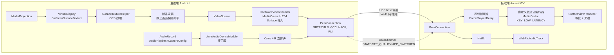
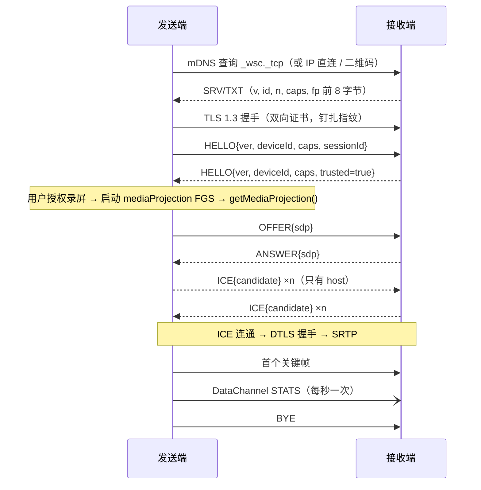
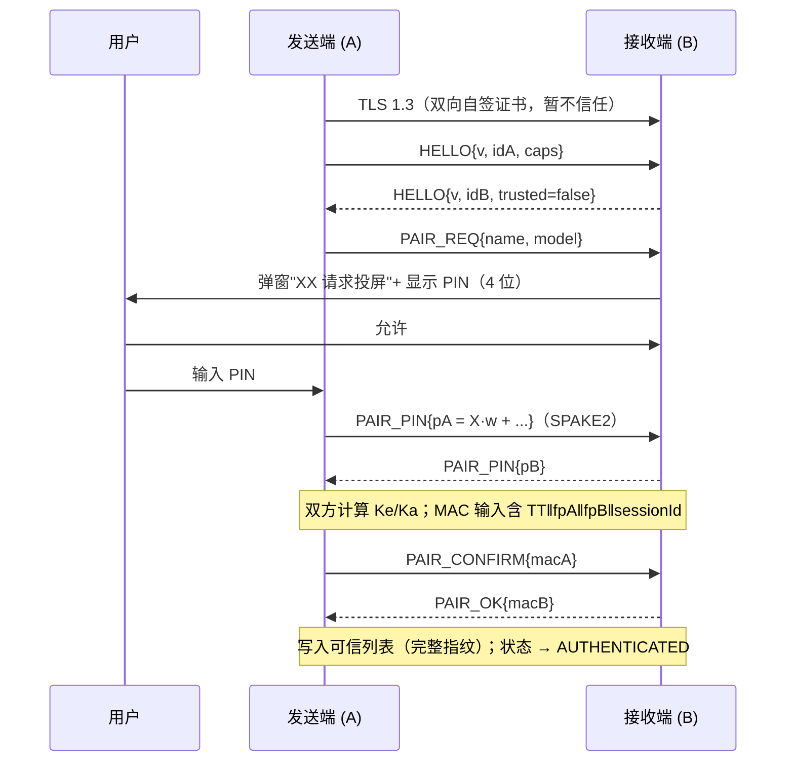
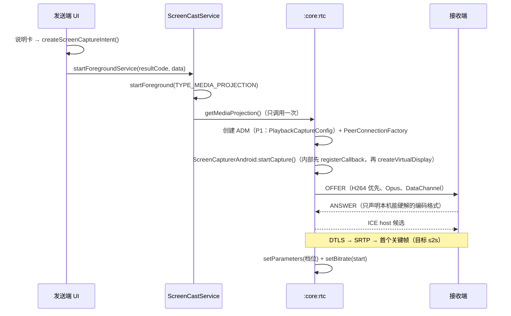
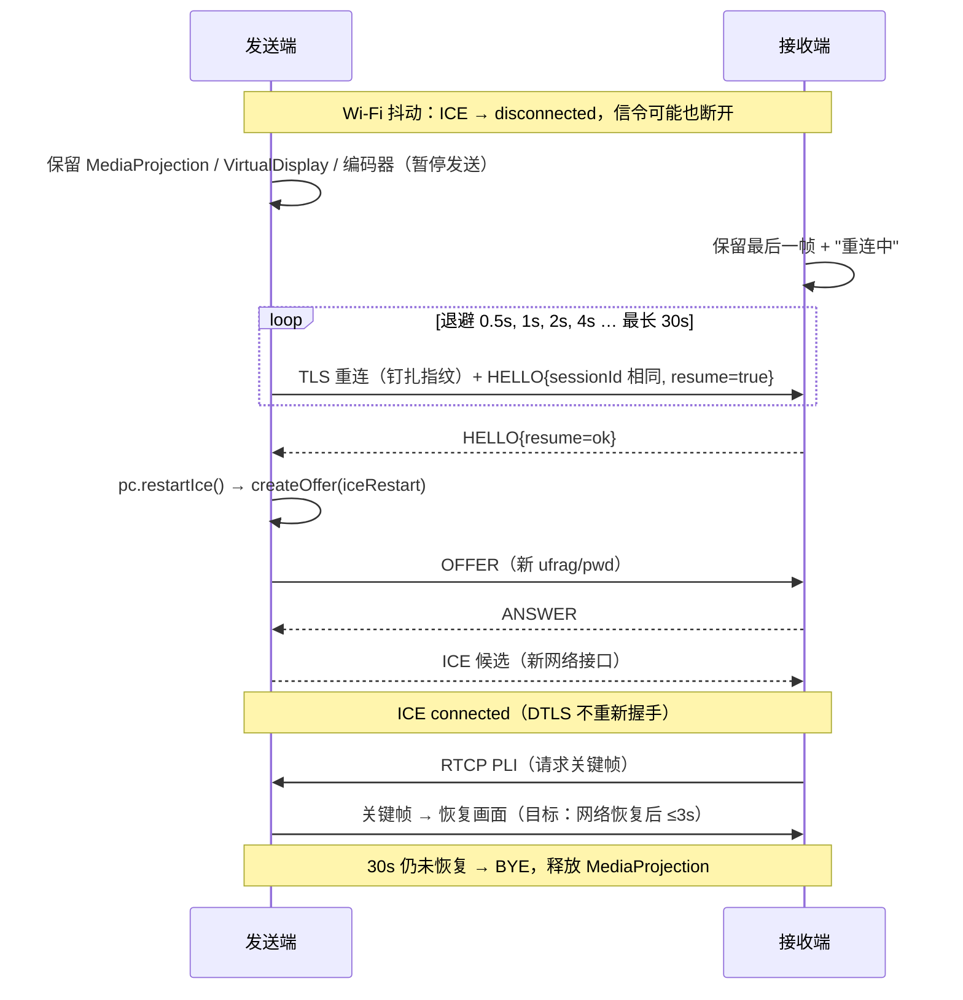

# 技术方案：局域网投屏（WirelessScreenCasting）v1.0

## 0. 文档信息

| 项 | 内容 |
|---|---|
| 文档名 | 技术方案-v1.0 |
| 依据 | [PRD-局域网投屏-v1.0](../prd/PRD-局域网投屏-v1.0.md)（第 16 节决策已锁定） |
| 工程基线 | AGP 9.4.1（内置 Kotlin，本地 `buildEnvironment` 实测内置 KGP **2.2.10**）、Gradle 9.6.0、compileSdk/targetSdk 37、minSdk 24→29、Java 11、配置缓存开启 |
| 日期 | 2026-11-14 |
| 状态 | 草案，待技术评审；标"待验证"的条目须在 M0 关闭 |

标注约定：**[已核实]** 有出处或本地实测；**[待验证]** 资料不足或依赖实机，M0 内确认；**[推断]** 基于源码或经验推理，未经实测。

---

## 1. 概述与结论摘要

1. **libwebrtc**：M0 先直接用 Maven Central 上的 `io.github.webrtc-sdk:android`（LiveKit 维护，150.7871.x，BSD-3）；M1 起改为**自建 fork**（基于同一里程碑，加 2~3 个小补丁），产物发布到 Maven Central，供 F-Droid 引用。不建议让 F-Droid 从源码编译 WebRTC（依赖 depot_tools 和 Google 预编译工具链，F-Droid 构建机跑不起来）。
2. **采集与编码**：`ScreenCapturerAndroid` 可以直接用。它在 API 31+ 用 `VirtualDisplay.resize()` 处理旋转，符合 Android 14 "授权只能用一次"。minSdk 29 后，上游 `HardwareVideoEncoderFactory` 只看 `isHardwareAccelerated()`，联发科等芯片的 H.264 硬编不再被白名单挡掉。
3. **音频**：上游 `JavaAudioDeviceModule` 没有接入 AudioPlaybackCapture 的入口。推荐给 `WebRtcAudioRecord` 打一个约 30 行的补丁，注入 `AudioPlaybackCaptureConfiguration`。这条路径不打开麦克风，只需要 `mediaProjection` 类型的前台服务。
4. **低延迟**：Android Java API **没有** `jitterBufferTarget` 的 setter。改用三项组合：字段试验 `WebRTC-ForcePlayoutDelay`、自定义低延迟 `VideoDecoderFactory`（`KEY_LOW_LATENCY`）、游戏模式下音视频不放进同一个同步组。中高端手机和盒子达到 1080p30 中位数 ≤150ms 的可能性**较高**；低端电视盒子**存在风险**，要等 M0 实测。
5. **信令**：服务端用 Java-WebSocket（MIT，WSS + 强制客户端证书），客户端用 OkHttp 5（`TLS_1_3` + 证书指纹钉扎）。双向 TLS 用设备自签 ECDSA P-256 证书。配对用 **SPAKE2（RFC 9382，P-256）**，PIN 作口令，双方证书指纹写进 transcript。DTLS 指纹借助"SDP 只走已双向认证的信令通道"做传递式绑定。
6. **DLNA**：**不用 jUPnP**。它是 CDDL-1.0 许可证，FSF 认定与 GPL 不兼容，而且 4.0 仍是里程碑版。改为自研最小 SSDP + SOAP + GENA，HTTP 层用 Ktor CIO，播放用 Media3 ExoPlayer。
7. **AirPlay**：直接沿用 `jqssun/android-airplay-server` 的做法：UxPlay `lib/` + libplist + openssl-cmake（OpenSSL 3.x 源码构建）+ FFmpeg（只用 ALAC）+ Oboe，用 MediaCodec 渲染，**不用 GStreamer**。这个项目已经在 F-Droid 上架（0.0.36，2026-10），说明从源码构建可行。构建开关用 Gradle 属性 `wsc.airplay`。
8. **工程**：PRD 11.1 的模块划分基本合理。建议补 `build-logic`（约定插件）、`:core:net`、`:core:ui`、`:core:data`，并把协议定义和测试向量放到仓库根的 `protocol/` 目录，与 TS 端共享。同一 AGP 9.4.1 下 Compose、KSP、Hilt 的组合已有开源项目跑通。
9. **M0**：细化为 10 项任务，合计约 **23 人日**（4.5 周），超过 PRD 估计的 2~3 周。建议延长 M0，或把 DLNA 和安全原型挪到 M1 的第一周。
10. **对 PRD 的关键反馈**：Android 15 QPR1+ **锁屏会自动停止投屏**；minSdk 29 会挡掉大量 Android 9 国产电视接收端；投屏码只有 3 位 PIN，强度不足；jUPnP 许可证不兼容。详见第 9 节。

---

## 2. 总体架构

### 2.1 模块依赖

```mermaid
graph TD
  app[":app<br/>入口/模式选择/导航/Compose"] --> fs[":feature:sender"]
  app --> fr[":feature:receiver"]
  app --> settings[":feature:settings<br/>设置/诊断/报告"]
  app -.构建开关 wsc.airplay.-> air[":protocol:airplay<br/>JNI + UxPlay"]

  fs --> rtc[":core:rtc"]
  fs --> disc[":core:discovery"]
  fs --> sec[":core:security"]
  fs --> sig[":core:signaling"]
  fs --> ui[":core:ui"]
  fr --> rtc
  fr --> disc
  fr --> sec
  fr --> sig
  fr --> dlna[":protocol:dlna"]
  fr --> ui
  fr --> airapi[":protocol:airplay-api<br/>接口 + 空实现"]
  air --> airapi

  sig --> proto[":core:protocol<br/>纯 Kotlin：消息/状态机/SPAKE2"]
  sec --> proto
  disc --> net[":core:net<br/>Ktor CIO HTTP / 组播工具"]
  dlna --> net
  dlna --> media[Media3 ExoPlayer]
  rtc --> webrtc[(libwebrtc AAR)]
  sig --> net
  sec --> data[":core:data<br/>DataStore/可信设备/日志"]
  settings --> data
  rtc --> common[":core:common"]
  proto --> common
```

### 2.2 运行时数据流（镜像）



### 2.3 信令总时序（已配对设备）



---

## 3. 分项方案

### 3.1 libwebrtc on Android

**结论**：M0 用 `io.github.webrtc-sdk:android:150.7871.04` 的未改名版本。M1 起改为基于同一里程碑的**自建 fork**，打 3 个补丁后发布到 Maven Central（自有 groupId，如 `io.github.<owner>.wsc-webrtc`）。

| 来源 | 最新版本 | 许可证 | 维护状态 | 体积 | F-Droid | 评价 |
|---|---|---|---|---|---|---|
| Google 上游自编译（`tools_webrtc/android/build_aar.py`） | 跟随上游 main / branch-heads | BSD-3 | Google 不再发布官方 AAR | 自控 | 只能"自编译后发布到 Maven Central"再引用 | 补丁最自由，构建环境重（约 20GB+ 源码，依赖 depot_tools） |
| **webrtc-sdk/android**（LiveKit） | `150.7871.04`（Maven Central，约 3 周前）[已核实] | 中央仓库显示 BSD-3；GitHub 仓库标 MIT | 活跃，LiveKit 生产在用 | 有 `-prefixed-stripped` 瘦身版（去掉软件编解码器）；每 ABI 增量[待验证] | Maven Central 上的自由许可证二进制符合 F-Droid 政策[已核实] | **M0 首选**：版本新、更新频繁 |
| GetStream webrtc-android | `1.3.10`（约 1 年前）[已核实] | Apache-2.0 + BSD | 节奏明显放缓 | 未公布 | 同上 | 不推荐：更新慢，有 `setAudioRecordDataCallback` 等扩展 |
| Threema / Snikket 等自建 AAR | 定制 | BSD | 只服务自家 App | — | F-Droid 过去曾借用 | 不推荐 |

**F-Droid 相关事实**：
- F-Droid 收录政策允许预编译二进制来自 Maven Central、Google Maven 等受信仓库，前提是自由许可证（"simply being included in one of those repositories is not enough"）[已核实，F-Droid Inclusion Policy]。
- F-Droid 历史上一直借用第三方预编译 WebRTC，因为版本陈旧被标过 KnownVuln（Snikket 事件）。Snikket 的解法是自建 AAR 并发布到 Maven Central [已核实]。
- 结论：我们的 fork 由自己的 CI 用 Docker 固定环境构建，发布到 Maven Central，同时在 README 里公开构建脚本、补丁和 commit hash，满足"可审计"。

**自建 fork 的补丁集（目标是每个补丁都小于 100 行）**：

| # | 补丁 | 原因 | 不打补丁的替代 |
|---|---|---|---|
| P1 | `JavaAudioDeviceModule.Builder.setAudioPlaybackCaptureConfiguration(cfg)`，在 `WebRtcAudioRecord.createAudioRecordOnMOrHigher()` 的 `AudioRecord.Builder` 上调用 `setAudioPlaybackCaptureConfig(cfg)` | 内录声音不经过麦克风（见 3.3） | webrtc-sdk 的 AudioBufferCallback 覆写方案（会打开麦克风） |
| P2 | `RtpReceiver.setJitterBufferMinimumDelay(Double?)` 的 Java/JNI 暴露 | 上游 Java `RtpReceiver` **没有**这个方法（只有 track/getParameters/id/dispose/SetObserver/setFrameDecryptor）[已核实]，但原生 `RtpReceiverInterface::SetJitterBufferMinimumDelay` 存在 [已核实] | 字段试验 `WebRTC-ForcePlayoutDelay`（全局生效，不能按会话动态调整） |
| P3（可选） | `AndroidVideoDecoder` 在 API 30+ 设置 `MediaFormat.KEY_LOW_LATENCY=1` | 上游解码器没有设置这个键 [已核实，源码 grep] | 自己实现 `VideoDecoderFactory`（Java 层可以替换，见 3.4），所以 P3 可以不打 |

**风险**：
- 16KB 页大小：Android 15+ 的部分设备使用 16KB 页，所有 `.so` 都要按 16KB 对齐。M0 要用 `zipalign -c -P 16 -v 4` 和 `check_elf_alignment.sh` 检查 webrtc-sdk 的 AAR [待验证]。自建时用 NDK r28+ 默认对齐。
- webrtc-sdk 的仓库许可证（MIT）和 Maven 元数据（BSD-3）不一致，都与 GPL-3.0 兼容，但发布前要在 NOTICE 中写清楚。
- 每 ABI 的体积增量 PRD 估计约 10MB，M0 实测 [待验证]。

---

### 3.2 屏幕采集链路

**结论**：直接用 `org.webrtc.ScreenCapturerAndroid`，外面包一层 `ProjectionSession`，负责前台服务、授权令牌、回调和旋转。

**Android 14+ 适配要点**（依据官方 Media projection 文档 [已核实]）：

| 规则 | 实现 |
|---|---|
| targetSdk ≥34：Manifest 声明 `FOREGROUND_SERVICE_MEDIA_PROJECTION`，Service 声明 `foregroundServiceType="mediaProjection"` | `ScreenCastService` 在 `onStartCommand` 里先调 `ServiceCompat.startForeground(..., FOREGROUND_SERVICE_TYPE_MEDIA_PROJECTION)`，**然后**才调用 `getMediaProjection()` |
| 同一个 Intent 只能传给 `getMediaProjection()` 一次；同一个 `MediaProjection` 只能 `createVirtualDisplay()` 一次，否则抛 `SecurityException` | **整个会话只调用一次** `ScreenCapturerAndroid.startCapture()`。断线重连时**不** stop/start 采集器，只做 ICE restart；所有尺寸变化都走 `changeCaptureFormat()` |
| `createVirtualDisplay()` 之前必须注册 `MediaProjection.Callback`，否则抛 `IllegalStateException` | `ScreenCapturerAndroid.startCapture()` 内部已按"`registerCallback` → `createVirtualDisplay`"的顺序执行 [已核实，源码] |
| `onStop()`：用户点状态栏胶囊、**锁屏（Android 15 QPR1+）**、另一个投屏会话开始、进程被杀，都会触发 | 收到回调后发 `BYE{reason=PROJECTION_STOPPED}`，释放资源，UI 进入"需要重新授权" |
| 单应用共享（Android 14+）：初始尺寸是整个屏幕，选择应用后才变化 | 用 `onCapturedContentResize(w,h)` 调 `changeCaptureFormat`；用 `onCapturedContentVisibilityChanged(false)` 通过 DataChannel 发 `APP_SWITCHED`，接收端显示占位画面 |

> **注意**：`ScreenCapturerAndroid` 构造时传入的 `MediaProjection.Callback` 由我们自己实现，但上游只转发 `onStop`。要拿到 `onCapturedContentResize/VisibilityChanged`（API 34），需要在自己的子类或包装中另外注册一个 Callback（`MediaProjection` 允许注册多个回调）[推断，M0 验证]。

**分辨率与旋转**：
- 目标框：按档位取 1920×1080 或 1280×720 的**外接框**，保持内容宽高比缩放进框内，宽高向下取整到 16 的倍数（部分编码器要求宏块对齐）。例如 20:9 竖屏手机在 1080p 档 → 864×1920 以内，取 848×1904 一类的对齐值。
- 旋转检测：API 34+ 用 `onCapturedContentResize`；API 29~33 用 `DisplayManager.DisplayListener.onDisplayChanged` 加 `WindowMetrics`。检测到变化后调 `changeCaptureFormat(w, h, fps)`。API 31+ 上游走 `virtualDisplay.resize()` + `setSurface()`；API 29~30 上游会**重建** VirtualDisplay [已核实，源码]。重建可能被 Android 14+ 的规则拦截，但 14+ 本来就 ≥31，不冲突。
- 接收端：`SurfaceViewRenderer` 收到尺寸变化的帧会回调 `onFrameResolutionChanged`，配合 `SCALE_ASPECT_FIT` 重新布局，PRD 要求 500ms 内方向正确。编码器在分辨率变化时会自动输出关键帧。
- **静止画面**：VirtualDisplay 只在内容变化时出帧。要实现一个 `FrameRepeater`（包装 `CapturerObserver`），超过 `1000/minFps` ms 没有新帧就 `retain()` 并重发上一帧（最低 5fps）。否则接收端统计会误判卡死，GCC 也会因为没有流量而降低码率估计。

**硬件 H.264 编码器**：
- `HardwareVideoEncoderFactory` 在 API ≥29（Q）只检查 `MediaCodecInfo.isHardwareAccelerated()`，不再按 `OMX.qcom`/`OMX.Exynos` 前缀过滤 [已核实，源码]。minSdk 29 直接解决了联发科、展锐等芯片 H.264 硬编被拒的老问题。
- High Profile 只在 Exynos 上启用 [已核实]，其余机型协商 Constrained Baseline（42e01f）。对局域网带宽影响不大。
- 用构造参数 `codecAllowedPredicate` 屏蔽已知有问题的编码器（黑名单在 M0 兼容实验中积累）。
- 用 `DefaultVideoEncoderFactory` 保留软件回退（OpenH264 不在 Android 包里，回退是 VP8，libvpx）。SDP 中视频编码器顺序是 H264 > VP8；如果用 stripped 版，要确认还有可用的回退编码器 [待验证]。

**编码参数（`RtpSender.setParameters`）**：

```kotlin
// 档位 → 发送参数；setParameters 必须基于 getParameters() 返回的对象修改（带 transactionId）
fun RtpSender.applyQuality(q: QualityProfile) {
    val p = parameters
    p.degradationPreference = when (q.mode) {
        Mode.SMOOTH, Mode.GAME -> RtpParameters.DegradationPreference.MAINTAIN_FRAMERATE
        Mode.CLARITY -> RtpParameters.DegradationPreference.MAINTAIN_RESOLUTION
        Mode.AUTO -> RtpParameters.DegradationPreference.BALANCED
    }
    p.encodings.firstOrNull()?.apply {
        maxBitrateBps = q.maxBitrateBps      // 4/8/15 Mbps
        minBitrateBps = q.minBitrateBps      // 例如 1 Mbps，防止 GCC 掉得太狠
        maxFramerate = q.fps                 // 30 / 60
        scaleResolutionDownBy = 1.0
        networkPriority = RtpParameters.Priority.HIGH  // 配合 enableDscp
    }
    check(setParameters(p)) { "setParameters rejected" }
}
```

- 首帧画质：GCC 默认起始码率低（约 300kbps）。连接后用 `PeerConnection.setBitrate(min, start=档位的 50%, max)` 抬高起始码率。局域网带宽充裕，可以更激进。
- `RtpParameters.degradationPreference`、`Encoding.maxFramerate/maxBitrateBps/minBitrateBps/networkPriority` 都存在于上游 Java API [已核实，源码]。

**风险**：FLAG_SECURE 窗口黑屏（PRD 已覆盖）；Android 15 投屏期间会隐藏敏感通知；部分厂商 ROM 的单应用共享实现有差异 [待验证]。

---

### 3.3 音频：AudioPlaybackCapture 接入 WebRTC

**结论**：采用 **P1 补丁方案**，备选是 webrtc-sdk 的 AudioBufferCallback 方案。

| 方案 | 做法 | 是否打开麦克风 | 前台服务类型 | 工作量 | 结论 |
|---|---|---|---|---|---|
| **A. 补丁 WebRtcAudioRecord（P1）** | Builder 新增 `setAudioPlaybackCaptureConfiguration()`，在 `AudioRecord.Builder` 上 `setAudioPlaybackCaptureConfig(cfg)`；`AudioSource` 不再生效 | 否 | `mediaProjection`（投屏本来就要）[推断] | fork 内约 30 行 + 自建 AAR | **推荐** |
| B. webrtc-sdk AudioBufferCallback 覆写 | LiveKit 的 `ScreenAudioCapturer` 做法：麦克风 AudioRecord 照常运行，在回调里用 playback capture 的数据覆盖缓冲（gain=1、静音麦克风数据）[已核实，LiveKit 文档] | **是**（麦克风会被打开，隐私指示灯亮起） | 后台需要 `microphone` 类型 FGS [已核实] | 不需要自编译 | 只用于 M0 快速验证；与 PRD"不录麦克风"的承诺冲突，**不进正式版** |
| C. 自研原生 AudioDeviceModule | C++ 实现 `webrtc::AudioDeviceModule`，通过 `PeerConnectionFactory.Builder.setAudioDeviceModule()` 注入 | 否 | mediaProjection | 大：要和 libwebrtc 头文件同版本编译 | 不推荐 |
| D. 外部音频源 / 单独 Opus 编码后走 DataChannel | 自行编码，用 DataChannel 传输 | 否 | — | 大，还会失去 WebRTC 的音画同步 | 不推荐 |

**P1 实现要点**：

```kotlin
val cfg = AudioPlaybackCaptureConfiguration.Builder(mediaProjection)
    .addMatchingUsage(AudioAttributes.USAGE_MEDIA)
    .addMatchingUsage(AudioAttributes.USAGE_GAME)
    .addMatchingUsage(AudioAttributes.USAGE_UNKNOWN)
    .build()
val adm = JavaAudioDeviceModule.builder(context)
    .setAudioPlaybackCaptureConfiguration(cfg)   // P1 新增
    .setUseHardwareAcousticEchoCanceler(false)   // 内录不需要 AEC/NS
    .setUseHardwareNoiseSuppressor(false)
    .setUseStereoInput(true)                     // 已核实存在
    .setInputSampleRate(48_000)
    .createAudioDeviceModule()
```

- 要点：`MediaProjection` 必须先存在，而 ADM 在 `PeerConnectionFactory` 创建时就要传入。因此**发送端 PeerConnectionFactory 在拿到 MediaProjection 之后才创建**；或者在 P1 里改成"运行时设置 cfg，下次 `startRecording` 生效"。推荐后者，更灵活。
- 软件 APM 关闭：`createAudioSource(MediaConstraints)` 里设 `googEchoCancellation/googAutoGainControl/googNoiseSuppression/googHighpassFilter=false`。新版本是否仍识别这些 constraints 要在 M0 用 `getStats` 和听感验证 [待验证]。备选：在 P1 中把 `AudioProcessing` 换成透传。
- Opus 参数：通过 SDP munging 设置 `stereo=1; sprop-stereo=1; maxaveragebitrate=128000; useinbandfec=1; usedtx=0`，`ptime=10~20`。
- 被投 App 设置 `ALLOW_CAPTURE_BY_NONE` 或 `allowAudioPlaybackCapture=false` 时，读到的是静音数据，不会报错。用 RMS 连续 N 秒为 0 来推断"可能被禁止捕获"，在 UI 上提示（PRD S-03）。
- 隐私指示灯：AudioPlaybackCapture 是否会触发麦克风指示灯 [待验证]。如果触发，要在说明卡里提前告知。

---

### 3.4 低延迟调优

**延迟预算（1080p30，5GHz，中端设备）[推断，M0 校准]**：

| 环节 | 典型值 | 可调手段 |
|---|---|---|
| 合成 + VirtualDisplay 出帧 | 8~17ms | — |
| 硬件编码 | 8~20ms | `KEY_LATENCY=1`（API 30+）、CBR、关闭 B 帧（Baseline 本来就没有） |
| 打包 + Pacer | 1~10ms | 局域网可以让 pacer 更激进 [待验证字段试验] |
| Wi-Fi 空口 | 2~10ms（P95 可达 30ms+） | 5GHz、`enableDscp` |
| 接收端视频缓冲 | 默认 20~100ms | `WebRTC-ForcePlayoutDelay`、P2 补丁 |
| 硬件解码 | 5~30ms；部分电视芯片 50~100ms+ | `KEY_LOW_LATENCY`、厂商私有键 |
| 渲染（SurfaceView → 屏幕） | 16~33ms | SurfaceView（不用 TextureView），关闭多余合成层 |
| **合计** | **约 70~200ms** | |

**可行性判断**：手机、平板、主流盒子（Android TV 11+，近 3 年的 SoC）达到**中位数 ≤150ms 的把握较高**。2019 年前后的低端盒子和部分国产电视受解码器缓冲限制，可能落在 150~250ms。PRD 已写明"M0 后校准"，建议实验室指标按"设备档位"分别设定。

**接收端视频缓冲**：
- Android Java 层没有 `jitterBufferTarget` [已核实]。可用手段：
  1. **字段试验** `WebRTC-ForcePlayoutDelay/min_ms:0,max_ms:<X>/`：初始化 `PeerConnectionFactory` 时通过 `InitializationOptions.setFieldTrials()` 设置。它会覆盖每个接收包的 playout delay（2020 年加入）[已核实存在]；当前里程碑是否还在、字符串格式是否完全如上 [待验证]。注意 `min=0` 且 `max>0` 才会启用低延迟渲染路径，`min=max=0` 是另一种行为 [已核实，playout-delay 文档]。
  2. **`WebRTC-ZeroPlayoutDelay/min_pacing:Xms,max_decode_queue_size:N/`**：调整低延迟路径的解码节拍 [已核实存在]。
  3. P2 补丁暴露 `setJitterBufferMinimumDelay`，供"流畅优先"档位动态加大缓冲。
  4. 发送端 playout-delay 头扩展：Java 层没有设置入口，不采用。
- 建议的初始取值（M0 扫参）：均衡 `max_ms` 100~150；游戏 `max_ms` 0~50。
- **音画同步陷阱**：WebRTC 会把**同一 MediaStream（同一 msid）里的音频和视频**做同步，视频会被推迟到和音频播放延迟（NetEq + AudioTrack 输出延迟）对齐。电视的 AudioTrack 输出延迟可能达到 100ms+，会把视频一起拖慢 [推断]。对策：
  - 均衡、高清档：音视频放进同一个 stream，保证唇音同步（PRD 1.3 要求）。
  - **游戏模式：音频和视频使用不同的 streamId**，解除同步，视频走最低延迟，声音允许稍微落后。
  - 接收端 ADM 开启 `setUseLowLatency(true)`（已核实存在，需要 API 26+）。

**硬件解码低延迟**：
- 实现 `LowLatencyVideoDecoderFactory`（Java 层可以替换），内部复用 MediaCodec 和 `SurfaceTextureHelper`：
  - API 30+ 且 `CodecCapabilities.isFeatureSupported(FEATURE_LowLatency)` 时设 `KEY_LOW_LATENCY=1`。
  - 高通加 `vendor.qti-ext-dec-low-latency.enable=1`，其他厂商的私有键按兼容表维护 [待验证]。
  - `KEY_PRIORITY=0`（实时）、`KEY_OPERATING_RATE` 设为帧率。
- M0 用"首包进入解码器到 `onOutputBufferAvailable`"的耗时统计每台设备的解码器缓冲深度。

**关闭不必要的处理**：发送端关闭 AEC/NS/AGC（硬件和软件都关）；视频关闭 CPU overuse 自适应降分辨率（`enableCpuOveruseDetection=false`，硬编场景下 CPU 不是瓶颈，避免误降档）[待验证收益]。

**帧率与码率策略**：

| 档位 | 分辨率 / fps | 最高码率 | degradationPreference | 视频缓冲 | 音画同步 |
|---|---|---|---|---|---|
| 流畅 | 720p30 | 4Mbps | MAINTAIN_FRAMERATE | max 150ms | 是 |
| 均衡（默认） | 1080p30 | 8Mbps | BALANCED | max 100~150ms | 是 |
| 高清 | 1080p60 | 15Mbps | MAINTAIN_RESOLUTION | max 150ms | 是 |
| 游戏（V1） | 720p60 | 8Mbps | MAINTAIN_FRAMERATE | max 0~50ms | **否** |

**端到端延迟测量方法**：

| 方法 | 原理 | 精度 | 用途 |
|---|---|---|---|
| M1：高速摄像（真值） | 发送端 App 内显示毫秒时钟或闪烁色块，手机 240fps 慢动作同时拍两块屏幕，逐帧读数相减 | ±4ms | 校准其他方法，作为验收证据 |
| M2：自动化时间码 | 发送端测试模式在屏幕角落绘制"时间码条形图"（32bit ms 时间戳，二值色块）；接收端对渲染输出 `PixelCopy` 取像素并解码，与时钟偏移校正后的本地时间相减。时钟偏移用 DataChannel 往返 ping（NTP 算法，取 RTT 最小的样本） | ±5ms，不含面板延迟（再加 1 帧） | 实验室批量、长时间统计 P50/P95 |
| M3：WebRTC 统计分解 | `inbound-rtp`：`jitterBufferDelay/jitterBufferEmittedCount`、`totalDecodeTime/framesDecoded`、`totalProcessingDelay`；`candidate-pair.currentRoundTripTime/2`；发送端编码耗时 `totalEncodeTime/framesEncoded` | 分段估计 | 定位延迟出在哪一段；也写入本地投屏报告 |
| M4：abs-capture-time 头扩展 | 协商 `http://www.webrtc.org/experiments/rtp-hdrext/abs-capture-time`，用 `RTCRtpReceiver.getSynchronizationSources`（Java 层是否暴露 [待验证]） | 依赖时钟同步 | 可选 |

---

### 3.5 信令与安全

#### 3.5.1 WebSocket over TLS 选型

| 角色 | 候选 | 许可证 | TLS 服务端 | 体积 | 结论 |
|---|---|---|---|---|---|
| 服务端 | **Java-WebSocket (TooTallNate) 1.6.0**（2024-12）[已核实] | MIT | 支持，`SSLParametersWebSocketServerFactory` 可以设 `needClientAuth` | 约 100KB | **推荐**：轻量，ws/wss 不能同端口共存（我们只用 wss，不受影响） |
| 服务端 | Ktor Server CIO 3.6.0 | Apache-2.0 | **CIO 不支持服务端 TLS**；`sslConnector` 只在 JVM 的 Netty/Jetty 引擎可用 [已核实，社区讨论] | 中 | 只用于明文 HTTP（DLNA、推送），不承载 WSC |
| 服务端 | Ktor Server Netty | Apache-2.0 | 支持 | 大（Netty 数 MB） | 不推荐 |
| 服务端 | NanoHTTPD + websocket 模块 | BSD-3 | 支持 | 小 | 2016 年后不再维护，不推荐 |
| 客户端 | **OkHttp 5.x**（5.4.0 于 2026-06 发布，tracker 显示 5.5.0）[部分待验证] | Apache-2.0 | — | 中（Okio） | **推荐**：WebSocket、ConnectionSpec、证书钉扎都很成熟 |

Java-WebSocket 已知坑：#1418 首个 GET 和 TLS 握手结束紧挨着到达时可能漏读 [已核实]。M0 要做压力测试；如果复现，在客户端握手后加 50ms 延迟或换实现。

#### 3.5.2 设备身份与证书

- 首次启动时生成 **ECDSA P-256** 身份密钥和自签 X.509 证书（CN=随机 deviceId，有效期 20 年）。指纹 = SHA-256(DER)。
- 存储，两种方案按 M0 结果二选一：
  - **方案 1（首选）**：私钥放在 AndroidKeyStore（不可导出），通过自定义 `X509KeyManager` 交给 `SSLContext`。平台 Conscrypt 可以用 Keystore 私钥签 TLS 握手，客户端证书场景已知可行，服务端场景 [待验证]。
  - **方案 2**：私钥以 PKCS#8 形式存在 App 私有目录，用 AndroidKeyStore 的 AES-GCM 密钥包裹加密。好处是可以同时作为 WebRTC 的 `RTCConfiguration.certificate`（`RtcCertificatePem`，已核实字段存在），让 DTLS 指纹等于设备身份指纹。
- 证书生成：Android 平台没有公开的 X.509 构建 API。用 **BouncyCastle `bcpkix`**（MIT 风格许可证）生成，R8 裁剪后体积可控。SPAKE2 的椭圆曲线运算也会用到 BouncyCastle，可以共用。
- `data_extraction_rules` / `fullBackupContent` 排除密钥和可信设备文件（PRD 8.5）。

#### 3.5.3 TLS 配置

- 服务端（接收端）：`SSLContext("TLSv1.3")`，`sslParameters.protocols=["TLSv1.3"]`，`needClientAuth=true`。`X509TrustManager` 接受任意自签证书（不做 CA 校验），在握手完成后的应用层按状态机判断：已信任指纹进入 `TRUSTED` 流程，未知指纹只允许 `PAIR_*` 消息。
- 客户端（发送端）：OkHttp `ConnectionSpec.Builder(MODERN_TLS).tlsVersions(TlsVersion.TLS_1_3)`；自定义 TrustManager，按 mDNS TXT 的 `fp` 前缀、二维码完整 `fp` 或可信列表钉扎；`hostnameVerifier` 一律放行（局域网 IP 无主机名，安全性由指纹钉扎保证）。
- Android 10+ 平台 Conscrypt 支持 TLS 1.3（P-256/P-384）[已核实，Conscrypt CAPABILITIES]。`SSLSockets.exportKeyingMaterial`（RFC 5705）**要到 API 31**才有 [已核实]，所以不能作为 minSdk 29 下的通道绑定基础，改用"证书指纹进 transcript"。

#### 3.5.4 PIN 配对：SPAKE2（RFC 9382）

| 方案 | 抗离线暴力 | 跨端实现 | 结论 |
|---|---|---|---|
| **SPAKE2（RFC 9382，P256-SHA256-HKDF-HMAC 套件）** | 是（中间人每次连接只能在线猜一次） | Kotlin：BouncyCastle `ECPoint` 自实现（约 300 行），用 RFC 附录的测试向量校验；TS：`@noble/curves` p256（MIT）自实现，用同一套测试向量 | **推荐** |
| SPAKE2-Ed25519（BoringSSL/ADB 兼容） | 是 | Java 库都标"未审计"（MuntashirAkon/spake2-java、Flyfish233/spake2-java）[已核实] | 不推荐依赖第三方未审计库 |
| J-PAKE（BouncyCastle 内置） | 是 | TS 端没有成熟实现 | 不推荐 |
| 短认证串比对（SAS） | 是 | 简单 | 需要用户在两块屏幕上比对 6 位数字。PRD 的交互是"输入 PIN"，**作为 TV 无输入场景的备选** |
| HMAC(PIN, ...) 承诺 | **否**（4 位 PIN 被离线穷举只要毫秒级） | 简单 | 禁止 |

协议细节：
- 角色：A = 发送端（输入 PIN），B = 接收端（显示 PIN）。`idA/idB` = deviceId；口令 `w = HKDF(PIN || sessionNonce)`。
- 在 `PAIR_PIN{pA}` / `PAIR_PIN{pB}` 交换之后，双方计算 Ke/Ka，key confirmation 的 MAC 输入 = `TT || fpA || fpB || sessionId`。**fpA/fpB 取自本次 TLS 会话实际看到的证书**。中间人分别和两端握手时，双方看到的指纹集合不同，MAC 校验失败。
- 失败策略：同一个 PIN 最多错 3 次，之后作废并重新生成；每台设备 30 秒内最多 5 次 `PAIR_REQ`。
- 成功后双方把对方的完整指纹写入可信列表，以后的连接靠双向 TLS 指纹钉扎完成认证，不再需要 PIN。
- **二维码配对**：`wsc://IP:port?fp=<完整指纹 base64url>&n=<128bit 随机数>&v=1`。扫码得到接收端完整指纹（带外认证），发送端在 TLS 内发 `PAIR_QR{mac=HMAC(n, fpA||fpB||sessionId)}`，接收端校验后完成互信，不用输 PIN。`n` 一次有效，60 秒过期。
- **投屏码**：PRD v1.1（决策 #19）已改为 8 位 = IP 末段 3 位 + PIN 5 位。5 位 PIN 配合 SPAKE2，每次在线猜中概率 1/100000，加上"输错 3 次锁 60 秒"后约 0.003%。

#### 3.5.5 DTLS 指纹与信令证书的绑定

- WebRTC 本身会强制校验"DTLS 握手证书 == 远端 SDP 里的 `a=fingerprint`"。因此**只要 SDP 只经由双向认证的 TLS 信令通道传递**，DTLS 就被传递式地绑定到设备身份。这是 WebRTC 安全模型的标准做法（RFC 8827）。
- 实现约束：
  1. `OFFER/ANSWER/ICE` 只在状态机处于 `AUTHENTICATED` 时接受，否则一律 `ERROR{code=UNAUTHENTICATED}` 并断开。
  2. 会话建立后用 `getStats` 读取 `transport.remoteCertificateId → certificate.fingerprint`，与收到的 SDP 指纹比对，写入诊断日志（纵深防御）。
  3. Android↔Android 且采用 3.5.2 方案 2 时，可以把身份证书设为 DTLS 证书，接收端额外校验"DTLS 指纹 == 可信列表指纹"。Electron/浏览器端做不到（DTLS 证书只能由 `RTCPeerConnection.generateCertificate` 生成），所以这一条是可选增强，不进协议的必选项。

#### 3.5.6 WSC 消息与状态机（概要）

```
DISCONNECTED → TLS_CONNECTING → HELLO_SENT → (trusted? AUTHENTICATED : PAIRING)
PAIRING: PAIR_REQ → AWAIT_USER_CONFIRM → SPAKE2 交换 → PAIR_OK → AUTHENTICATED
AUTHENTICATED → NEGOTIATING (OFFER/ANSWER/ICE) → STREAMING
STREAMING ⇄ RECONNECTING（信令断：退避重连；ICE 断：restartIce）
任意 → CLOSED（BYE / 超时 30s / ERROR 致命码）
```

- 消息统一外壳：`{"t":"OFFER","id":<uint32 自增>,"sid":"<sessionId>","v":1,"p":{...}}`，JSON 结构由 `protocol/schema/*.json` 定义，Kotlin 用 kotlinx.serialization，TS 用 zod 或 typebox 从同一份 schema 生成。
- 心跳：WebSocket ping/pong 每 5 秒一次，连续丢 3 次判定信令断开。
- 版本：`HELLO.v` 主版本号不同时，按 N-1 兼容表降级；无法兼容返回 `ERROR{code=VERSION_UNSUPPORTED, min, max}`。

---

### 3.6 设备发现

**mDNS（NsdManager）**：

| 已知坑 | 影响版本 | 对策 |
|---|---|---|
| `resolveService` 不能并发：第二个请求返回 `FAILURE_ALREADY_ACTIVE`（错误码 3）[已核实，社区与 CHIP 项目] | API ≤33 | 用 `Mutex` 串行化解析队列；API 34+ 改用 `registerServiceInfoCallback`（`resolveService` 在 34 被废弃）[已核实] |
| 长时间运行后解析全部失败、发现停滞 | 旧版本 | 发现会话每 60 秒或网络变化时重建；UI 层去抖 |
| 服务名冲突时系统自动改名（如 "TV (2)"） | 全部 | 不靠服务名识别设备，以 TXT 中的 `id` 为准 |
| 部分设备不带 MulticastLock 就收不到响应 [已核实，社区] | 厂商相关 | 发现期间持有 `WifiManager.MulticastLock`（`setReferenceCounted(false)`），离开发现页就释放 |
| 多网络（Wi-Fi + 蜂窝/VPN）时在错误接口上发现 | API 33+ 可指定 Network | API 33+ 用 `discoverServices(..., network, ...)` 绑定 Wi-Fi Network；VPN 开启时提示 |
| TXT 记录长度和编码 | 全部 | 每个键值对不超过 255 字节，设备名 UTF-8 截断；指纹前缀用 base64url |
| 国产 ROM 后台限制组播 | 厂商相关 [待验证] | 只在前台发现；接收端待机时保持前台 |

- **备选**：jmDNS 3.5.9（Apache-2.0）[已核实版本]，作为 NsdManager 在某些机型失效时的兜底。只在兼容表命中时启用，避免两个 mDNS 栈同时响应。
- 接收端注册：`NsdManager.registerService`，端口来自 Java-WebSocket 实际绑定的端口（0 = 随机）。

**SSDP**（DLNA 用，也可以作为 WSC 的第二条发现路径）：
- `MulticastSocket` 绑定到 Wi-Fi 接口（`setNetworkInterface`），加入 `239.255.255.250:1900`，需要 MulticastLock。
- DMR：启动时发 3 次 `NOTIFY ssdp:alive`（间隔 100~200ms），之后每 `max-age/2`（900s）重发；响应 `M-SEARCH`，按 `MX` 随机延迟；退出时发 `ssdp:byebye`。
- WSC over SSDP：在 DMR 的设备描述里加自定义 `<wsc:service>` 节点，带 port 和 fp。mDNS 失效时，发送端可以从 SSDP 结果里拿到 WSC 入口 [推断，低成本收益高]。

**二维码与投屏码**：
- 生成：ZXing `core`（Apache-2.0，纯 Java），接收端渲染成 Compose `ImageBitmap`。
- 扫码：CameraX + ZXing core 自行解码（不用 ML Kit / Play Services，满足 F-Droid）。`zxing-android-embedded` 维护停滞，不推荐。CAMERA 权限只在点击扫码时申请。也可以用"系统相机扫码打开 `wsc://` 深链接"作为零权限路径（注册 intent-filter）[推断，国产相机对自定义 scheme 的支持待验证]。
- 投屏码解析：发送端取当前 Wi-Fi `LinkProperties` 的 IPv4 前缀，只有 /24 时启用投屏码，其余网段提示扫码。

---

### 3.7 DLNA（DMR 进 MVP，DMC 在 V1）

**结论**：**自研最小 UPnP 栈**，不用 jUPnP。

| 方案 | 许可证 | 维护 | Android 适配 | 体积 | 结论 |
|---|---|---|---|---|---|
| jUPnP | **CDDL-1.0** [已核实，LICENSE 与 Maven Central]；最新版 `4.0.0.M1`（里程碑版）[已核实] | 活跃（openHAB 驱动），重心在 OSGi/服务器 | 文档已不提 Android；依赖 Jetty/servlet 体系 | 大 | **不采用**：FSF 认定 CDDL 与 GPL 不兼容，GPL-3.0 项目分发组合作品有法律风险 |
| Cling 2.1.x | LGPL-2.1 / CDDL 双许可 | 已停止维护 | 有 Android 支持但很陈旧 | 中 | 不采用 |
| **自研 SSDP + SOAP + GENA** | GPL-3.0（自有） | 自控 | 原生 Kotlin 协程 | 约 2~3k 行 | **采用** |

**DMR 范围**：

| 服务 | 必须实现的动作 |
|---|---|
| AVTransport:1 | SetAVTransportURI、Play、Pause、Stop、Seek（REL_TIME）、GetTransportInfo、GetPositionInfo、GetMediaInfo、GetTransportSettings、GetCurrentTransportActions；可选 SetNextAVTransportURI |
| RenderingControl:1 | GetVolume、SetVolume、GetMute、SetMute（Master 通道） |
| ConnectionManager:1 | GetProtocolInfo（声明 `http-get:*:video/mp4:*` 等 Sink 列表）、GetCurrentConnectionIDs、GetCurrentConnectionInfo |
| GENA 事件 | SUBSCRIBE/RENEW/UNSUBSCRIBE；`LastChange` 事件（TransportState、音量），节流 200ms |

- HTTP 层：Ktor Server CIO（Apache-2.0）。V1 的推送 HTTP 服务（Range）和 V2 的 Web 接收页可以共用。GENA 用非标准方法 `SUBSCRIBE/UNSUBSCRIBE/NOTIFY`，Ktor 可以用 `route(path, HttpMethod("SUBSCRIBE"))` 处理，CIO 解析器是否接受非标准方法 [待验证，M0 T10]。不行则用 `ktor-network` 的原始 socket 自己写一个最小 HTTP/1.1 解析器（只服务 DLNA）。
- XML：设备描述和 SCPD 用静态模板；SOAP 解析用平台 `XmlPullParser`（不引入新依赖）；DIDL-Lite 元数据解析出标题、`res@protocolInfo`、`duration`。
- 播放器：Media3 ExoPlayer（`media3-exoplayer`、`-hls`、`-dash`）。`MediaSession` 用于遥控器和音量键；播放器状态映射到 `TransportState`（PLAYING/PAUSED_PLAYBACK/STOPPED/TRANSITIONING/NO_MEDIA_PRESENT）。
- 安全：陌生控制点（按 IP + `User-Agent`）第一次 `SetAVTransportURI` 时弹确认（PRD 8.5），确认后记住 IP 24 小时。
- 兼容：国内视频 App（哔哩哔哩、腾讯视频、爱奇艺、优酷）对 DLNA 的实现各有差异，部分 App 只对会员开放投屏或使用私有协议 [待验证，M0 T10 实测]。BubbleUPnP 和 VLC 作为标准控制点的基线。

---

### 3.8 AirPlay 接收（UxPlay via JNI）

**结论**：参照 `jqssun/android-airplay-server`（GPL-3.0，F-Droid 0.0.36，2026-10-25 [已核实]）的原生构建结构，自己写 JNI 桥接层，把它的思路移植进 `:protocol:airplay`。

| 项 | 方案 | 依据 |
|---|---|---|
| UxPlay 版本 | 跟随 FDH2/UxPlay 稳定版（1.73.x，2026-03；1.74 实验版，2026-06）[已核实]，以 git submodule 固定 commit | |
| 只编译 `lib/` 协议部分 | `raop*.c`、`httpd.c`、`pairing.c`、`srp.c`、`fairplay_playfair.c`、`mirror_buffer.c`、`airplay_video.c` 等，外加内嵌的 `llhttp`、`playfair` | jqssun CMakeLists [已核实] |
| 不要 GStreamer | 视频：H.264/H.265 NAL 回调到 Kotlin，用 MediaCodec 解码到 SurfaceView；音频：AAC-ELD/AAC-LC 走 MediaCodec，ALAC 走 FFmpeg 软解，输出用 **Oboe** | jqssun README / CMake [已核实] |
| OpenSSL | `viaduck/openssl-cmake` 从源码编译 OpenSSL 3.x（jqssun 用 3.4.4）。UxPlay 文档指出 GPLv3 链接 OpenSSL <3.0 有许可证问题，3.0+（Apache-2.0）没有 [已核实] | |
| libplist | submodule 源码静态编译（LGPL-2.1，与 GPL-3.0 兼容） | |
| mDNS | 不用 Avahi/Bonjour；实现 UxPlay `dnssd.h` 的 Android shim，回调 Kotlin 层用 `NsdManager.registerService` 注册 `_airplay._tcp` 和 `_raop._tcp` | jqssun `android_dnssd_shim.c` [已核实] |
| HLS 视频网址 | UxPlay 只支持 YouTube iOS App 的 m3u8 [已核实]。用本地 playlist 代理加 ExoPlayer 播放 | |
| PIN | UxPlay 支持 `-pin`（4 位，首次连接时显示）和注册表持久化 [已核实]，映射到设置里的"AirPlay PIN" | |
| FairPlay | 镜像握手由 playfair 实现（逆向得来）；**FairPlay 视频 DRM 不支持** | PRD 12 风险已覆盖 |
| NDK | NDK r27+（jqssun 用 27.0.12077973），C17/C++17，`ANDROID_STL=c++_shared`，`ANDROID_SUPPORT_FLEXIBLE_PAGE_SIZES=ON`（16KB 页） | [已核实] |

**构建开关**：

```kotlin
// settings.gradle.kts：始终 include，保证 IDE 可见，编译图由 app 决定
include(":protocol:airplay", ":protocol:airplay-api")

// app/build.gradle.kts（配置缓存兼容：通过 providers 读取）
val airplayEnabled = providers.gradleProperty("wsc.airplay").map { it.toBoolean() }.getOrElse(true)
android.defaultConfig.buildConfigField("boolean", "AIRPLAY_AVAILABLE", airplayEnabled.toString())
dependencies {
    implementation(project(":protocol:airplay-api"))          // 接口 + NoOp 实现
    if (airplayEnabled) implementation(project(":protocol:airplay"))
}
```

- `:protocol:airplay-api` 定义 `AirPlayReceiver` 接口和 `NoOpAirPlayReceiver`。有实现模块时由 Hilt `@Binds` 覆盖（用 `@BindsOptionalOf` 或 `Optional<AirPlayReceiver>`）。没有时设置页隐藏开关。
- 为什么不用 productFlavor：flavor 会让所有模块的变体数量翻倍，F-Droid 和 CI 也要分别指定 flavor，还会和"同一 applicationId 用不同 versionCode 区分"的发布方式冲突。Gradle 属性对日常开发零成本，只在需要时用 `-Pwsc.airplay=false` 出无 AirPlay 包。

**风险**：
- OpenSSL 和 libwebrtc 内置的 BoringSSL 同时存在于进程中。libwebrtc 的 `.so` 只导出 JNI 符号，理论上不会冲突 [推断]。M0 要验证两者同时加载、同时握手的稳定性。
- 原生包体积：jqssun 整包 26MiB（含三个 ABI）[已核实]。我们按 ABI 拆分后预计 AirPlay 部分每 ABI 增加 4~6MB [待验证]。
- 苹果协议变更、法律风险：PRD 第 12 节已覆盖。技术上保持 submodule 可以随时升级。

---

### 3.9 TV 端（Compose for TV）

| 项 | 结论 |
|---|---|
| 版本 | `androidx.tv:tv-material` **1.1.0**（2026-05-06 稳定版）[已核实]；`tv-foundation` 停在 1.0.0，懒加载列表等基础组件改用标准 `compose.foundation`（`LazyRow/LazyColumn`）配合 TV 焦点修饰符 |
| 成熟度 | 1.0 起已稳定，组件包括 Surface、Button、Card、NavigationDrawer、Carousel、TabRow。我们的接收端 UI 简单（待机页、确认弹窗、设置、统计浮层），没有障碍 |
| Leanback 声明 | `<uses-feature android:name="android.software.leanback" android:required="false"/>`、`android.hardware.touchscreen required=false`、`android.hardware.camera required=false`；入口 Activity 同时声明 `LAUNCHER` 和 `LEANBACK_LAUNCHER`；`application android:banner`（320×180） |
| 遥控器焦点 | 每个页面有 `FocusRequester` 初始焦点；确认弹窗的默认焦点按 PRD 由交互评审决定，建议放在"拒绝"上防止误投；返回键用 `BackHandler`（连按两次退出会话）；菜单键（`KEYCODE_MENU`）打开统计浮层；焦点态必须同时有缩放和描边（可访问性要求） |
| 播放画面 | `AndroidView` 承载 `SurfaceViewRenderer` 或 ExoPlayer 的 `PlayerSurface(SURFACE_TYPE_SURFACE_VIEW)`；Compose 层只放浮层，避免整树重组 |
| 国产电视注意点 | ① 很多系统**不识别 `LEANBACK_LAUNCHER`**，只显示 `LAUNCHER` 入口，所以两者都要声明；② 部分品牌禁止侧载或需要开启"未知来源"（小米、华为智慧屏等）；③ 后台查杀很激进，接收中必须用 `mediaPlayback` 前台服务，待机只在前台监听；④ 低端机内存 1~1.5GB，Compose 首帧较慢，要配 Baseline Profile；⑤ 遥控器按键映射有差异（部分把"确认"映射为 `KEYCODE_ENTER` 或 `NUMPAD_ENTER`），要统一处理 `DPAD_CENTER/ENTER/NUMPAD_ENTER`；⑥ **大量存量国产电视是 Android 9 或更低**（见第 9 节） [品牌清单待验证] |
| targetSdk 37 | 大屏忽略方向锁定，强制边到边。TV 端布局用 `WindowSizeClass` 加安全区（overscan 留 5%） |

---

### 3.10 工程与构建

#### 3.10.1 模块划分（在 PRD 11.1 基础上调整）

| 模块 | 类型 / 插件 | 职责 | 相对 PRD 的调整 |
|---|---|---|---|
| `build-logic`（included build） | `kotlin-dsl` | 约定插件：`wsc.android.library`、`wsc.android.compose`、`wsc.jvm.library`、`wsc.android.native` | **新增**：统一 SDK、Java 版本、lint、测试配置，配置缓存友好 |
| `:app` | `com.android.application` + compose | 入口、模式选择、导航、Hilt 根 | 同 PRD |
| `:feature:sender` / `:feature:receiver` | android library + compose | 同 PRD | 同 PRD |
| `:feature:settings` | android library + compose | 设置、诊断、本机投屏报告 | **新增**：从 app 拆出 |
| `:core:common` | **JVM**（`org.jetbrains.kotlin.jvm`） | Result、日志接口、协程调度抽象 | 改为纯 JVM，单测更快 |
| `:core:protocol` | **JVM** | WSC 消息模型、状态机、SPAKE2、二维码和投屏码编解码 | **新增**：把 PRD 中 `:core:signaling` 的纯逻辑和 `:core:security` 的密码学纯逻辑合并到这里，方便与 TS 共享测试向量 |
| `:core:signaling` | android library | Java-WebSocket 服务端、OkHttp 客户端、重连 | 只保留 I/O |
| `:core:security` | android library | Keystore、证书生成（BC）、可信设备 | 同 PRD |
| `:core:discovery` | android library | NsdManager、SSDP、MulticastLock、网络诊断 | 同 PRD |
| `:core:net` | android library | Ktor CIO HTTP 服务、网络接口工具 | **新增**：DLNA、V1 推送、V2 Web 共用 |
| `:core:rtc` | android library | libwebrtc 封装：工厂、采集、ADM、低延迟解码器、统计 | 对外只暴露 `MediaSession` 抽象接口（PRD 12 要求保留传输层抽象） |
| `:core:data` | android library | DataStore（设置）、环形诊断日志 | **新增** |
| `:core:ui` | android library + compose | 设计系统、TV 和手机通用组件 | **新增** |
| `:protocol:dlna` | android library | SSDP 广播、SOAP、GENA、DMR、ExoPlayer 适配 | 同 PRD；纯解析部分可以再拆 JVM 子模块 |
| `:protocol:airplay-api` | android library | 接口 + NoOp | **新增**（构建开关需要） |
| `:protocol:airplay` | android library + CMake | JNI + UxPlay | 同 PRD |
| 仓库根 `protocol/` | 非 Gradle | `schema/`（JSON Schema）、`vectors/`（测试向量）、`PROTOCOL.md` | **新增**：Kotlin 与 TS 共享 |

**纯 Kotlin 模块的插件**：
- AGP 9.4.1 内置 KGP 2.2.10 [已核实，本地实测]。`org.jetbrains.kotlin.jvm` 与内置 Kotlin 共存时，版本必须与内置 KGP 一致，或通过显式声明 KGP 版本整体升级。官方说明"可以通过加载指定版本的 KGP 或应用 Compose 编译器插件来覆盖默认 Kotlin 版本"[已核实]。
- **参考组合**：同为 AGP 9.4.1、compileSdk 37 的 `jqssun/android-airplay-server` 使用 Kotlin（compose 插件）2.2.10、KSP 2.3.12、Hilt 2.60.1、Compose BOM 2026.05.00、Media3 1.11.1、Oboe 1.9.3 [已核实，其 libs.versions.toml]，可以作为起点。
- KMP 不在 MVP 范围内。V2 如果要让 `:core:protocol` 产出 JS，再迁到 `com.android.kotlin.multiplatform.library` 或 `kotlin("multiplatform")`。AGP 9 下旧的 KMP 和 Android 组合不再兼容 [已核实]。

#### 3.10.2 版本目录建议条目

```toml
[versions]
kotlin = "2.2.10"            # 与 AGP 9.4.1 内置 KGP 一致；升级时 compose 插件和 jvm 插件同步
ksp = "2.3.12"
hilt = "2.60.1"
composeBom = "2026.05.00"    # 已验证可用；M0 评估升到 2026.09.00+ [待验证]
tvMaterial = "1.1.0"
media3 = "1.11.1"
coroutines = "1.10.x"        # [待验证 最新稳定]
serialization = "1.9.x"      # [待验证]
okhttp = "5.4.0"
javaWebsocket = "1.6.0"
ktor = "3.6.0"
webrtc = "150.7871.04"       # M0；M1 换自建 fork
bouncycastle = "1.8x"        # bcprov/bcpkix-jdk18on [待验证 最新]
zxing = "3.5.x"              # [待验证]
camerax = "1.5.x"            # [待验证]
oboe = "1.9.3"
datastore = "1.1.x"          # [待验证]
turbine = "1.2.x"            # [待验证]
mockk = "1.14.x"             # [待验证]
licensee = "1.x"             # app.cash.licensee [待验证]

[plugins]
kotlin-jvm = { id = "org.jetbrains.kotlin.jvm", version.ref = "kotlin" }
kotlin-compose = { id = "org.jetbrains.kotlin.plugin.compose", version.ref = "kotlin" }
kotlin-serialization = { id = "org.jetbrains.kotlin.plugin.serialization", version.ref = "kotlin" }
ksp = { id = "com.google.devtools.ksp", version.ref = "ksp" }
hilt = { id = "com.google.dagger.hilt.android", version.ref = "hilt" }
android-library = { id = "com.android.library", version.ref = "agp" }
```

#### 3.10.3 按 ABI 拆包

```kotlin
android {
    splits.abi {
        isEnable = true
        reset(); include("arm64-v8a", "armeabi-v7a")   // x86_64 只在 debug 保留给模拟器
        isUniversalApk = false
    }
}
// versionCode = base * 10 + abiDigit（v7a=1, arm64=2），F-Droid 元数据中每个 ABI 一个 build 条目
```

- AGP 9 新 DSL 下 `splits` 与变体 API 的写法要在 M0 实测 [待验证]；versionCode 覆盖改用 `androidComponents.onVariants { it.outputs.forEach { o -> o.versionCode.set(...) } }`。
- 只发 v7a 和 arm64：TV 盒子大量是 32 位用户空间（arm64 芯片跑 armeabi-v7a 系统），**v7a 不能省**。

#### 3.10.4 R8 keep 规则（放在 `app/src/main/keepRules/`）

```proguard
# webrtc.keep —— libwebrtc 通过 JNI 反射调用大量 Java 方法
-keep class org.webrtc.** { *; }
-keep class livekit.org.webrtc.** { *; }          # 使用 prefixed 版本时
-dontwarn org.webrtc.**

# jni.keep —— 我们自己的 JNI 桥接（AirPlay）：native 方法与 C 回调的 Java 方法
-keepclasseswithmembernames,includedescriptorclasses class * { native <methods>; }
-keep @androidx.annotation.Keep class * { *; }
-keepclassmembers class * { @androidx.annotation.Keep *; }

# serialization.keep —— kotlinx.serialization 的规则通常随库自带，这里只放兜底
```

- 当前 `optimization { packageScope = setOf("androidx.**","kotlin.**","kotlinx.**") }` 的语义（是否只优化这些包）要在 M0 确认，并决定是否把 `com.benchan.**` 和 `org.webrtc.**` 纳入或排除 [待验证]。
- JNI 回调方法统一加 `@Keep`，C 侧用 `RegisterNatives` 而不是靠符号名查找，减少对 keep 规则的依赖。

#### 3.10.5 配置缓存兼容

- 构建开关、版本号都通过 `providers.gradleProperty` / `providers.exec` 读取；禁止在配置阶段用 `project.exec`、`System.getenv` 直接读取。
- CMake 外部构建（`externalNativeBuild`）与配置缓存兼容（AGP 内置）。openssl-cmake 在 CMake 配置期下载源码的行为要**改成 submodule 预置**，否则 F-Droid 的离线构建会失败 [推断，jqssun 已用 submodule]。
- `build-logic` 中的约定插件不要访问 `Project` 的可变全局状态。

#### 3.10.6 CI（GitHub Actions）

| 工作流 | 触发 | 步骤 |
|---|---|---|
| `ci.yml` | PR / push | `actions/checkout`（submodules: recursive）→ `setup-java`（Temurin，FLOSS JDK）→ `gradle/actions/setup-gradle`（缓存）→ `./gradlew lint testDebugUnitTest assembleDebug -Pwsc.airplay=true` → 再跑一次 `-Pwsc.airplay=false` 的 `assembleDebug` |
| `protocol.yml` | 改动 `protocol/**` | JVM 测试（`:core:protocol:test`）+ Node 测试（`vitest`）跑同一套 vectors |
| `deps-audit.yml` | PR | ① `licensee` 插件做许可证白名单（GPL 兼容：Apache-2.0、MIT、BSD、LGPL、MPL-2.0），出现 CDDL、专有许可证即失败；② 禁止依赖坐标黑名单：`com.google.android.gms`、`com.google.firebase`、`com.crashlytics`、`io.sentry`、广告与统计 SDK；③ `fdroid scanner`（fdroidserver Docker 镜像）扫描构建产物 |
| `release.yml` | tag `v*` | 按 ABI `assembleRelease`，签名密钥放在 Secrets，生成 SHA-256 清单，发布到 GitHub Releases；启用可重现构建检查（同一 commit 构建两次后比对） |
| `webrtc-build.yml`（独立仓库） | 手动 | Docker 固定 depot_tools 版本，拉取 branch-heads/xxxx 并应用补丁，执行 `build_aar.py`，发布到 Maven Central |

#### 3.10.7 F-Droid 元数据

- 仓库内维护 `fastlane/metadata/android/{zh-CN,en-US}/`（`title.txt`、`short_description.txt`、`full_description.txt`、`images/`、`changelogs/<versionCode>.txt`）。
- 向 `fdroiddata` 提交 `metadata/com.benchan.wireless.screencasting.yml`，要点：
  - `Builds:` 中每个 ABI 一条，`gradle: [yes]`，`ndk: r27x`（与 `ndkVersion` 一致），`submodules: true`。
  - `AutoUpdateMode: Version`、`UpdateCheckMode: Tags`。
  - libwebrtc 来自 Maven Central 的自有 groupId（符合受信仓库政策）。
  - 声明 `AntiFeatures` [待验证 F-Droid 审核意见]：AirPlay 兼容功能可能被要求标注，例如逆向的非自由协议；无公网连接，不应有 `NonFreeNet`。
  - 尽早与 F-Droid 维护者沟通 AirPlay 的处理方式（jqssun 已上架、无反功能标注 [已核实]，是有利先例）。
- 可重现构建：版本号、时间戳去随机化，CMake 加 `-ffile-prefix-map`（jqssun 已这么做），这样 F-Droid 可以用开发者签名分发。

---

### 3.11 测试策略

| 层级 | 范围 | 工具 | 关键用例 |
|---|---|---|---|
| 单元（JVM） | `:core:protocol` 状态机、消息编解码、SPAKE2、投屏码 | JUnit4（沿用模板）+ kotlinx-coroutines-test + Turbine | 状态机**表驱动**：所有（状态 × 消息）组合的期望转移和错误码；非法序列（未认证就发 OFFER）必须拒绝；RFC 9382 附录 P-256 测试向量；PIN 错 3 次作废；超时、退避序列 0.5/1/2…30s |
| 单元（Android 逻辑） | 档位到 RtpParameters 的映射、旋转尺寸计算、DLNA SOAP 和 DIDL 解析 | JUnit + MockK；必要时用 Robolectric | 各种宽高比的 16 对齐结果；畸形 SOAP 与超大 XML 的防护 |
| 协议一致性 | Kotlin 与 TS 两套实现 | 仓库根 `protocol/vectors/*.json`：`messages/`（JSON ↔ 语义对象）、`state/`（输入序列 → 期望输出）、`spake2/`（固定随机数 → 期望 pA/pB/Ke） | 两端 CI 都必须 100% 通过；再加一个"JVM 参考服务端 ↔ Node 客户端"的互通冒烟测试（不含媒体） |
| 集成（设备） | PeerConnection 回环、TLS 双向认证、NsdManager 注册与发现 | AndroidX Test（instrumented） | 同机两个 PeerConnection 回环出帧；错误指纹握手失败；ICE restart 后恢复出帧 |
| UI | Compose 手机与 TV | compose-ui-test；TV 用 `performKeyInput` 模拟方向键 | 每个页面的初始焦点、焦点不被困住、TalkBack 语义 |
| 端到端延迟 | 见 3.4 测量方法 | M1 高速摄像 + M2 自动时间码 | 每台设备 3 段 × 5 分钟，输出 P50/P95；结果写入兼容表 |
| 兼容性实验室 | 设备矩阵 × 路由器矩阵 | 测试脚本 + 本地诊断报告导出 | 首投成功率（60 秒内）、3 秒发现率、断线恢复、2 小时稳定（`dumpsys meminfo` 每 5 分钟采样） |
| 零外联验收 | 全流程 | 路由器侧抓包（OpenWrt tcpdump）或 PCAPdroid | 除推送的网址外，目的地址只能是 RFC1918、链路本地或组播地址 |
| 网络损伤 | 丢包、抖动 | 在 Linux 软路由上用 `tc netem` | 5% 丢包不出现超过 1 秒的卡顿（V1 验收） |

**设备矩阵建议（M0 起步，Q5 待产品负责人提供）**：发送端选高通、联发科、Exynos 或 Tensor 各一台，覆盖 Android 10/12/14/15/16；接收端选 Chromecast with Google TV（或 Google TV Streamer）、小米盒子、当贝或天猫魔盒、海信或 TCL 电视各一台；路由器选 TP-Link、小米、华为、OpenWrt 各一台，外加一个开了 AP 隔离的访客网络。

---

### 3.12 反向控制（F23，v1.3 起实施）

接收端（手机 / 平板 / TV）操作发送端。只用于 WSC 镜像会话（DLNA / 兼容 Apple 设备会话没有输入通道）。协议见 `protocol/PROTOCOL.md` 4.1 / 4.2 / 第 6 节，向量见 `protocol/vectors/datachannel/messages.json`、`protocol/vectors/state/control-sequences.json`。

**1. 注入机制**：只用 AccessibilityService（不依赖 root / adb / Shizuku）。

| 能力 | API | 版本 | 本期 |
|---|---|---|---|
| 点击 / 长按 / 滑动 | `dispatchGesture` + `StrokeDescription(…, willContinue)` + `continueStroke` | 26+（minSdk 29 全覆盖） | A 期 |
| 返回 / 主页 / 最近任务 | `performGlobalAction` 白名单 | 16+ | A 期 |
| 方向键焦点导航 | `GLOBAL_ACTION_DPAD_*` | 33+ | B 期 |
| 菜单 / 播放暂停 | `GLOBAL_ACTION_MENU` / `MEDIA_PLAY_PAUSE` | 36+ | B 期 |
| 文字输入 | `AccessibilityService.InputMethod`（`flagInputMethodEditor`，按 `EditorInfo.inputType` 拒绝密码框） | 33+ | B 期（已实现） |
| 双指缩放 | 同一 `GestureDescription` 两笔一次派发（PINCH 宏，不用多指续接） | 24+ | C 期（已实现；抬手后执行、不跟手） |

服务声明最小权限：`canPerformGestures`；不申请 `canRetrieveWindowContent`（读不到任何屏幕文字，代价是 29–32 不支持文字输入、拿不到窗口位置）、不申请 `canRequestFilterKeyEvents`；C 期起只订阅前台窗口切换事件（`typeWindowStateChanged`，只用事件里的应用标识做敏感界面拦截，不读取屏幕内容）；`isAccessibilityTool=false`（如实声明；Android 17 高级保护模式下系统会禁用，用 `AdvancedProtectionManager` 检测后如实提示）。Shizuku / adb 的 `InputManager.injectInputEvent` 只作为将来的可选增强评估（`InputInjector` 接口已预留）。

**2. 坐标映射**（`core/control` `InputGeometry`，JVM 单测）：接收端触点去掉 ASPECT_FIT 黑边 → 相对解码帧（已旋转）的 0..1 坐标；发送端：帧里的内容按原比例居中（`CaptureSize` 向下对齐 16 造成几像素黑边）→ 内容像素 → 屏幕坐标。几何代号 `g` 随采集尺寸 / 旋转 / 被采集内容变化递增（`GEOM` 消息），接收端按宽高比（容差 1.5%，WebRTC 自适应降分辨率只等比缩放）选代号，发送端只接受当前代号。单应用共享：系统没有可靠的“单应用模式”判定（整屏与全屏单应用的 `onCapturedContentResize` 都报告屏幕尺寸，`onCapturedContentVisibilityChanged` 两种模式都会回调），因此**开启反向控制时 Android 14+ 录屏改用 `MediaProjectionConfig.createConfigForDefaultDisplay()` 强制整屏**（用户决策 D1，06 说明卡提示）；保留防线：内容不是整屏 → 暂停（WINDOWED）、被共享应用不在前台 → 暂停（APP_HIDDEN）。

**3. 手势分段**（`StrokeSegmenter`）：DOWN 后缓冲 30 ms：期间抬起且没动 → 一次 tap（最低延迟）；期间抬起但移动过 → 一段完整笔画（保留 fling 速度）；仍按着 → 流式续接，每 16 ms 一段，段时长取接收端时间戳差（夹 1~300 ms），落后 >150 ms 时压缩追帧；1 秒无事件（接收端按住不动每 250 ms 保活）中止。**任何中止都不补抬起**（避免误点 / 长按，用户决策 D5）：注入器立即派发一个 1 ms 的新手势，系统据此给进行中的笔画发 ACTION_CANCEL，新手势落在会话期间存在的 8 dp 透明吸收窗口（无障碍覆盖层，屏幕左上角）上被吞掉。注入器（`A11yGestureInjector`，HandlerThread `wsc-inject`）等上一段 `onCompleted` 再发续接段，积压的续接段合并；`onCancelled`（本机有人触摸）→ 放弃该手势并回 `IREJ{LOCAL_TOUCH}`。

**4. 传输**：`wsc` 通道承载低频 CTL_REQ / CTL_STATE / CTL_END / GEOM；高频输入走新的 negotiated 通道 `wsc-input`（id 100，有序可靠，双方各自创建，不需要重新协商 SDP，ICE restart 后保持）。接收端 `PointerCoalescer` 把 MOVE 合并到 ≤60 Hz（历史采样放进 `h`），发送缓冲 >16 KiB 时丢 MOVE（DOWN / UP / K 不丢）。

**5. 安全与隐私**：授权状态机 `ControlStateMachine`（`core/protocol`，向量驱动）由发送端独占：UNAVAILABLE / IDLE / PENDING（30 s）/ ACTIVE / PAUSED。每次会话本人确认（确认页 R03，通知只给“拒绝”，确认页显示期间丢弃一切远端输入）；同一 sid 30 秒内重连只是 RECONNECTING 暂停；锁屏 / 熄屏（`ACTION_SCREEN_OFF`、每次注入前 `isKeyguardLocked`）立即结束且不自动恢复；被拒 / 超时 / 取消 / 收回 / 不可用回复后 10 s 冷却，同一会话第二次被拒起 60 s。确认页可见期间撤掉请求通知（真机问题 R2），离开后静默重发；请求渠道被关闭（IMPORTANCE_NONE）或通知总开关关闭时直接拉起确认页。本机投屏报告记录“本次被××控制 mm:ss”（只存本地）。门控（`ControlPolicy`）：手势 DOWN 落在边缘胶囊或状态栏 / 通知栏区域丢弃；全局动作只放行返回 / 主页 / 最近任务。可见性：投屏前台服务通知变为“××正在控制本机 [收回控制] [停止投屏]”（小图标换成反向控制图标）、屏幕边缘胶囊（`TYPE_ACCESSIBILITY_OVERLAY`，不申请悬浮窗，可上下拖动吸边、不可关闭）、投屏页控制卡。日志只记状态迁移与计数，不记坐标、不记对端内容。系统不允许发通知时，确认页由无障碍服务所在进程直接启动（已绑定无障碍服务的应用不受后台启动 Activity 限制，需真机验证）。

**6. 模块落点**：`core/protocol`（`control/` 消息、枚举、状态机）、`core/control`（新 JVM 模块：`InputGeometry`、`StrokeSegmenter`、`PointerCoalescer`、`ControlPolicy` / `RejectLimiter` / `SequenceGate`）、`core/rtc`（`wsc-input` 通道、几何回调、解码帧尺寸回调）、`feature/control`（新 Android 模块：`RemoteControlService`、`AccessibilityBridge`、`InputInjector` / `A11yGestureInjector`、`ControlOverlay`、`SenderControlCoordinator`（HandlerThread `wsc-control`）、`ControlConsentActivity`、R01 / R02 设置与引导、`ControlActionReceiver`）、`feature/sender`（接入会话生命周期、通知、R04）、`feature/receiver`（`ReceiverControlClient`、触摸层、把手 / 控制条 / 角标 / 提示）。

**6b. B 期（TV 与外设）**：
- TV 光标模式（`TvCursorModel`）：光标在接收端本地绘制，限制在视频内容区；首帧 8 dp、按住 300 ms 后 600 ms 内线性加速到 40 dp / 帧；确定 = 光标处按下 / 抬起（复用 R4 静止按住修复，长按自然形成，按住确定 + 方向键 = 拖动）；顶 / 底边新的一次按上 / 下 = W ±1/3；3 s 无操作淡至 40%。
- 方向键模式：DPAD → `GLOBAL_ACTION_DPAD_*`（对方 13+），无法检测画面里的焦点变化，按“首次方向键后 5 s”提示一次可换光标模式。
- 按键映射（`KeyMapper`，按 `ControlFeatures.forSdk` 降级）：遥控器 / 全键盘区分来源（字母键盘 = 键盘）；键盘方向键 = DPAD、Esc = 返回、Meta = 主页、Alt+Tab = 最近任务、Enter / Backspace = 编辑键、可打印字符 = TXT（`TextCoalescer` 50 ms 合并）。
- 鼠标：左键 = 点击 / 拖动、右键 = 返回、中键 = 主页、滚轮 = W（`WheelCoalescer` 50 ms 合并、每格 8%）；Ctrl + 滚轮（双指缩放）属 C 期，B 期忽略并从映射表标注。
- 滚动合成（`WheelSynthesizer`）：以指针为中心，平移进上下 12% 安全区（避开状态栏下拉与手势导航），200 ms 滑动 + 80 ms 1 px 微动后抬起，无惯性甩动。
- 文字（`A11yText`，Android 13+）：服务声明 `flagInputMethodEditor`，`AccessibilityService.getInputMethod().currentInputConnection.commitText`；`InputTypes.isPassword` 拒绝密码框；单行框的回车执行 IME 动作。仍不读取屏幕内容。
- D9：协调器以 `ActivityLifecycleCallbacks` 统计本应用前台 Activity，有则 PAUSED{OWN_APP}。

**6c. C 期（加固）**：
- 双指缩放：**不使用多指续接**（continueStroke 中途加指在各 ROM 上的可靠性无法在本机验证），采用 PINCH 宏——接收端 `PinchTracker` 跟踪两指（间距按内容宽度归一化、带角度），任一手指抬起时一次性发送 `PINCH`；发送端 `PinchSynthesizer` 生成两笔同时开始 / 结束的多笔 GestureDescription（平移 / 等比缩小进安全区）。代价：缩放结果在手指抬起后才出现（不是实时跟手）。鼠标 Ctrl + 滚轮 → `PinchWheelCoalescer`（每格 ×1.25，50 ms 合并）。
- 单应用共享：仍无可靠判定，维持 D1（开启反向控制时 Android 14+ 强制整屏），不放开。
- 敏感界面拦截：服务订阅 `typeWindowStateChanged`，`SensitiveApps` 按包名（安装器、权限控制器、独立的无障碍设置应用）与设置的类名（含 Accessibility）判断，PAUSED{SENSITIVE_APP}；仍 `canRetrieveWindowContent=false`。局限：通过 SubSettings 打开的无障碍页类名不含 Accessibility 时识别不到。
- 高级保护模式：`AdvancedProtectionManager.isAdvancedProtectionEnabled` + `registerAdvancedProtectionCallback` 实时更新可用性（API 37，`QUERY_ADVANCED_PROTECTION_MODE`）。
- 投屏结束自动关闭无障碍服务（默认关）：会话结束时 `disableSelf()`（`AutoDisablePolicy`）。
- 读屏（触摸浏览）开启时确认页 / 投屏页提示“对方的操作可能不准”。

**6d. Shizuku 评估（spike，不交付代码、不加依赖）**：
- 可行性：Shizuku 以 shell（adb）权限运行服务进程，应用通过 Binder 调用 `IInputManager.injectInputEvent` 注入真实 MotionEvent / KeyEvent，可实现实时多指、任意按键（含菜单、音量、键盘组合键）、更低延迟，且不依赖无障碍服务。
- 许可：Shizuku API / provider 为 Apache-2.0，与 GPL-3.0 兼容；Shizuku 本体需用户另装（F-Droid 有收录）。
- 代价：① 用户需开启开发者选项与无线调试，Android 11+ 每次重启后要重新启动 Shizuku（非 root）；② 需要反射隐藏 API（`InputManager.injectInputEvent`），Android 版本间有变化，需持续维护；③ shell uid 权限远大于无障碍注入（可注入到任何窗口、包括锁屏与系统对话框），需要一套独立的安全门控（本方案的门控基于无障碍服务的行为）；④ 国产 ROM（MIUI 等）需额外打开“USB 调试（安全设置）”才允许注入；⑤ 双路径（无障碍 / Shizuku）测试矩阵翻倍。
- 建议：**当前不做**。无障碍路径已覆盖点击、滑动、长按、滚动、方向键、文字与 PINCH 宏；Shizuku 的增益主要是实时多指与游戏场景，不符合本产品“零配置、普通用户”的定位。若将来用户需求明确，可在 `InputInjector` 接口下以可选增强接入（设置里“高级：Shizuku 注入”，默认关），并单独评审安全门控。

**7. 测试**：JVM 单测覆盖坐标换算（黑边、16 对齐、降分辨率、旋转代号）、分段器（tap / fling / 流式续接 / 保活 / 超时 / 乱序）、合并器、门控、状态机与两份共享向量。真机清单见 `docs/dev/开发进度.md`。

## 4. 关键时序

### 4.1 首次配对（PIN + SPAKE2）



### 4.2 建立会话（含 Android 14+ 授权顺序）



### 4.3 断线重连（ICE restart，不重新授权录屏）



- 只是 ICE 断开而信令还在时，直接 `restartIce()`，不经过重连 HELLO。
- `continualGatheringPolicy = GATHER_CONTINUALLY`，网络切换时自动收集新的 host 候选。
- Android 15 QPR1+ 锁屏会触发 `MediaProjection.onStop`，这种情况**无法**靠重连恢复，必须重新授权（见第 9 节）。

**ICE 配置（零外联）**：

```kotlin
val config = PeerConnection.RTCConfiguration(emptyList()).apply {  // 不配置 STUN/TURN
    sdpSemantics = PeerConnection.SdpSemantics.UNIFIED_PLAN
    bundlePolicy = PeerConnection.BundlePolicy.MAXBUNDLE
    rtcpMuxPolicy = PeerConnection.RtcpMuxPolicy.REQUIRE
    tcpCandidatePolicy = PeerConnection.TcpCandidatePolicy.DISABLED
    candidateNetworkPolicy = PeerConnection.CandidateNetworkPolicy.LOW_COST // 排除蜂窝
    continualGatheringPolicy = PeerConnection.ContinualGatheringPolicy.GATHER_CONTINUALLY
    enableDscp = true
}
// PeerConnectionFactory.Options.networkIgnoreMask = ADAPTER_TYPE_CELLULAR or ADAPTER_TYPE_VPN（已核实常量存在）
```

- Android 原生 libwebrtc 默认不做 mDNS 候选混淆（混淆需要注入 MdnsResponder，`RTCConfiguration` 里也没有对应开关）[已核实，字段清单]。V1 的 Electron 端 Chromium **默认会**用 `.local` 混淆，要用 `--disable-features=WebRtcHideLocalIpsWithMdns` 关闭，或者在 Android 侧实现 mDNS 候选解析 [待验证]。

---

## 5. 模块划分与 Gradle 结构

```
WirelessScreenCasting/
├─ build-logic/convention/          # wsc.android.library / wsc.android.compose / wsc.jvm.library / wsc.android.native
├─ protocol/                        # PROTOCOL.md、schema/、vectors/（与 Electron/TS 共享）
├─ app/                             # :app（keepRules/ 内放 webrtc.keep、jni.keep）
├─ feature/{sender,receiver,settings}/
├─ core/{common,protocol,signaling,security,discovery,net,rtc,data,ui}/
├─ protocol-impl/                   # 为避免与根目录 protocol/ 同名，Gradle 路径仍为 :protocol:*
│   ├─ dlna/
│   ├─ airplay-api/
│   └─ airplay/                     # src/main/cpp/{CMakeLists.txt, bridge/, third_party/(submodules)}
├─ fastlane/metadata/android/
└─ .github/workflows/
```

- `settings.gradle.kts`：`includeBuild("build-logic")`；用 `project(":protocol:dlna").projectDir = file("protocol-impl/dlna")` 映射目录。
- 每个模块只依赖 `libs.*`；仓库保持 `FAIL_ON_PROJECT_REPOS`。
- minSdk 29、compileSdk 37、Java 11（建议 M1 时升到 Java 17 字节码，minSdk 29 下完全可用，D8 会脱糖；保持 11 也没有问题）统一由约定插件设置。

---

## 6. 依赖清单

| 库 | 版本 | 许可证 | 用途 | F-Droid 友好 | 备注 |
|---|---|---|---|---|---|
| libwebrtc（webrtc-sdk/android） | 150.7871.04 | BSD-3 | 传输与编解码 | 是（Maven Central 自由许可证） | M0 用；M1 换自建 fork |
| 自建 wsc-webrtc fork | 与上同里程碑 | BSD-3 | P1/P2 补丁 | 是（自己发布到 Maven Central） | 需要独立 CI |
| Compose BOM | 2026.05.00（已验证）/ 2026.09.00+ | Apache-2.0 | UI | 是 | |
| androidx.tv:tv-material | 1.1.0 | Apache-2.0 | TV UI | 是 | |
| Media3 ExoPlayer（+hls/dash/session） | 1.11.1 | Apache-2.0 | DLNA DMR、AirPlay HLS | 是 | |
| Hilt / KSP | 2.60.1 / 2.3.12 | Apache-2.0 | DI | 是 | 与 AGP 9.4.1 的组合已有项目验证 |
| kotlinx.serialization / coroutines | 待验证最新 | Apache-2.0 | 协议、并发 | 是 | |
| OkHttp | 5.4.0（5.5.0 待验证） | Apache-2.0 | WSS 客户端 | 是 | |
| Java-WebSocket | 1.6.0 | MIT | WSS 服务端 | 是 | |
| Ktor Server CIO | 3.6.0 | Apache-2.0 | DLNA HTTP、推送服务 | 是 | 只用于明文 HTTP |
| BouncyCastle bcprov/bcpkix-jdk18on | 待验证 | MIT（Bouncy Castle License） | 证书生成、SPAKE2 的 EC 运算 | 是 | 依赖 R8 裁剪 |
| ZXing core | 3.5.x 待验证 | Apache-2.0 | 二维码生成与解码 | 是 | |
| CameraX | 待验证 | Apache-2.0 | 扫码 | 是 | 不使用 ML Kit |
| jmDNS（可选兜底） | 3.5.9 | Apache-2.0 | mDNS 兜底 | 是 | 只按兼容表启用 |
| DataStore | 待验证 | Apache-2.0 | 设置 | 是 | |
| UxPlay（lib/） | 1.73.x 稳定 | GPL-3.0 | AirPlay | 是（源码编译，有 jqssun 先例） | submodule |
| OpenSSL（openssl-cmake 源码编译） | 3.x（参考 3.4.4） | Apache-2.0 | UxPlay 加密 | 是 | 必须 ≥3.0 |
| libplist | 2.6.0 | LGPL-2.1 | UxPlay | 是 | |
| FFmpeg（只开 ALAC 解码器） | 固定 tag | LGPL-2.1+ | ALAC 软解 | 是 | 精简配置，`--disable-everything --enable-decoder=alac` |
| Oboe | 1.9.3 | Apache-2.0 | AirPlay 音频输出 | 是（Maven prefab AAR） | |
| ~~jUPnP~~ | 4.0.0.M1 | **CDDL-1.0** | — | — | **不采用**（与 GPL 不兼容） |
| 测试：JUnit4、Turbine、MockK、Robolectric、compose-ui-test | 待验证 | Apache/MIT | 测试 | — | 只用于测试，不进 APK |
| 构建：app.cash.licensee | 待验证 | Apache-2.0 | 许可证门禁 | — | |

---

## 7. M0 技术验证计划

合计约 **23 人日**（1 人约 4.5 周）。PRD 预计 2~3 周，偏差见第 9 节。建议执行顺序：T1 → T2 → T3 → T4 并行 T5 → T9 → T6/T7（需要设备）→ T8 → T10。

| # | 任务 | 目标 | 方法 | 通过标准 | 人日 |
|---|---|---|---|---|---|
| T1 | 工程骨架验证 | 证明 AGP 9.4.1 下的多模块和插件组合可行 | 在 spike 分支建 `build-logic`、1 个 JVM 模块（kotlin.jvm 2.2.10）、1 个 Compose 模块、Hilt/KSP；minSdk 改 29；开配置缓存跑两次 | `assembleDebug` 通过；第二次构建命中配置缓存；IDE 同步正常 | 1.5 |
| T2 | libwebrtc 包评估 | 确定 M0 用包、体积、对齐 | 分别引入 webrtc-sdk `android` 与 `android-prefixed-stripped`；`apkanalyzer` 测每 ABI 增量；`zipalign -c -P 16` 检查 16KB 对齐；核对 LICENSE | 每 ABI 增量有实测值；16KB 对齐通过（否则记录为自建 fork 的必要理由） | 1 |
| T3 | 镜像链路打通 | MediaProjection → H.264 硬编 → host-only ICE → 接收端渲染 | 明文 WebSocket 临时信令；Android 14+ 授权顺序；旋转用 `changeCaptureFormat`；FrameRepeater | 手机到手机、手机到盒子出画面；旋转 500ms 内方向正确；首帧 ≤2s；抓包确认没有 STUN 流量 | 3 |
| T4 | 延迟基线与调参 | 给 PRD 1.3 的延迟指标定标 | 实现 M2 时间码工具和 M1 高速摄像；扫描 `ForcePlayoutDelay` 的 max_ms（0/50/100/150）、低延迟解码器开关、音视频同组与分组 | 每台设备输出 P50/P95 表；给出 1080p30 与 720p60 的推荐参数；验证字段试验字符串有效（统计里 jitterBufferDelay 下降） | 3 |
| T5 | 内录声音 | 验证 P1 可行，排除 B 方案 | 先用 B 方案（webrtc-sdk AudioBufferCallback）快速出声；再在本地自建 AAR 中打 P1（可与 T8 共用构建环境） | P1：不打开麦克风，只用 mediaProjection FGS，后台也有声；音画偏差在 PRD 阈值内；记录是否出现麦克风指示灯 | 2 |
| T6 | 电视与盒子实测 | 侧载、解码延迟、保活、UxPlay | 3 款国产电视或盒子 + 1 台 Google TV：侧载安装 → 接收 T3 的流 → 记录解码器名称和缓冲深度 → 后台 30 分钟存活 → 安装 jqssun AirPlay（F-Droid 版）用 iPhone 镜像 | 输出兼容表：能否安装、`LEANBACK` 或 `LAUNCHER` 入口是否可见、解码延迟、是否被杀、AirPlay 能否镜像 | 3 |
| T7 | 发现率 | mDNS 与 SSDP 在 5 种路由器下的表现 | 自动化脚本：接收端注册，发送端每 10 秒冷启动一次发现，共 50 次；场景含 AP 隔离、双频合一、访客网络 | 输出每种路由器的 3 秒发现率；确认兜底路径（IP 直连、二维码）在组播被屏蔽时仍然可用 | 2 |
| T8 | F-Droid 构建路线 | 确认 libwebrtc 自建和 UxPlay 源码构建都可行 | ① Docker 中用 depot_tools 构建固定 branch-heads 的 AAR，记录耗时、体积、可重现性；② 在 fdroidserver Docker 中离线构建 `:protocol:airplay`；③ 对产物跑 `fdroid scanner` | 两条链路都能离线、可重复构建；scanner 无阻断项；输出 fdroiddata 元数据草稿 | 3 |
| T9 | 安全原型 | 验证双向 TLS、证书和 SPAKE2 | JVM 上实现 SPAKE2 P-256 并通过 RFC 9382 向量；Android 上用 Java-WebSocket（needClientAuth）+ OkHttp（TLS 1.3 + 钉扎）；测试 AndroidKeyStore 私钥做 TLS 服务端是否可用 | 测试向量全部通过；错误指纹被拒；确定证书存储方案（3.5.2 方案 1 或 2）；Java-WebSocket #1418 压测 1000 次连接无失败 | 2 |
| T10 | DLNA DMR 原型 | 验证自研栈与主流控制点的兼容 | SSDP + 设备描述 + AVTransport/RenderingControl 最小实现 + GENA；Ktor CIO 处理 SUBSCRIBE；ExoPlayer 播放 | BubbleUPnP、VLC 能发现并播放、暂停、拖动进度；B 站、腾讯视频、爱奇艺、优酷各测一次并记录结果 | 2.5 |
| | **合计** | | | | **23** |

**M0 交付物**：延迟基线报告（含推荐参数）、设备与路由器兼容表 v0、libwebrtc 与 F-Droid 构建方案定稿、安全方案定稿（含证书存储结论）、本文档 v1.1（关闭所有"待验证"项）。

---

## 8. 风险清单（技术）

| 风险 | 等级 | 说明 | 应对 |
|---|---|---|---|
| 低端电视解码器缓冲大 | 高 | 部分 SoC 的解码器不支持 `KEY_LOW_LATENCY`，会多攒 2~3 帧 | 兼容表 + 厂商私有键；指标按设备档位分别设定；推荐用户改用推送模式 |
| 字段试验在新里程碑被移除或改名 | 中 | `ForcePlayoutDelay` 是 2020 年的试验开关 | 自建 fork 固定里程碑；P2 补丁作为长期方案 |
| 自建 libwebrtc 的维护成本 | 中 | 每次升级里程碑都要重新应用补丁并构建（每次约 1~2 小时机器时间） | 补丁保持极小；半年跟进一次安全更新 |
| BoringSSL 与 OpenSSL 共存 | 低 | 符号冲突 | 验证 `.so` 导出符号；必要时 OpenSSL 加 `-fvisibility=hidden` |
| AndroidKeyStore 私钥做 TLS 服务端在部分 ROM 上异常 | 中 | 厂商 Keymaster 实现差异 | 回退到 3.5.2 方案 2 |
| Java-WebSocket 维护节奏慢 | 低 | 1.6.0 之后更新少 | 信令层抽象接口；备选是在 ktor-network 原始 socket 上自写 TLS + WebSocket 帧解析 |
| 16KB 页设备 | 中 | 第三方 `.so` 未对齐会导致无法加载 | T2 检查；自建产物用 NDK r28+ |

---

## 9. 风险与对 PRD 的反馈

以下内容不推翻第 16 节的决策，只指出需要 PRD 修订或补充的点。

| # | 涉及 PRD | 发现 | 严重度 | 建议 / 替代方案 |
|---|---|---|---|---|
| F1 | 1.3「断线自动恢复，不需要重新授权」、9.4「发送端锁屏」、10「断线重连」 | **Android 15 QPR1 起，设备锁屏会自动停止 MediaProjection**，状态栏胶囊也能一键停止 [已核实，官方文档]。这类停止无法通过 ICE 重启恢复，必须重新授权 | 高 | ① 在 PRD 状态表中新增"锁屏导致投屏停止"状态，发送端引导用户解锁后一键重新授权；② 投屏中建议用户保持亮屏（PRD 已有"屏幕常亮"）；③ 看剧场景更要引导用推送模式（锁屏不受影响）；④ "2 小时连续镜像"验收要写明"不锁屏" |
| F2 | 决策 #8 minSdk 29、9.2/9.3 | 国产电视和盒子的存量里 Android 9 及以下占比很高 [待验证，需要市场数据]。minSdk 29 会让**接收端**直接装不上，削弱 P1"家庭观影者"的核心场景。DLNA 推送要到 V1 才能补位 | 中高 | 不改决策 #8 的前提下给两个选项：A. 维持现状，把"Android 9 电视"写进 FAQ，并把 DLNA DMC（F13）提前到 MVP 后期；B. 增加一个只含接收端的 `receiverLegacy` 构建（minSdk 26，去掉发送端代码），WebRTC、Compose、Media3 都支持 API 26 以下。B 会增加一个变体的测试成本，建议在 M0 T6 拿到电视版本分布后再定 |
| F3 | 8.4 投屏码"IP 末段 3 位 + PIN 3 位" | 3 位 PIN 即使配合 SPAKE2，在线猜中概率也有 0.1%/次，弱于 4 位 PIN 的配对路径 | 中 | 投屏码连接后**仍然要求接收端点"允许"**（PRD 8.4 第 2 步已有确认弹窗，要明确投屏码路径不能跳过）；或者把投屏码改为 8 位（3 位 IP + 5 位 PIN），TV 上大字显示的成本可以接受 |
| F4 | 8.3.2 DLNA 选型 | **jUPnP 是 CDDL-1.0**，FSF 认定与 GPL 不兼容；4.0 仍是里程碑版，对 Android 的支持已不在文档中 | 中（法律） | 定为自研最小 SSDP + SOAP + GENA（本方案 3.7），PRD 12 中"jUPnP 待查"可以关闭 |
| F5 | 8.1 S-03「通过自定义 AudioDeviceModule 送入 WebRTC」 | 上游 libwebrtc 没有现成入口。社区现成方案（LiveKit）需要打开麦克风，与"不录麦克风"的说明冲突 | 中 | 采用 P1 补丁（需要自建 libwebrtc），PRD 11.1 中"libwebrtc 来源"改为"自建 fork，发布到 Maven Central" |
| F6 | 8.2 R-03「设置 jitterBufferTarget」 | Android Java API 没有这个接口 | 低 | 改为"通过字段试验和自建补丁控制接收端缓冲"，PRD 不用写具体 API 名 |
| F7 | 1.3「1080p30 中位数 ≤150ms」 | 中高端设备可以达到；低端电视大概率达不到 | 中 | 指标分档：A 档（近 3 年 SoC）≤150ms，B 档（低端盒子）≤220ms，M0 后定稿 |
| F8 | 13 里程碑 M0 2~3 周 | 细化后约 23 人日 | 低 | M0 改为 4~5 周；或把 T9（安全）和 T10（DLNA）挪到 M1 第 1~2 周，作为技术前置任务 |
| F9 | 12「F-Droid 收录」 | jqssun 的 AirPlay 应用已在 F-Droid 上架且没有反功能标注，是有利先例。libwebrtc 用"自建后发布到 Maven Central"符合收录政策 | 正面 | PRD 12 中的风险等级可以从"中"降为"中低"；仍需尽早与 F-Droid 维护者沟通 |
| F10 | 8.3.1 跨端（V1 Electron） | Chromium 默认把 host 候选混淆成 mDNS `.local` 名称，Android 端需要解析或 Electron 要关闭这个特性 | 低 | 写进 V1 的 Electron 技术要求：启动参数 `--disable-features=WebRtcHideLocalIpsWithMdns` [待验证] |
| F11 | 8.5 权限清单 | 如果用 P1 方案，**不需要** `FOREGROUND_SERVICE_MICROPHONE`；如果临时用 B 方案则需要。另外扫码用 CameraX 需要 CAMERA（PRD 已列） | 低 | 权限清单保持现状，在 PRD 中注明"不申请 FOREGROUND_SERVICE_MICROPHONE" |

---

## 10. 参考资料

- Android Media projection 指南（Android 14 单次授权、回调顺序、单应用共享、Android 15 QPR1 锁屏停止）：https://developer.android.com/media/grow/media-projection
- Android 15 前台服务类型变更（BOOT_COMPLETED 不能启动 mediaPlayback/mediaProjection 等）：https://developer.android.com/about/versions/15/changes/foreground-service-types
- Android 14 前台服务类型要求：https://developer.android.com/about/versions/14/changes/fgs-types-required
- WebRTC `ScreenCapturerAndroid.java`：https://webrtc.googlesource.com/src/+/refs/heads/main/sdk/android/api/org/webrtc/ScreenCapturerAndroid.java
- WebRTC `HardwareVideoEncoderFactory.java`：https://webrtc.googlesource.com/src/+/refs/heads/main/sdk/android/api/org/webrtc/HardwareVideoEncoderFactory.java
- WebRTC `RtpReceiver.java`（无 jitter buffer setter）：https://webrtc.googlesource.com/src/+/refs/heads/main/sdk/android/api/org/webrtc/RtpReceiver.java
- WebRTC `JavaAudioDeviceModule.java`：https://webrtc.googlesource.com/src/+/refs/heads/main/sdk/android/api/org/webrtc/audio/JavaAudioDeviceModule.java
- WebRTC `PeerConnection.java`（RTCConfiguration 字段）：https://webrtc.googlesource.com/src/+/refs/heads/main/sdk/android/api/org/webrtc/PeerConnection.java
- WebRTC playout-delay 头扩展说明：https://webrtc.googlesource.com/src/+/main/docs/native-code/rtp-hdrext/playout-delay/README.md
- `WebRTC-ForcePlayoutDelay` 字段试验提交：https://webrtc.googlesource.com/src/+/14a23a32c4419210c65cd5e4f98557c3f19ab3a0
- `WebRTC-ZeroPlayoutDelay` 低延迟参数提交：https://webrtc.googlesource.com/src/+/23bfff33837dce2d8d2381dfb7d3e72d40847232
- 原生 `RtpReceiverInterface::SetJitterBufferMinimumDelay`：https://webrtc.googlesource.com/src/+/ecefb208ff2b5a71632cd212425b2f8df44a5328/api/rtp_receiver_interface.h
- webrtc-sdk/android（LiveKit 预编译）：https://github.com/webrtc-sdk/android ；Maven Central：https://central.sonatype.com/artifact/io.github.webrtc-sdk/android-prefixed
- GetStream webrtc-android：https://github.com/GetStream/webrtc-android ；Maven Central：https://central.sonatype.com/artifact/io.getstream/stream-webrtc-android
- LiveKit ScreenAudioCapturer：https://docs.livekit.io/reference/client-sdk-android/livekit-android-sdk/io.livekit.android.audio/-screen-audio-capturer/index.html
- LiveKit playout delay 建议值：https://docs.livekit.io/robotics/media/performance/low-latency/playout-delay/
- F-Droid 收录政策：https://f-droid.org/docs/Inclusion_Policy/
- Snikket 关于 F-Droid WebRTC 预编译的说明：https://snikket.org/blog/fdroid-security-warning/ 、https://snikket.org/blog/fdroid-security-update/
- jqssun/android-airplay-server：https://github.com/jqssun/android-airplay-server ；F-Droid：https://f-droid.org/en/packages/io.github.jqssun.airplay/
- UxPlay（FDH2）：https://github.com/FDH2/UxPlay
- jUPnP：https://github.com/jupnp/jupnp ；Maven Central：https://central.sonatype.com/artifact/org.jupnp/org.jupnp
- CDDL 与 GPL 兼容性：https://en.wikipedia.org/wiki/Common_Development_and_Distribution_License
- Compose for TV 发布页：https://developer.android.com/jetpack/androidx/releases/tv
- Media3 1.10 发布：https://android-developers.googleblog.com/2026/03/media3-110-is-out.html
- Compose BOM：https://developer.android.com/develop/ui/compose/bom
- AGP 9 内置 Kotlin 说明：https://developer.android.com/build/releases/agp-9-0-0-release-notes 、https://blog.jetbrains.com/kotlin/2026/01/update-your-projects-for-agp9/
- Ktor 3.6.0 发布：https://blog.jetbrains.com/ktor/2026/09/18/ktor-3-6-0-is-now-available/ ；Ktor SSL：https://ktor.io/docs/server-ssl.html
- Ktor `sslConnector` 仅 JVM 的讨论：https://slack-chats.kotlinlang.org/t/16756891/sslconnector-seems-to-be-jvm-only-is-there-a-way-to-enable-h
- Java-WebSocket：https://github.com/tootallnate/Java-WebSocket
- OkHttp 更新日志：https://square.github.io/okhttp/changelogs/changelog
- Android `SSLSockets`（exportKeyingMaterial 需 API 31）：https://developer.android.com/reference/android/net/ssl/SSLSockets
- Conscrypt 能力说明（TLS 1.3）：https://android.googlesource.com/platform/external/conscrypt/+/HEAD/CAPABILITIES.md
- NsdManager 参考（API 34 废弃 resolveService）：https://developer.android.com/reference/android/net/nsd/NsdManager
- CHIP 项目串行化 resolveService：https://pigweed.googlesource.com/third_party/github/project-chip/connectedhomeip/+/439fad5f80bfcd7c75cdc7f6a6f3241a88e74994%5E%21/
- SPAKE2 RFC 9382：https://www.rfc-editor.org/rfc/rfc9382
- WebRTC 安全架构 RFC 8827：https://www.rfc-editor.org/rfc/rfc8827
- spake2-java（MuntashirAkon）：https://github.com/MuntashirAkon/spake2-java ；（Flyfish233）：https://github.com/flyfish233/spake2-java
- jmDNS 发布：https://github.com/openhab/jmdns/releases
